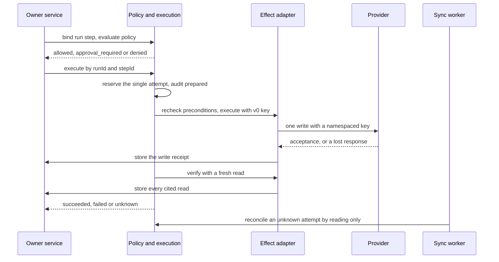

# Adding a governed action

A governed action is an external effect that only happens through one path: an immutable
proposal, authorization, policy admission, approval when the risk needs it, one durable
dispatch reservation, an independent fresh read that verifies the outcome, and append-only
audit at each step. `@luma/execution` and `@luma/policies` own that path; you add the owner
record, the provider write and the bindings between them. Return creation in an order's system
is a complete example: the owner in `@luma/orders`, its bindings in
`packages/application-runtime/src/composition/return-cases.ts`, the JTL and Shopify write
handlers, and the worker journey in `apps/api/e2e/worker-effects.e2e.mjs`. Purchase-order
submission follows the same path in `@luma/procurement`.

Read these first; they hold the rules this procedure relies on:

- [Policy, execution and audit](../../../docs/execution.md): admission, write modes, policy and
  approval, idempotency, attempts, verification and recovery.
- [`packages/execution/AGENTS.md`](../../../packages/execution/AGENTS.md): the invariants that
  are easiest to break.
- [Connector capabilities](../../../docs/connectors.md#writes-and-verification): write handlers,
  idempotency strategies and error certainty.
- The owning feature's guide, such as
  [creating a return](../../../docs/returns-workspace.md#creating-the-return-in-the-orders-system)
  or [submission](../../../docs/supplier-commitments.md#submission).

## Invariants that must not break

- **No duplicate effects.** One proposal has one attempt with key `v0:<proposal UUID>`.
  Retries, redelivery, worker restarts and a second process return the stored result or
  `reconciliation_required`; they never dispatch again. Never create a new proposal to retry
  an ambiguous write.
- **Acceptance is not verification.** A provider receipt only records that a write was
  accepted. Only a fresh, complete, independent read of the business postcondition passes the
  attempt. Partial, stale, older-than-the-request or failed reads are inconclusive.
- **Tenant context throughout.** Every owner, adapter and pass runs with a trusted
  `TenantContext`, refreshed before acting. Provider keys are namespaced by tenant and
  connection. Cross-tenant discovery returns routing identities only.
- **Fail closed.** Without enabled execution, an installed runtime or an eligibility reader, the
  action is unavailable. Don't add permissive defaults.
- **Authority stays with the requester.** The proposer is the authenticated user. Background
  passes act as the requester under the recorded approval; an approver never gains execution
  authority, and no worker proposes or approves.
- **No provider I/O inside a transaction**, and no payloads, credentials, message content or
  exception text in parameters, receipts or audit.

## 1. Capability contract

In `@luma/connections`, add the write capability to the installation capability union and its
input and output (a write receipt) to the domain capability module of its area. Add it to the
action-diff semantics with its reversibility; with the `action-review-diffs` release enabled, a
capability without an entry is unavailable. Expose an effect factory for it on the installed
runtime facade that owns its area (purchase orders, returns, messages), so only trusted
composition can bind the write. Add a read capability that can find the effect again by a
Luma marker, if none exists; verification needs it.

## 2. Provider write handler

In the app package (see [add-workspace-app](../add-workspace-app/SKILL.md)):

- Declare the descriptor honestly: `minimumRisk`, the app `permission`, `idempotency`
  (`provider_key`, `conditional_write` or `none`) and retry advice of one attempt.
- In `run`, check that tenant, connection and provider match the invocation, and refuse a
  missing idempotency key. Derive the provider key from tenant, connection, capability and the
  execution key; never from parameters.
- Mark the effect with a Luma identity the provider keeps (such as a case marker), so a read can
  find exactly this effect. Matching quantities or values never establish identity.
- Report `not_dispatched` only when certain nothing was sent, for example when a pre-read finds
  the effect already exists or cannot rule it out. A malformed or lost response after sending is
  `effect: 'unknown'`, `retry: 'reconcile'`, keeping the provider request ID.
- Add the simulator provider behavior, including lost responses, so journeys exercise the
  real handler.

## 3. Owner record and bound action

The owning domain persists the request as its own record with explicit states, such as
`approval_required`, `approved`, `sending`, `uncertain`, `created`, `failed`, `expired` and
`not_executed`. From that record it builds the exact immutable action: a proposal UUID fixed
at request time, tenant, connection, capability and version, a target whose kind is the owner's
admission subject, minimal scalar parameters in canonical order, evidence references with
`validUntil`, the expected postcondition, risk, `proposedBy` the requesting user and expiry.
Changed intent needs a new record and proposal ID.

The owner provides the hooks the bindings call:

- `eligible(context, step)`: the bound record still exists in a live state, matches its
  current subject (connection, lines, revision) and produces exactly the step's action.
- `verify(context, id)`: a fresh complete read through the read capability. Store every read it
  cites, in the tenant's transaction, before returning `passed`, `failed` or `inconclusive`
  with the observation IDs. A read that cannot be stored is not cited.
- `storeWriteReceipt(context, id, acceptance)`: store the acceptance as the owner's write
  receipt in the tenant's transaction after checking connection and capability, and return its
  ID. A failure throws; execution then records the write as dispatched with an unknown outcome.
- A lookup of the record and its action by target ID, and a `recover(context)` pass (step 6).

## 4. Bindings and registration

In `packages/application-runtime/src/composition`, next to the owner's other wiring:

- **Effect registry:** return `null` unless capability and target kind match; load the bound
  record and require its canonical action to equal the intent; map it to the capability input;
  in `checkPreconditions` require the action to be unchanged and call the owner's `eligible`;
  delegate `verify` with a versioned `evaluatorVersion`; pass `storeReceipt`.
- **Admission adapter:** `prepare` activates a manual artifact that allows exactly this
  capability, version, target kind and minimum risk for one step, binds the run (owner record ID
  as `runId`, the requester as principal, the subject, `eligibilityValidUntil`) and evaluates
  policy with `available` from the resolved effect and its preconditions. `execute` passes only
  `runId` and `stepId`; `reconcile` reads only and skips terminal attempts. Map execution
  results to the owner's states, keeping accepted, uncertain and verified apart.
- **Effect family:** add a family to `EffectFamily` and to `resolvableEffects` with the runtime
  it needs. Compose the effect registry and the admission adapter only when the family is
  resolvable, add the registry to the combined chain, and pass `null` admission otherwise so
  the owner reports the action as unavailable.
- **Eligibility route:** add the subject kind to the owned admission subjects and route it to the
  owner's `eligible`. An unlisted kind is routed to replenishment instead of its owner.

Every runtime that can reach the owner's send or reconcile path must resolve the same adapter,
because reconciliation refuses a different dispatch identity. Follow the
[wire-composition](../wire-composition/SKILL.md) skill for the runtime paths.

An app-owned action, such as Shopify stock protection, composes the same execution and
admission from `@luma/execution/composition` inside its app package instead of an effect
family; the rest of this procedure still applies.

## 5. Policy and approval

Policy combines the proposal's risk with the adapter's `minimumRisk`. Medium and high risk need
an explicit response with `decisions.respond` and the app permission, under the
[workspace approval preference](../../../docs/workspace-settings.md#approval-preference).
Approvals expire within 24 hours; rejection and expiry need a new request. The owner records
the response it receives and sends at once as the requester. Observe-only workspaces record
`not_executed` without a reservation; show it, don't hide it. To list approvals in Needs you,
follow the [add-needs-you-source](../add-needs-you-source/SKILL.md) skill.

## 6. Background follow-up and reconciliation

The API may stop between approval and dispatch, or lose the response. A commerce sync pass
finishes the work:

- Discover requesters with live steps through a `SECURITY DEFINER` function that returns
  tenant and principal IDs only (a migration; see [add-migration](../add-migration/SKILL.md)),
  then resolve each requester's context and call the owner's `recover`.
- `recover` applies an approval policy recorded but the owner did not, sends an approved step
  that was never reserved with the same execution identity while the approval is valid,
  expires it afterwards, and settles reserved or uncertain steps by reconciling. It leaves
  just-changed steps to the request that is sending them and skips paused workspaces.
- Wire the pass in the commerce sync composition and in the pilot worker role, which runs its
  own passes. Take the owner from `createApplicationServices` so it resolves the same adapter.

Provide a manual check that reconciles an uncertain step by reading; it never sends.

## 7. Audit and evidence

Execution and policy write their own audit events (prepared, withheld, completed,
reconciled). The owner records its domain events, such as created or failed, in the same
transaction as the state change, citing the stored reads. Let `@luma/read-models` resolve what
the owner's record cites (see [reading cited evidence](../../../docs/execution.md#reading-cited-evidence)),
or implement the app's `evidence` hook for app-owned storage.

## 8. Presentation

The contract and UI distinguish awaiting approval, approved, sending, accepted but not yet
verified, verified, failed with its reason, uncertain, expired and not executed. Show uncertain
as needing attention with the read-only check, never as done or failed, and never offer a resend.
Put labels in both catalogs with the [localize-ui](../localize-ui/SKILL.md) skill.

## 9. Tests

- **Write handler:** key namespacing, missing key, an existing or unprovable effect withheld,
  malformed and lost responses unknown with the request ID, partial reads.
- **Bindings:** mismatched capability, target, tenant or changed intent resolve no adapter;
  preconditions fail after the record changes; families and dispatch identity pinned in the
  runtime effects test for every runtime.
- **Owner:** verification passes only on a fresh complete read, stores what it cites, and stays
  unknown when storing fails; recovery sends once, expires, resumes an unreserved send,
  reconciles without resending and applies a policy-recorded approval.
- **Database integration:** RLS, grants and tenant isolation of new tables.
- **Backend journeys:** request, approval by another person, one dispatch and independent
  verification; missing permission, rejection, observe-only and another tenant; a lost response
  and worker restart that reconcile without a second write. Map them in
  `apps/api/e2e/journey-areas.mjs`.
- **Browser journey** for the states people see.

Update the owning guide and [execution](../../../docs/execution.md#runtimes) where the new owner
stores its receipts and reads. Finish with the [verify-change](../verify-change/SKILL.md) skill.
