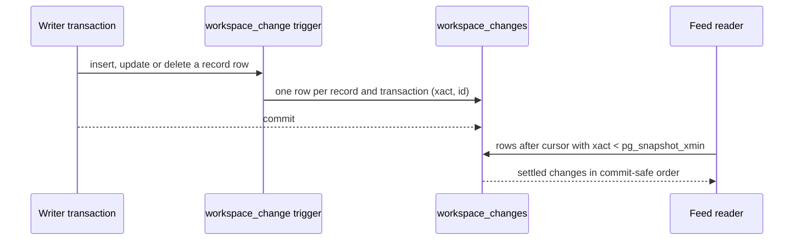

# HTTP API foundation

One oRPC contract in `@luma/api-contract` is shared by the Fastify server, the typed web client and the generated OpenAPI document ([ADR-010](architecture/010-orpc-http-contracts.md)). Requests and responses are validated on both sides, errors have one sanitized shape, and every tenant route is authorized by the identity guard before a handler runs. Session routes and tenant authorization are described in the [identity guide](identity.md).

## Serving and consuming

Browsers reach the API only through the same-origin `/api` proxy, which removes the `/api` prefix. Vite proxies to `API_PROXY_TARGET`, which `pnpm dev` sets to this worktree's API port; production hosting must provide the same proxy. Cross-origin browser access is not enabled.

- Browser clients call `/api`; server-side callers pass an absolute API origin.
- Create credential-bearing clients per request, never as a server singleton. Session forwarding must stay explicit in the server authentication layer.
- Client calls resolve with the validated response body. Error statuses reject with the status and error body; malformed responses reject with a validation error. Neither enters the query cache. Query cancellation reaches `fetch`.
- Tenant queries include the organization ID in their cache keys.

`@luma/api-contract/openapi` is a separate server and tooling entry point, so schema generation stays out of browser bundles. The server serves the document at `/openapi.json`; the committed copy in `packages/api-contract` must be regenerated with `pnpm --filter @luma/api-contract generate:openapi` after contract changes, and a test rejects a stale copy.

Personal API apps call the API directly with `Authorization: Bearer <token>`, either through the same `/api` proxy or at the API origin. Only routes marked `publicApi` accept tokens; `/openapi.public.json` describes them, with the bearer scheme and their 401, 403 and 429 responses. Routes whose responses can include customer personal data also declare `personalData`, published as `x-luma-personal-data`; API app reads of them are counted. See [API apps](identity.md#api-apps).

`/v1/connector-providers` is a public, static catalog of provider names and categories. It describes no installed connections and exposes no tenant data.

## Contract rules

- Business endpoints use `/v1`. Additive changes may stay in v1. Removing or renaming fields, changing types or narrowing accepted inputs needs a new major path and an explicit migration. Health and readiness stay unversioned.
- Route keys form OpenAPI operation IDs; keep them stable.
- Routes marked `publicApi` are called by tools outside Luma that can't be updated with the web app. Treat every change to them as a published API change, and mark a route public only when it reads with a permission API apps can be granted ([ADR-017](architecture/017-api-apps.md)).
- Start routes from `endpoint` in the contract package. Declare a non-200 success status with `successStatus`, and every intended error status in the route's `errors` metadata; the OpenAPI document adds the shared error schema for them. Use strict mutation objects so unexpected tenant or region fields are rejected.
- Contract paths use `{param}`. Each route is registered with Fastify as `:param`, which is the form hooks, the guard and route allowlists see.
- Handlers and use cases report expected failures by throwing `ServiceError` from `@luma/platform`, which the Fastify error handler turns into the error body with its status, code and message. Use its helpers in the `throw notFound(message)` form (also `conflict`, `invalid`, `forbidden` and `unavailable`) so TypeScript narrows after the throw; do not declare local helpers that return `never`. Do not throw oRPC errors from handlers: only input validation failures are mapped to 400, and any other oRPC error becomes a 500.
- A new resource adds its schemas and routes to the shared contract, implements the owning package's application port and API mapping, and is wired in application runtime composition. Only API layers import the contract; inner layers stay framework independent. HTTP handlers map validated requests and use-case results; they hold no business rules.
- Tenant resources follow [ADR-003](architecture/003-tenant-isolation-and-data-residency.md): `/v1/organizations/:organizationId/<resource>`, camelCase fields and UUID organization IDs. Schemas reserve `EU | US | APAC`, but only EU provisioning is enabled. Never treat path IDs or caller-supplied region or context as authorization.

## Change feed

`GET /v1/organizations/:organizationId/changes` tells API clients which public records changed, so they can keep a copy current ([ADR-017](architecture/017-api-apps.md)). Items carry a record type, ID and `upserted` or `deleted`, never content.

- **Order and visibility.** Rows are keyed by `pg_current_xact_id()` and read only below the snapshot's `xmin`, so a row behind a cursor can never commit later. A long transaction anywhere in the cluster holds the feed back; it never skips a change. A page that isn't full moves the cursor to the newest settled position even when its rows were filtered out by type.
- **Operations.** A record is `deleted` when, after a delete, no row of its table holds its ID; everything else is `upserted`. Updates that change no column are not recorded. Source-side soft deletes are `upserted`, and the reread returns 404.
- **Writers.** The trigger function is `SECURITY DEFINER` and owned by the login-less `luma_change_feed`, which may only read the ID columns it checks. Runtime roles can read the feed but never write it.
- **Retention.** The data-retention worker prunes rows after 30 days and records each workspace's newest pruned position. A cursor before it returns `410 GONE`.
- **Purges.** Purging a closed workspace records nothing. Removing a connection's data and erasing a customer record deletions, so outside copies remove them too.
- **New record types.** A table that backs a public record needs the triggers, a type in the contract and a read permission in the read model's map. Child tables (lines, evidence) are covered only when their changes also rewrite the record's row.

## Errors

Errors have `{ code, message, requestId }`, and `requestId` matches the `x-request-id` header.

| Condition                                          | Response                                        |
| -------------------------------------------------- | ----------------------------------------------- |
| Request fails schema validation                    | `400 VALIDATION_ERROR`                          |
| Body parser failure                                | normalized 400, 413 or 415                      |
| No session                                         | `401 UNAUTHENTICATED`                           |
| Member lacks the declared permission               | `403 FORBIDDEN`                                 |
| API app token on a route that isn't public         | `403 FORBIDDEN`                                 |
| API app over its token or workspace limit          | `429 TOO_MANY_REQUESTS` with `Retry-After`      |
| Unknown route or resource, or inaccessible tenant  | `404 NOT_FOUND`                                 |
| Change feed cursor older than the retained changes | `410 GONE`                                      |
| Provisioning in an inactive region                 | `422 REGION_UNAVAILABLE`                        |
| Request served by the wrong regional cell          | `503 REGION_UNAVAILABLE`                        |
| Unexpected exception or invalid handler output     | sanitized `500 INTERNAL_ERROR`, details in logs |

Authenticated routes declare 401, 403, 404 and the regional errors where they apply. Responses carry `Cache-Control: no-store`.

## Probes and shutdown

`/health` reports process liveness without probing dependencies. `/ready` checks the identity database, schema and restricted runtime role, and returns 503 on failure, an exception or a one-second timeout. That timeout does not cancel the underlying operation, so every readiness check must bound and cancel its own I/O. Shutdown marks the app as draining before closing connections; a pending readiness check cannot report ready after draining begins.

## Correlation headers

Responses include a server-generated `x-request-id` and, when observability is wired, an `x-trace-id`. Clients send a UUIDv4 `x-luma-action-id` to correlate the requests of one user action; invalid values are ignored. These IDs are diagnostics, never authentication or tenant access. See [observability](observability.md).

## Browser security headers

Every API response, including errors, missing routes and redirects, forbids framing, MIME sniffing, referrers and all subresource loading. The API serves no HTML; adding a page or document response requires its own policy. The web app's pages carry a separate, nonce-based policy described in the [identity guide](identity.md#production-proxy). `Strict-Transport-Security` is sent only when `BETTER_AUTH_URL` uses HTTPS. Hijacked event streams write their own headers and do not carry these.

## Dependency trap

oRPC is pinned to 1.x. Version 2 changes routing metadata, error status handling and client options, so upgrading is a deliberate migration of the contract package, the Fastify bridge in `@luma/identity/http` and the client.
