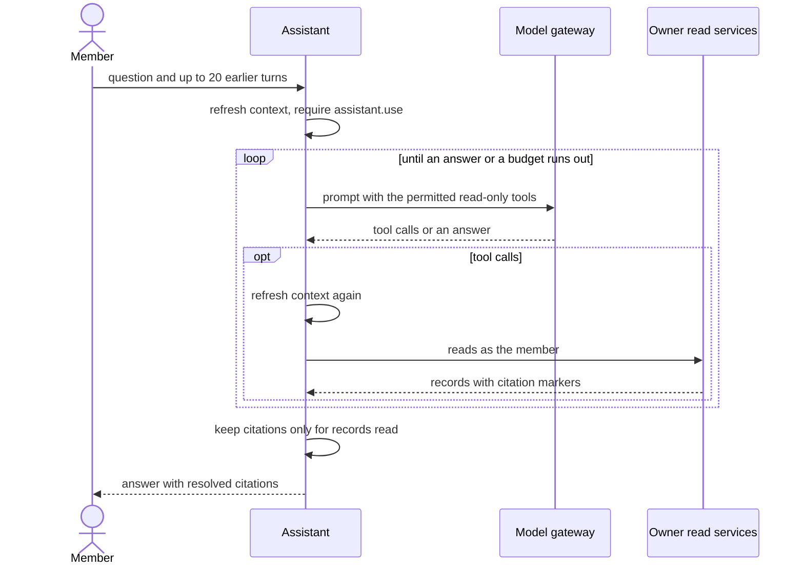

# Ask Luma assistant

Ask Luma answers workspace questions through a bounded model loop over read-only tools. It
runs inside the API with the asking member's `TenantContext`, does not call the Luma HTTP
API or an MCP server, and never gives the model a credential. Answers can only cite records
that were read for the current question. The [user guide](../apps/web/content/docs/ask-luma.mdx)
describes the feature for users.

## Request path

- The context is refreshed and must hold `assistant.use` with an unchanged actor. The
  model is offered only the tools the person's permissions allow, and each tool checks its
  permission again.
- Without an EU zero-retention Bedrock route for the `assistant` profile, the request
  returns 503 with the reason and no model is called.
- Requests are `sensitive`, EU, zero-retention. Before each tool batch the context is
  refreshed again; a removed member or changed actor ends the answer with the identity
  error.

Conversations are not stored. The client sends up to 20 earlier turns; the prompt tells the
model to read again rather than rely on them.

## Tools

Tool handlers call owner read services (orders, cases, inventory, fulfillment, returns),
never SQL, so scoping, RLS and metric definitions match the pages. To add a tool, define it
next to the others, register it in the assistant composition, and, if it cites a new record
kind, add the kind to the assistant record-kind schema and the web `RecordLink`. Keep
projections small: only fields that answer questions, with provider text clipped. Filter
values are typed against the read ports and tested against the API contract.

The tool registry validates arguments, not the gateway, whose tool parser only requires a
JSON object. Invalid arguments and stale cursors come back to the model as tool results
with field problems, so it can correct them within the budget. Undeclared tools are still
rejected by the gateway (`invalid_output`), which fails the answer before anything runs.

## Citations

Every record in a tool result carries a `[[kind:id]]` marker that the model copies into its
answer. A marker survives only when that record was in a tool result shown to the model for
this question. Resolved citations carry the record's source labels, `observedAt` and
`sourceUpdatedAt`; for issues, `observedAt` is the last activity.

## Limits

| Budget                     | Default           | On reaching it                                         |
| -------------------------- | ----------------- | ------------------------------------------------------ |
| Model calls per question   | 6                 | `outcome: incomplete` with a fixed message             |
| Tool calls per question    | 12                | Further calls return `lookup_limit` and are skipped    |
| Output tokens per call     | 2048              | Bedrock `max_tokens` fails the call (`invalid_output`) |
| Output tokens per question | 8192              | `outcome: incomplete`                                  |
| Deadline                   | 60 s              | 503, combined with client disconnects                  |
| Tool result size           | 12,000 characters | Items dropped from the end with `omitted`              |

Model failures map to fixed 503 reasons. Nothing retries or falls back beyond gateway
behavior; asking again is safe because nothing is written.

## Untrusted data and telemetry

Tool results include provider text such as titles and return reasons. The system prompt
marks tool results as data, not instructions. Prompt injection can at most change an
answer's wording: tools are read-only, scoped to the asking member, and citations resolve
only to records actually read.

Questions, answers and tool data stay out of logs, spans and Langfuse. `agent.run` wraps a
question, `tool.execute` each read, and `model.generate` records the route, token counts and
latency.

Route the `assistant` profile like authoring; see
[Model gateway](model-gateway.md#assistant-profile). Synthetic local data does not need the
[processing-path review](architecture/003-model-processing-path-review.md); tenant data does.

## Record context

Contextual assistance is released per tenant through the default-off
`contextual-record-assistance` flag. Availability exposes that decision only after refreshing
the member context; an explicit contextual question checks it again on the server.
Navigation context contains record IDs or validated chart filters, never trusted facts or
grants. The assistant forces the contextual lookup before its first model call. Failed,
missing and permission-limited reads remain explicit tool results. Selecting another record
starts a new conversation; retries and follow-ups retain its context.

Chart selections use the Insights owner's records query with the original range, time zone,
connection, point, series and evaluation time. Expired selections fail rather than widening
silently. Evaluation time is distinct from source observation time. Chart summaries without a
source timestamp cite that timestamp as unknown; individual detail reads can provide it.

Issue reads include the desk owner's current permitted decisions, policy freshness and
proposal/approval state. A diagnosis recommendation alone never establishes eligibility.
Following the issue citation opens governed review, which checks permission, current evidence,
policy and Action Admission again. Assistant tools remain read-only; proposed actions,
accepted writes, observed progress and independently verified outcomes stay distinct.
