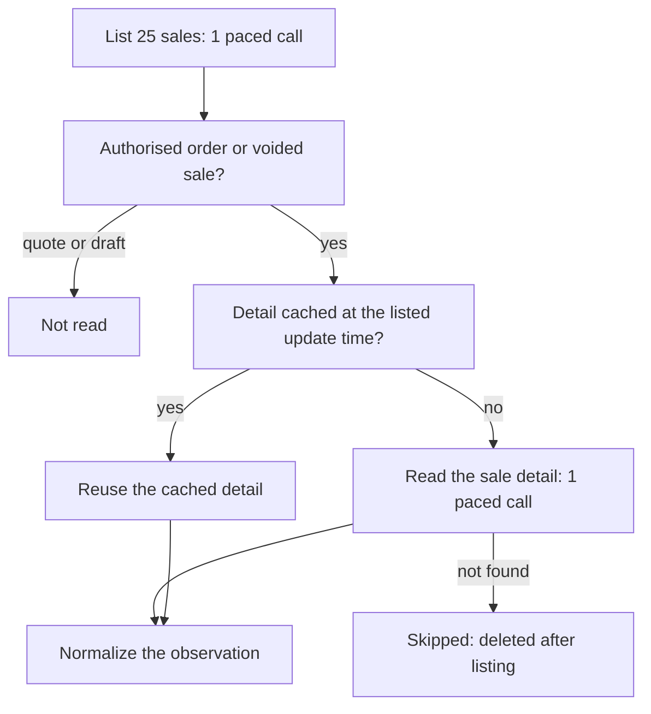

# Cin7 Core connector

The Cin7 app reads sales orders, fulfilments, credit notes, products, stock, suppliers,
purchases and, when the connection opts in, customers from the Cin7 Core (formerly DEAR
Inventory) API v2. It offers no writes. Cin7 Omni, the older Cin7 product, has a separate
API and is not supported. Code: `@luma/app-cin7`, with the protocol client in
`@luma/connector-cin7`.

## Connections and call budget

A connection targets one Cin7 account ID. The secret is the key of an API application the
merchant creates on Cin7's API setup page; requests send both as `api-auth-accountid` and
`api-auth-applicationkey` to the fixed Cin7 host. An application reads the whole account,
so verification probes each requested endpoint once and grants what answers; a 402 or 404
leaves that capability ungranted. Cin7 answers a deleted or replaced key with a plain 403.
Reads then fail with `authentication`, but the connection keeps its stored key: Cin7
documents no other cause for 403, so a single response is not treated as proof that the
key was revoked. Rotate the key to recover.

Cin7 allows **60 calls per minute per API application** and answers 429 above it, without
`Retry-After`. All adapters and the verifier of one connection share a pacer in each
process that admits at most one request per 1.1 seconds. After a 429 or 503 the pacer
admits nothing for a minute and sync defers the connection. The pacer waits in place for
at most five seconds; while it is paused for longer, reads fail at once with `rate_limited`
and the remaining delay instead of holding a worker. Another process using the same
connection (the API during a check while the worker syncs) has its own pacer and can still
trigger a 429; that is handled, not prevented. Never give Luma's key to another
integration: it would share the budget.

Requests reject redirects and time out 15 seconds after admission. Reads retry short
transient failures as described in [connectors](connectors.md#errors-retries-and-evidence).
Provider error text is discarded.

## Read cost

Order, fulfilment and return reads list 25 sales per page and then read each sale's
details, about 26 calls per page. A history of 20,000 orders therefore takes about six
hours to import. Fulfilment reads skip sales without fulfilments, and quotes and draft
orders need no detail read. The connection keeps the last 2,000 sale details by the
update time the list reported, so the order, fulfilment and return streams read an
unchanged sale once.

These reads, products, customers and suppliers use Cin7's `UpdatedSince` or
`ModifiedSince` filters for incremental scans. Stock and purchases have none and are read
in full.

## Mapping rules

**Line identity.** Cin7 sale, credit-note, fulfilment and purchase lines have no ID; they
name a product. Luma identifies a line by its product within the sale or purchase and sums
repeated lines of one product. Lines without a product, such as additional charges, are
not product lines.

**Units.** Only products carry a unit of measure. Each connection keeps its products'
units in memory, filled by product reads and by loading the catalog (1,000 products per
call) when a line names an unknown product, at most every 15 minutes. `Item`, `Each`,
`Unit` and similar names map to `each`; other names are kept; a product still unknown has
the unit `unknown`, which blocks cross-provider comparisons.

**Orders.** A sale is an order once its order stage is authorised; quotes and draft orders
are not imported. Voided sales are cancelled; a fulfilled, closed or completed sale is
completed. Paid and prepaid map to paid, unpaid to pending, partial payment stays unknown.
Changed order quantities are not cancellations, so `cancelledQuantity` is null. For a sale
from a sales channel, the customer reference is kept as the marketplace order number for
link suggestions; otherwise it is the customer's own reference and is not kept.

**Fulfilments.** Each fulfilment is one record: shipped once its ship step is authorised,
processing while a pick, pack or ship step is in progress, cancelled when voided, otherwise
pending. Lines come from the pick, or the pack before a pick exists. A line for a product
the order does not contain rejects the page, as for JTL. Fulfilments have no time of their
own, so progress is the latest shipment date once shipped and otherwise the sale's last
change.

**Credit notes.** Each authorised credit note is a refund; its recorded refund payments
count as money returned and restocked products as returned. Voided credit notes are
reported as removed, drafts not at all. Cin7 has no return requests, so no returns are
reported. Credit lines for products the order does not contain are not refund lines; the
credit note's total still includes them.

**Stock.** Stock rows are per product, location, bin and batch, and name the location
instead of identifying it. Luma sums each product per location and maps names to location
IDs, including deprecated locations; two locations sharing a name, or a name it cannot
find, reject the page. A missing quantity in any bin leaves that location's total unknown.
Pages hold 1,000 rows. Rows of one product can continue on the next page, so the first and
last product of each page are reread by ID, and the cursor names the last one so the next
page skips it. Like any offset pagination, a full read is not a transactional snapshot.

**Products and partners.** Each Cin7 product is one SKU; product families are not read.
Tier-1 prices carry no currency and Cin7 reports unused tiers as zero, so zero is no price.
Deprecated products are archived, "Setup required" is draft. Customers take contact
details from the default contact and the address from the default shipping, business or
billing address. Suppliers have no supplier number.

**Purchases.** Purchase lines report units on authorised stock receipts as delivered. Cin7
records no supplier confirmation, and a voided purchase has no Luma status, so it is
`unknown`. Luma does not submit purchase orders to Cin7.

## Limits

- No writes: Cin7 has no idempotency keys and no conditional updates, so a governed write
  needs a documented non-atomic preflight and a sandbox smoke test first.
- Webhooks need Cin7's paid Automation module and are not used; sync polls.
- The [simulator](simulator.md#cin7-core-as-the-erp) implements the endpoints and fields
  Luma reads. Simulator compatibility does not prove live-provider compatibility; run a
  smoke test against a Cin7 trial account before relying on a mapping change.

## Supplier purchasing terms

Released purchasing reads retain the product's documented nested supplier records. They
report supplier inventory code, fixed cost where present (otherwise the latest purchase
cost) and supplier currency. Lead time comes from one unambiguous default supplier option set (no location).
Location-specific option sets cannot become a product-wide lead time. Price validity,
pack size, purchase minimums and preferred supplier are unavailable and stay unknown; product reorder quantities are not
supplier purchasing terms.

The metadata travels with the existing incremental product scan and shares its call
budget. Luma records it only for explicitly linked suppliers and mapped canonical SKUs.
A changed purchasing-system value appends history without replacing a person's override.
A product response without supplier metadata cannot establish that earlier terms disappeared.
