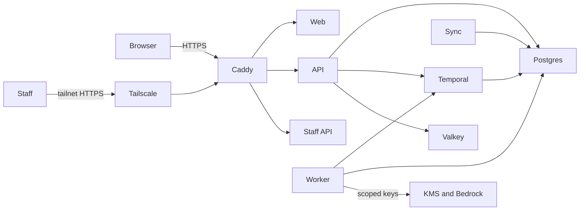

# Deployment

Luma's AU cell runs on AWS in Sydney. The `infra` workspace describes it with AWS CDK; the
[deployment decision](architecture/016-aws-deployment.md) explains why the first cell is a
single host. Tenant requests terminate on that host, every Luma-managed store stays in the
cell region, and application code never receives the host's AWS credentials.

## Synthesis and checks

`pnpm --filter @luma/infra test` synthesizes every stack and fails on any cdk-nag AWS
Solutions finding that has no recorded reason. `pnpm --filter @luma/infra synth` writes the
templates to `infra/cdk.out`. Neither needs AWS credentials. Acknowledge a finding only with
a concrete reason next to the resource; prefer narrowing the permission.

Account IDs, domains and the alert address come from CDK context, never from source:
`luma:staging:account`, `luma:production:account`, `luma:<stage>:domain`,
`luma:alertEmail` and `luma:organization:targets` (organizational unit or account IDs).

## Accounts

1. Create an AWS Organization, enable IAM Identity Center for people and service control
   policies, and create `luma-staging` and `luma-production` accounts.
2. From the management account, deploy `LumaOrganization` with
   `-c luma:organization:targets=<ou-or-account-ids>`. Its policy denies regional actions
   outside `ap-southeast-2` and `ap-southeast-4`; global services such as IAM stay usable.
3. In each workload account, run `cdk bootstrap aws://<account>/ap-southeast-2`.

## First deployment of a stage

1. Deploy `LumaFoundation<Stage>` and `LumaLiteCell<Stage>` with the stage's account
   context. The host boots, attaches its data volume and waits for a deploy.
2. In GitHub, create the stage's environment with the variable `AWS_DEPLOY_ROLE_ARN` set to
   the `luma-<stage>-github-deploy` role. Add required reviewers for production.
3. Set Bedrock's data retention to `none` in Sydney before adding Bedrock routes, as the
   [model gateway guide](model-gateway.md#bedrock-regional-adapter) requires.
4. Run the **Deploy Lite cell** workflow for the stage.

The first deploy generates database passwords, auth secrets, the connection key and access
keys for the KMS and Bedrock principals, and stores them below `/luma/<stage>/generated/`.
They never change afterwards; a replaced host reuses them.

## Settings

The host renders each container's environment from SSM parameters below `/luma/<stage>/`.
Values must be single lines.

| Path         | Owner                | Contents                                                                                                                       |
| ------------ | -------------------- | ------------------------------------------------------------------------------------------------------------------------------ |
| `host/`      | CDK and the operator | Image repository, host files, key ARN and log group from CDK; `TAILNET` and `TS_AUTHKEY` from the operator.                    |
| `generated/` | The host             | Secrets created on first deploy. Do not edit.                                                                                  |
| `app/`       | The operator         | Extra API, worker and sync settings, such as `SHOPIFY_*`, `GMAIL_*`, `MODEL_GATEWAY_ROUTES` or `MODEL_GATEWAY_BEDROCK_REGION`. |
| `staff/`     | The operator         | `STAFF_GOOGLE_CLIENT_ID`, `STAFF_GOOGLE_CLIENT_SECRET` and `STAFF_GOOGLE_HOSTED_DOMAIN`.                                       |
| `web/`       | The operator         | Optional `LUMA_GLOBAL_ENTRY_URL` and `LUMA_REGIONAL_ORIGINS`.                                                                  |

Store secrets as `SecureString`. Settings take effect on the next deploy. Bedrock keys reach
the application only when `app/MODEL_GATEWAY_BEDROCK_REGION` is set. Mail stays disabled
until a regional adapter is approved under ADR-003.

## Hosts and staff access

Without a domain, the customer app runs at `https://au.app.<elastic-ip-with-dashes>.sslip.io`.
With `luma:<stage>:domain`, the stack creates a hosted zone and an `au.app.<domain>` record;
delegate the domain to the name servers in the stack output, then redeploy. Changing the
host changes every origin: sessions end and provider OAuth callbacks must be updated.

The passkey relying-party ID is the stage domain (or the `sslip.io` name without one), not
the `au.app.` host, so every regional cell shares it as ADR-003 requires; set
`luma:production:domain` to `luma.ai`. Set the domain before customers register passkeys:
changing it, including adding a domain to a stage that ran on `sslip.io`, invalidates every
registered passkey.

The staff console runs only after `host/TAILNET`, `host/TS_AUTHKEY` and the `staff/`
settings exist. The tailnet needs MagicDNS and HTTPS certificates, and the auth key should
be reusable, pre-approved and tagged. The console is
`https://luma-<stage>-staff.<tailnet>` and the regional staff API is
`https://luma-<stage>-au-staff-api.<tailnet>`; register
`https://luma-<stage>-au-staff-api.<tailnet>/auth/callback/google` as the Google OAuth
redirect URI. Provision staff admission as the [staff guide](staff.md) describes, through
an SSM session on the host.

## Deploys and failures

A deploy refreshes the host files, renders settings, pulls the image, applies migrations,
provisions the region and runtime logins, upgrades the Temporal schema, starts every
service and waits for health checks. A failed deploy stops at the failing step and leaves
the last successful tag recorded; fix the cause and redeploy. Migrations only move
forward, so redeploy an older tag only when its code accepts the current schema.

Temporal's server certificate comes from a CA whose key stays on the data volume; a deploy
renews it 30 days before expiry and restarts Temporal.

Changing the instance image or type through CDK replaces the instance. The new host waits
until the old one releases the data volume, then restores the last deployment.

## Operations

- Open a shell with SSM Session Manager; no SSH port exists. Run host commands with
  `docker compose` through the helpers in `/opt/luma/bin/luma-lib.sh`.
- Container logs go to the `/luma/<stage>/lite` CloudWatch log group for 30 days.
- Apply OS updates with `dnf upgrade` and a reboot, or by deploying a newer image.
- Rotate an access key by deleting it in IAM and its two `generated/` parameters, then
  redeploying.

## Backups and restore

AWS Backup snapshots the data volume daily and keeps seven days. The host also uploads
logical dumps of `luma`, `temporal` and `temporal_visibility`, plus roles without passwords,
to `s3://luma-<stage>-backups-<account>-ap-southeast-2/lite/<stage>/` daily; the bucket
expires them after 35 days. Both stay in Sydney.

To recover the whole host, add `luma:<stage>:restoreSnapshot` with the snapshot ID to the
context in `infra/cdk.json` in a reviewed change and deploy the cell. CloudFormation creates
a new data volume from the snapshot, snapshots and deletes the current one, and replaces the
instance, which restores the deployment recorded on the volume. Keep the setting: removing
or changing it replaces the volume again. To restore one database, stop the services that
use it and run `pg_restore --clean` with the migration administrator inside the PostgreSQL
container. Test a restore before relying on either path.
