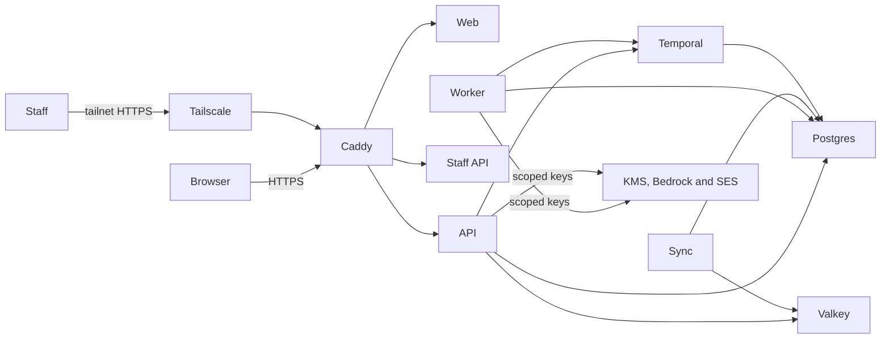
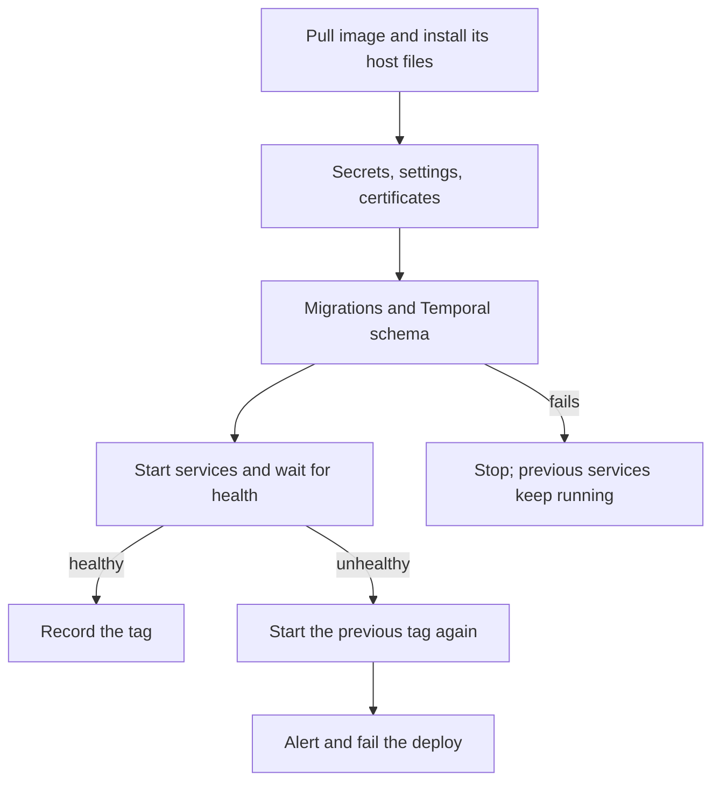
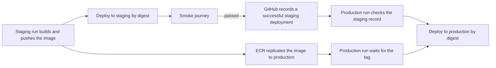

# Deployment

Luma's AU cell runs on AWS in Sydney. The `infra` workspace describes it with AWS CDK; the
[deployment decision](architecture/016-aws-deployment.md) explains why the first cell is a
single host. Tenant requests terminate on that host, and every Luma-managed store stays in
Sydney; only copies of the data volume snapshots are kept in Melbourne, the second approved
Australian region. Application code never receives the host's AWS credentials.

## Synthesis and checks

`pnpm --filter @luma/infra test` synthesizes every stack and fails on any cdk-nag AWS
Solutions finding that has no recorded reason. `pnpm --filter @luma/infra synth` writes the
templates to `infra/cdk.out`. Neither needs AWS credentials. Acknowledge a finding only with
a concrete reason next to the resource; prefer narrowing the permission. CI runs the infra
tests with the other package tests.

Account IDs, domains, images and the alert address come from CDK context, never from source:
`luma:staging:account`, `luma:production:account`, `luma:<stage>:domain`,
`luma:<stage>:hostImage`, `luma:<stage>:alertEmail` or `luma:alertEmail`, and
`luma:organization:targets` (organizational unit or account IDs). Once a stage has an
account, synthesis requires its `hostImage` (an arm64 Amazon Linux 2023 AMI ID in
`ap-southeast-2`), and production also requires an alert address and the staging account,
because production deploys only images promoted from staging.

CDK deploys run from an operator workstation with the stage's credentials. Put the change in
a reviewed pull request with the output of `cdk diff` for each affected stack, and deploy
only after the pull request is merged.

## Accounts

1. Create an AWS Organization, enable IAM Identity Center for people and service control
   policies, and create `luma-staging` and `luma-production` accounts.
2. From the management account, deploy `LumaOrganization` with
   `-c luma:organization:targets=<ou-or-account-ids>`. Its policy denies regional actions
   outside `ap-southeast-2` and `ap-southeast-4`; global services such as IAM stay usable.
3. In each workload account, run `cdk bootstrap` for `aws://<account>/ap-southeast-2` and
   `aws://<account>/ap-southeast-4`; the snapshot copy vault lives in Melbourne.

## First deployment of a stage

1. Deploy `LumaFoundation<Stage>`, `LumaSnapshotCopies<Stage>` and `LumaLiteCell<Stage>` with
   the stage's account context. Once production exists, synthesize with both account IDs and
   deploy `LumaFoundationProduction` before `LumaFoundationStaging`: production's registry
   policy must accept images before staging starts replicating them. CloudFormation waits until the host has fetched its files;
   the host then attaches its data volume and waits for a deploy. Confirm the alert topic's
   email subscription.
2. In GitHub, create the stage's environment with the variable `AWS_DEPLOY_ROLE_ARN` set to
   the `luma-<stage>-github-deploy` role. Restrict its deployment branches and tags to `main`
   and `v*`. For production, add required reviewers and prevent self-review. For staging, also
   set `LUMA_DOMAIN` to the stage domain to run the [smoke journey](#staging-smoke-journey).
3. Set Bedrock's data retention to `none` in Sydney before adding Bedrock routes, as the
   [model gateway guide](model-gateway.md#bedrock-regional-adapter) requires.
4. Run the **Deploy Lite cell** workflow for the stage from `main`.

The first deploy generates database passwords, auth secrets, the connection key and access
keys for the KMS, Bedrock and mail principals, and stores them below
`/luma/<stage>/generated/`. They stay the same across deploys and replaced hosts until an
operator rotates them; see [secret rotation](#secret-rotation).

## Settings

The host renders each container's environment from SSM parameters below `/luma/<stage>/`.
Values must be single lines.

| Path         | Owner                | Contents                                                                                                                                                                                          |
| ------------ | -------------------- | ------------------------------------------------------------------------------------------------------------------------------------------------------------------------------------------------- |
| `host/`      | CDK and the operator | Image repository, host files, key ARN, log group, alert topic and mail principal from CDK; `TAILNET`, `TS_AUTHKEY` and, only to start an empty cell, `ALLOW_EMPTY_DATA_VOLUME` from the operator. |
| `generated/` | The host             | Secrets created on first deploy. Change them only as [secret rotation](#secret-rotation) describes.                                                                                               |
| `app/`       | The operator         | Extra API, worker and sync settings, such as `SHOPIFY_*`, `GMAIL_*`, `MAIL_FROM`, `FEATURE_FLAGS`, `MODEL_GATEWAY_ROUTES` or `MODEL_GATEWAY_BEDROCK_REGION`.                                      |
| `staff/`     | The operator         | `STAFF_GOOGLE_CLIENT_ID`, `STAFF_GOOGLE_CLIENT_SECRET` and `STAFF_GOOGLE_HOSTED_DOMAIN`.                                                                                                          |
| `web/`       | The operator         | Optional `LUMA_GLOBAL_ENTRY_URL` and `LUMA_REGIONAL_ORIGINS`.                                                                                                                                     |

Store secrets as `SecureString`. Settings take effect on the next deploy. Bedrock keys reach
the application only when `app/MODEL_GATEWAY_BEDROCK_REGION` is set. Each deploy sets
`OBSERVABILITY_RELEASE` to the deployed image tag.

The AU cell does not use hosted PostHog, so feature flags come from `app/FEATURE_FLAGS`
(`flag=true|false,...`). CloudTrail records each change and the next deploy applies it. Values
apply to every workspace in the cell; unlisted flags return their safe fallback, and unknown
keys, duplicates or malformed entries stop startup. See [feature flags](observability.md#feature-flags).

## Mail

Mail uses Amazon SES in Sydney and needs a stage domain. With `luma:<stage>:domain`, the cell
stack creates an SES identity for the domain with DKIM records, a `mail.<domain>` MAIL FROM
domain and the `luma-<stage>` configuration set, which suppresses addresses that bounced or
complained. The `luma-<stage>-mail` principal may send only from addresses at the domain,
through that identity and configuration set.

Mail stays off until `app/MAIL_FROM` is set, such as `Luma <no-reply@<domain>>`. The deploy
then adds the SES region, the principal's access key, the configuration set and
`MAIL_PUBLIC_ORIGIN` (the customer app's origin unless `app/MAIL_PUBLIC_ORIGIN` is set).
Setting `MAIL_FROM` on a stage without a domain stops the application from starting.

Operator steps before enabling mail:

1. Delegate the domain and wait until the SES console shows the identity and its MAIL FROM
   domain as verified.
2. Request production access for SES in `ap-southeast-2`. Until AWS grants it, the account
   is in the SES sandbox and delivers only to verified addresses.
3. Publish a DMARC record for the domain, starting with `p=none` while reports are reviewed.

## Staging smoke journey

After each staging deploy, the workflow drives the real customer app through `pnpm test:smoke`
(`tooling/smoke`): it creates `smoke+<run>@inbox.<domain>`, opens the confirmation link from the
received mail, creates a workspace, invites `smoke+<run>-b@inbox.<domain>`, which signs up and
accepts the invitation, and checks the membership from the owner. Cleanup removes the
teammate's access and signs both out. A failed journey or cleanup fails the staging
deployment, so production refuses that commit. Normal test suites never run it.

With a staging domain, the cell stack receives mail for `inbox.<domain>` with SES: an MX record,
the `luma-staging-smoke-inbox` receipt rule set and a rule that stores each raw message in the
private `luma-staging-smoke-inbox-<account>-ap-southeast-2` bucket for one day. Only SES, through
that rule, may write to it; only the staging deploy role may read it. The journey reads only
links on the app's origin and never logs them.

Operator steps:

1. CloudFormation cannot activate a receipt rule set, and one rule set per region is active.
   After the first cell deploy with a domain, run
   `aws ses set-active-receipt-rule-set --rule-set-name luma-staging-smoke-inbox --region ap-southeast-2`
   with staging credentials.
2. Enable staging mail (`app/MAIL_FROM`). While the account is in the SES sandbox, sending is
   limited to verified identities; confirm that mail to `inbox.<domain>` arrives, or request
   production access.
3. Set the staging environment's `LUMA_DOMAIN` variable. Without it the journey is skipped with
   a notice and the deployment still counts for promotion.
4. Customers cannot delete their own accounts, so smoke accounts and workspaces remain on
   staging. Erase them from time to time through [staff account deletion](staff.md#account-deletion).

## Hosts and staff access

Without a domain, the customer app runs at `https://au.app.<elastic-ip-with-dashes>.sslip.io`.
With `luma:<stage>:domain`, the stack creates a hosted zone and an `au.app.<domain>` record;
delegate the domain to the name servers in the stack output, then redeploy. Changing the
host changes every origin: sessions end and provider OAuth callbacks must be updated.

The passkey relying-party ID is the stage domain (or the `sslip.io` name without one), not
the `au.app.` host, so every regional cell shares it as ADR-003 requires; set
`luma:production:domain` to `luma.ai`. Set the domain before customers register passkeys:
changing it, including adding a domain to a stage that ran on `sslip.io`, invalidates every
registered passkey.

The staff console runs only after `host/TAILNET`, `host/TS_AUTHKEY` and the `staff/`
settings exist. The tailnet needs MagicDNS and HTTPS certificates, and the auth key should
be reusable, pre-approved and tagged. The console is
`https://luma-<stage>-staff.<tailnet>` and the regional staff API is
`https://luma-<stage>-au-staff-api.<tailnet>`; register
`https://luma-<stage>-au-staff-api.<tailnet>/auth/callback/google` as the Google OAuth
redirect URI. Provision staff admission as the [staff guide](staff.md) describes, through
an SSM session on the host.

## Releases and deploys

`main` is the release trunk. The **Deploy Lite cell** workflow runs only from `main` or a
`v*` tag, and only for a commit whose `Quality gates` check passed; CI runs on every push to
`main` so merged commits get that check. The deploy role may run a single SSM command
document, `luma-<stage>-deploy`, which accepts nothing but an image tag and, optionally, the
digest that tag must point to. The workflow always passes the digest; the host refuses a tag
that points elsewhere, runs the image by digest and keeps the tag as `OBSERVABILITY_RELEASE`.

A deploy takes the host files (scripts, Compose and Caddy configuration, systemd units) from
the image it deploys, so the host always runs the files of the deployed commit; the CDK copy
is used only on first boot and for images built before the files moved into the image. It
then renders settings, applies migrations, provisions the region and runtime logins,
upgrades the Temporal schema, installs the host's timers and CloudWatch agent, starts every
service and waits for health checks.

A deploy that fails before the final start leaves the previous services running. When the
services do not become healthy, the deploy starts the previously recorded tag again, alerts
and fails; the failed tag is written to `state/failed-image` on the data volume. Migrations
are not undone, so this rollback works only because migrations follow expand and contract:
release N-1 must run against schema N. Keep destructive schema changes for a later release
than the one that stops using the old shape. `pnpm lint` rejects statements that break the previous release unless a `-- contract:`
comment explains why, and on pull requests that change migrations CI runs the base branch's
backend journeys against the new schema.

To roll back by hand, run the workflow from `main` with `image_tag` set to the commit SHA of
an earlier image. It skips the build and deploys that existing image if its commit passed
the quality gates; production also requires the promotion checks below. The same schema
rule applies.

### Promotion to production

An image is built once, in staging, and promoted. With both account IDs in context, the
staging registry replicates every `luma/server` image to production's repository, and
production's registry policy accepts replication only from the staging account. Production's
deploy role can read images but not push them.

A production run deploys a commit only after a staging run with that image reached a
successful GitHub deployment, which needs the deploy and the smoke journey to pass. A staging
rollback records the commit it ran from, not the image, so the check also requires the
staging run's name to be `Deploy <sha> to staging`. Production then waits up to 10 minutes for
the replicated tag and deploys its digest. Replication copies only images pushed after it was
configured; deploy an older image to staging again, or copy it by hand, before promoting it.

Temporal's server certificate comes from a CA whose key stays on the data volume; a deploy
renews it 30 days before expiry and restarts Temporal.

## Host image and replacement

Each stage pins its host image in `luma:<stage>:hostImage`. Apply operating system updates by
bumping it in a reviewed change; a stack update with a new image or instance type replaces
the instance. CloudFormation waits up to 20 minutes for the new host to signal that it
fetched its files, and rolls the update back otherwise. The signal comes before the host
takes the data volume: the old host releases the volume only when CloudFormation terminates
it after the new instance is complete. The new host then attaches the volume and restores
the last deployment; setup failures after the signal alert through the topic.

When a new host finds a blank data volume but backups of the stage exist in S3, it refuses
to format it, alerts and leaves services stopped. This protects against an accidentally
replaced volume. Restore the volume from a snapshot, or, to start an empty cell on purpose,
set `host/ALLOW_EMPTY_DATA_VOLUME` to `true` and rerun `/opt/luma/bin/luma-host-setup`.

## Capacity

PostgreSQL allows 165 connections. Luma's pools can open 99 (the API's share grows with
`app/API_DATABASE_POOL_MAX`, default 20, and sync's with `COMMERCE_SYNC_CONCURRENCY` and
`COMMERCE_SYNC_WORKSPACE_CONCURRENCY`) and Temporal's 32; the rest covers superuser slots,
migrations, backups and operator sessions. Check the budget in `compose.yaml` before raising
a pool or the sync concurrency, and compare it with `pg_stat_activity` under load.

Each deploy divides the host's memory among the containers by share, with a floor per
service, and sizes PostgreSQL's buffers and Valkey's `maxmemory` from the same plan. On the
8 GiB production host the limits leave about a fifth of memory unassigned; on the 4 GiB
staging host they add up to about all of its memory, so they only cap a runaway service. A container that
exceeds its limit is killed and restarted. Node heaps take a percentage of their container
limit; the worker keeps half of its limit for Code Step processes.

Valkey keeps `noeviction` because Shopify admission state must not disappear. Every key
expires, so usage follows traffic. When Valkey is full, its writes fail and Shopify
admission fails conservatively until keys expire.

## Volumes

The 20 GiB root volume holds the operating system, the host files and a 2 GiB swap file. The
data volume, mounted at `/var/lib/luma`, holds Docker's images, containers and volumes
(PostgreSQL, Valkey, Caddy certificates, Tailscale state), the rendered settings, the
Temporal CA and the deploy state. Backups stream to S3 and use no local space; the monthly
restore drill temporarily needs free space about the size of the `luma` database.

To grow the data volume, raise `dataVolumeGiB` for the stage in a reviewed change and deploy
the cell stack; gp3 volumes grow online. Then run `xfs_growfs /var/lib/luma` on the host. A
volume can grow only once every six hours and never shrinks.

## Monitoring and alerts

Container logs go to the `/luma/<stage>/lite` CloudWatch log group for 30 days. The Docker
log driver does not block: when CloudWatch is slow, a container keeps running and lines
beyond a 16 MB buffer are dropped. Caddy writes JSON access logs without headers or query
strings.

Every alarm notifies the stage's SNS topic, which emails the alert address. Hosted error
tracking and analytics are not used in AU: hosted Sentry is not available in Australia, so
alarms on log metrics take its place. A self-hosted Sentry or GlitchTip in Sydney can be
added later by setting `SENTRY_DSN` and allowing its origin under `sentry` in
`LUMA_REGIONAL_SERVICE_ENDPOINTS`.

| Alert                                            | Meaning                                                                                   | First action                                                                                            |
| ------------------------------------------------ | ----------------------------------------------------------------------------------------- | ------------------------------------------------------------------------------------------------------- |
| `AppUnreachable`                                 | `https://au.app.<domain>/api/ready` failed from Sydney in 3 of 5 minutes. Needs a domain. | Open the app; check the host's status checks, `docker compose ps` and the API logs.                     |
| `ApiServerErrors`, `IngressServerErrors`         | Five API server errors, or ten Caddy 5xx responses, within 5 minutes.                     | Search the log group for `Request failed` or the failing route; check recent deploys.                   |
| `ActivityFailures`, `SyncFailures`               | Sustained workflow activity or commerce sync failures within 5 minutes.                   | Search for `Workflow activity failed before sanitization` or `Sync pass failed`; check provider status. |
| `Memory…`, `RootDisk…`, `DataDisk…`              | Memory or a volume is over 80 % (warning) or 90 % (critical).                             | Find the consumer with `docker stats` or `du`; grow the data volume before it fills.                    |
| `BackupMissing`                                  | No logical backup completed in 26 hours.                                                  | Read `journalctl -u luma-backup`; run `systemctl start luma-backup` after fixing the cause.             |
| `SystemCheck`, `InstanceCheck`                   | The host failed an EC2 status check; AWS recovers or reboots it.                          | Watch the probe recover; the host restores the deployment on boot.                                      |
| `<unit> failed`                                  | A host timer failed: backup, restore drill or watchdog.                                   | Read `journalctl -u <unit>` in an SSM session.                                                          |
| `restarted <container>`                          | The watchdog restarted a container that failed its health checks.                         | Read the container's logs around the restart; repeated alerts mean it does not recover.                 |
| `deploy of <tag> rolled back` or `… failed`      | A deploy's services did not become healthy.                                               | Read the deploy output in the workflow run; fix forward or deploy an earlier image.                     |
| `blank data volume refused`, `host setup failed` | A new host did not finish setup and services are stopped.                                 | See [host image and replacement](#host-image-and-replacement).                                          |

The CloudWatch agent publishes memory, swap and disk usage to the `Luma/Lite` namespace with
a `Stage` dimension instead of the instance ID, so alarms survive a replaced host. A
watchdog timer restarts containers of the `luma` project that Docker reports unhealthy once
a minute, except during a deploy; Docker's restart policy already restarts crashed ones.

## Service targets

These are targets for the single-host cell, not commitments:

- Availability: 99.5 % per month for the customer app, measured by the readiness probe.
  Deploys, host replacements and status-check recovery each cost a few minutes.
- Recovery point: 24 hours. Logical dumps and EBS snapshots run daily.
- Recovery time: about 2 hours to restore the host from a snapshot in the same zone, and
  longer for an [Availability Zone outage](#availability-zone-outage).

## Backups and restore

AWS Backup snapshots the data volume daily, keeps seven days in Sydney and copies each
snapshot to a vault in Melbourne for seven days. The host also streams logical dumps of
`luma`, `temporal` and `temporal_visibility`, plus roles without passwords, to
`s3://luma-<stage>-backups-<account>-ap-southeast-2/lite/<stage>/<time>/` daily and writes a
`COMPLETE` marker last; a backup without it failed part-way. The bucket is versioned and
Object Lock keeps every version in governance mode for 35 days, after which it expires.

The dumps are taken one after another, so `luma` and the Temporal databases are not
consistent with each other. Restore the whole cell from an EBS snapshot, which captures every
database at one moment; use a dump to recover one database or a partial loss.

A monthly restore drill streams the newest complete `luma.dump` into a scratch database,
checks that migrations were recorded and drops it. A failed drill alerts.

To recover the whole host, add `luma:<stage>:restoreSnapshot` with the snapshot ID to the
context in `infra/cdk.json` in a reviewed change and deploy the cell. CloudFormation creates
a new data volume from the snapshot, snapshots and deletes the current one, and replaces the
instance, which restores the deployment recorded on the volume. Keep the setting: removing
or changing it replaces the volume again. AWS Backup recovery points are snapshots; find
their snapshot IDs in the Sydney vault. To restore one database, stop the services that
use it and run `pg_restore --clean` with the migration administrator inside the PostgreSQL
container.

## Availability Zone outage

The cell runs in one zone: its subnet, the instance and the data volume share it, and the
volume's zone follows the subnet. Snapshots and the Elastic IP are regional and survive the
zone. To move the cell:

1. Choose the newest snapshot of the data volume from the Sydney backup vault.
2. In a reviewed change, place the network in a healthy zone (set the VPC's availability
   zones in the cell stack) and set `luma:<stage>:restoreSnapshot` to that snapshot.
3. Deploy the cell stack. CloudFormation replaces the subnet, the instance and the data
   volume, moves the Elastic IP association, and the new host restores the deployment, so
   DNS and certificates stay valid.
4. Check the readiness probe, the latest deploy tag and a recent tenant workflow.

Data written after the snapshot is lost; compare it with the newest logical dump. If Sydney
as a whole is unavailable, the Melbourne copies preserve the data, but running the cell there
needs a cell stack for Melbourne and a review under ADR-003.

## Secret rotation

Every rotation takes effect with the next deploy; redeploy the current tag to apply it.

- **Connection key:** run `/opt/luma/bin/luma-rotate-connection-key` on the host. It adds
  `generated/CONNECTION_KEY_k<n>` and makes it the active key. Earlier keys stay in
  `CONNECTIONS_KEYS` and keep decrypting; Luma does not re-encrypt stored credentials, so
  never delete an earlier key while connections sealed with it exist.
- **Runtime database passwords and Temporal's:** overwrite the `generated/` parameter with a
  new random value of at least 24 characters. The deploy applies it to the login.
- **PostgreSQL administrator password:** change it inside the PostgreSQL container with
  `ALTER ROLE postgres PASSWORD …` first, then overwrite `generated/POSTGRES_PASSWORD`.
- **Valkey password:** overwrite `generated/VALKEY_PASSWORD`; Valkey restarts with it.
- **`BETTER_AUTH_SECRET` or `STAFF_AUTH_SECRET`:** overwrite the parameter. Every customer or
  staff session ends, and HMACs of failed sign-in emails no longer correlate with older ones.
- **Access keys** (`TEMPORAL_KMS`, `BEDROCK`, `MAIL`): delete the two
  `generated/<PREFIX>_*` parameters and deploy; the deploy creates a new key while the old
  one still works. Then delete the old key in IAM. A principal holds at most two keys.

## Incidents

1. Acknowledge the alert to the other operators and note the start time.
2. Check whether customers are affected: the readiness probe, the customer app, recent
   deploys.
3. Stabilize first: roll back a bad deploy, restart a stuck service, or free disk.
4. Preserve evidence: keep logs and the failed tag; do not delete volumes or snapshots.
5. Afterwards, record the cause and follow-up work in Linear.

**Operator step:** who receives alerts and who is on call is an organizational decision.
Record the rotation and escalation contacts where the team keeps its runbooks, and keep the
alert address pointing to them.

## Operations

- Open a shell with SSM Session Manager; no SSH port exists. Run host commands with
  `docker compose` through the helpers in `/opt/luma/bin/luma-lib.sh`.
- Apply urgent OS security updates with `dnf upgrade` and a reboot, and bump the pinned
  host image afterwards so a replacement host includes them.
