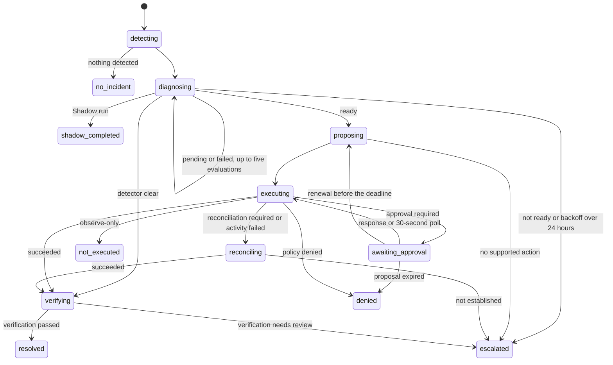

# Durable exception workflows

Temporal drives exception process progress and retry scheduling: detection, diagnosis,
proposal preparation, policy and approval, execution, business verification and recovery.
PostgreSQL remains the authority for incidents, diagnoses, approvals, execution attempts
and audit evidence. A workflow never resolves an incident on its own; only fresh
authoritative verification through the exceptions service does. The workflow lives in
`@luma/workflow-temporal` and is composed in `@luma/application-runtime`.

These are progress phases, not incident states. `resolved` reports that the exceptions
service accepted the verification; every escalation leaves the incident unresolved.

## Run the worker

`pnpm dev:workflows` starts PostgreSQL, the Temporal development server and the worker
locally (see [local development](development.md)). The worker runs separately from the
HTTP server, drains on SIGINT/SIGTERM and then closes its connections and pools. Use a
persistent Temporal deployment for durable operation. Settings are documented in
`apps/api/.env.example`:

- `WORKFLOW_DATABASE_URL` is a restricted login with the worker's
  [database roles](development.md#database-roles).
- `TEMPORAL_ADDRESS`, `TEMPORAL_NAMESPACE` and `TEMPORAL_TASK_QUEUE` select the service and
  queue. Each worker connection belongs to one namespace and task queue.
- `TEMPORAL_DATA_REGION` must equal `LUMA_REGION` (`AU` by default). Operators must provision
  the server, namespace, backups and workers in the approved cell region; the setting cannot verify
  physical placement.
- `TEMPORAL_TLS=true` is required in production and whenever `TEMPORAL_API_KEY` is set.
  Inject the key as a deployment secret. A self-hosted server may present a certificate from a
  private CA: set `TEMPORAL_TLS_SERVER_CA` to the base64-encoded PEM bundle, which then
  replaces the system roots for that connection.

The default worker runs persisted diagnosis for incident references and returns manual
intervention when no published proposal exists. It resolves no connector effect adapters
itself and never invents an action from diagnosis prose or resolves an incident without a
verifier. App-owned writes, such as Shopify corrections, run through
[case workflows](workflows.md#case-workflows) and their owners' services.

## Payload encryption and recovery

Production clients and workers require regional KMS envelope encryption, including failure
messages and stacks. Local synthetic runs may omit it. Every worker rejects a foreign-region
or missing-region envelope before invoking the activity, and encrypted payload headers bind
the cell region and namespace before decryption. Workflow IDs contain opaque hashes; memos
contain only a request hash and there are no tenant-bearing search attributes. Temporal
SDK patch markers and `TemporalChangeVersion` remain plaintext technical metadata; their
static version identifiers must never contain tenant data.

Configure `TEMPORAL_KMS_KEY_ARN`, `TEMPORAL_KMS_REGION` and the KMS credentials as deployment
secrets. AU uses a single-region Sydney key. KMS data keys are cached in process memory for
one minute or 1,000 payload uses by default; the hard limits are five minutes and 10,000 uses.
A cold cache or expired key with inaccessible KMS stops processing. An authorized cached
key remains usable only within those limits. Closing the codec clears key bytes.

KMS automatic rotation preserves the key ARN. When replacing the key, deploy the new write
ARN and add the old ARN to `TEMPORAL_KMS_DECRYPTION_KEY_ARNS` in every API and worker before
writing new history. Retain old-key decrypt permission until all referencing histories and
backups expire. Missing, disabled or retired keys and tampered history fail decryption;
restore the authorized key/access and replay. Never fall back to plaintext, another region,
or re-dispatch uncertain effects as a recovery shortcut.

## Starting and identity

Clients start and query workflows with an authenticated `TenantContext` and a source
reference: an incident, or a detection delivery. A detection source requires a binding
that loads an immutable, tenant-owned detection request from durable storage; persist the
source before starting. Detection then runs as a retryable activity with the usual
evidence deduplication. A producer that needs guaranteed delivery must keep its start
command in a transactional outbox and retry until acknowledged. The default worker has no
detection-source store, so use incident references with it.

Workflow IDs hash the tenant and source kind and ID. Repeated starts return the same
workflow, including after completion, without changing its initiating user, and tenants
cannot address each other's workflows. A new immutable detection delivery can start
another investigation for the same incident. An identical source never resets a
completed run within Temporal's history retention; execution receipts still prevent
repeat effects after retention expires. Set retention to cover the operational review
period.

## Proposals

Proposal preparation must persist once per tenant, incident, diagnosis revision and
requester, and reads must return that immutable action with its incident and revision
binding, or null when no supported action exists. A changed action needs a new proposal
ID. Before dispatch the activity checks the current diagnosis revision and freshness;
execution then validates the action, binds its hash, checks adapter availability and
evaluates policy before any write. Composing with the case desk persists the producer's
action before returning its reference and records the case/workflow association (see
[case decisions](case-decisions.md#proposals-and-workflow-composition)).

## Approval

Policy evaluation and the initial dispatch share execution's preflight boundary; no
separate policy result authorizes a later write. While awaiting approval, the command
layer records the response through policies with the approver's authenticated context and,
after commit, signals `approvalChanged` to the workflow bound to the case. The signal is only a
wake-up hint with no approval or actor claims, sent only for approve and reject, bounded to two
seconds and never failing the decision. A 30-second durable poll covers lost notifications. The poll only
reads whether the decision is still pending: it records no policy decision and reads no
provider. Execution runs again after a signal, a recorded response, a workspace policy
change or a replaced proposal. Process capability steps wait the same way.

Approval waits end at the proposal or evidence expiry, at most 24 hours after the first
proposal, including renewals. When the
composition installs a proposal refresher (the shipping-method correction), the workflow
rereads current conditions 30 seconds before that deadline and renews an unexecuted
proposal. Renewal records a policy evaluation but never approves; a rejection or a
still-valid approval prevents it, and an expired approval needs a new decision. Rejection,
expiry and changed membership never authorize execution.

## Authority, retries and recovery

The execute activity may run for five minutes, because preflight reads, the write and
verification can each be slow. It heartbeats while it runs, so Temporal retries after a
lost worker within 20 seconds instead of retrying an attempt that is still running. Worker
shutdown waits six minutes for running activities; give deploys at least that much
termination grace.

Every activity rebuilds the initiating user's context through identity and checks current
membership, role, organization status and cell placement. Serialized contexts, sessions,
cookies and earlier roles are not trusted. Logout does not stop an explicitly started
workflow; membership removal or role loss does.

A suspended or closed workspace, or a suspended initiating member or disabled account, pauses
the workflow instead.
The rejected activity runs no effect and reports `WorkspaceInactive` or `MembershipSuspended`
without retrying; the workflow waits durably, one
minute at first and doubling up to an hour, then calls the same activity again. The cap
keeps history bounded during a long suspension; after reactivation the run continues when
its current wait ends, at most an hour later. Cancellation recovery does not wait for
reactivation.

Activities retry up to five attempts within five minutes, with a one-minute attempt
timeout. Diagnosis retries honor persisted reread backoff, up to five evaluations; a
backoff beyond 24 hours escalates. Exhausted retries end in a stable escalation reason.
Timers and approval polling survive worker replacement, and the workflow never loops
indefinitely over uncertainty.

Before dispatch, activities check for an existing execution receipt. Prepared or unknown
attempts go to read-only reconciliation, even if the diagnosis expired or the proposal
source is gone. A lost activity completion, a restart or a cancellation after dispatch
never causes a fresh write. Execution activities use `WAIT_CANCELLATION_COMPLETED`:
cancellation waits for the activity to finish or time out, then reconciles in a
non-cancellable scope. A completion that arrives after a cancellation request still ends
in a cancelled workflow, with any unresolved outcome visible in the execution record for
operator recovery. Failed or inconclusive reconciliation escalates instead of producing a
retry proposal. Cancellation is not compensation.

Detector `clear` results and successful executions both go through verification.
Repeated verification recognizes an already committed verified resolution; a human
disposition is never reported as verified.

## Progress and data handling

Progress is a Temporal projection, not a second incident lifecycle: it exposes the phase
and relevant incident, proposal and decision IDs. Escalations and interrupted workflows
report escalation without marking the incident resolved. The canonical incident changes
only through the exceptions service. [Case decisions and progress](case-decisions.md)
expose the persisted state to people.

Temporal history holds only source, tenant, user and correlation IDs, diagnosis revision
and status, proposal ID and expiry, policy decision ID and finite result codes. It never
holds evidence documents, connector payloads, proposal parameters, credentials, model
prompts or provider errors; activity failures are sanitized. Limit namespace access to
trusted workers and operators, because they can invoke workflows directly.

The Temporal integration tests download the development server binary on first use (CI
needs access to Temporal's download service). The lost-notification test uses the
time-skipping test server, which needs Rosetta 2 on Apple silicon.
