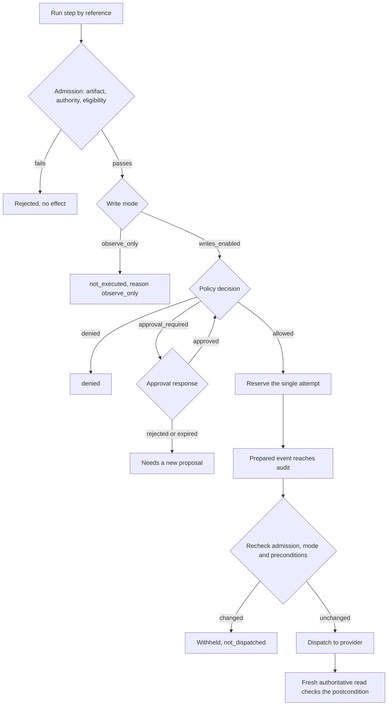
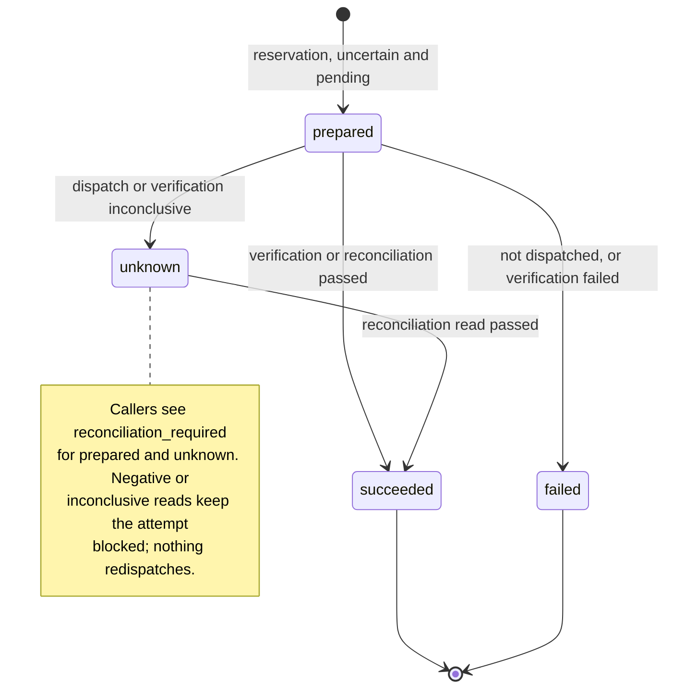

# Policy, execution and audit

Every external write goes through one path: action admission, policy and approval, a
single durable dispatch reservation, then independent verification, with append-only
audit evidence at each step. A successful provider call is never verification, and
retries, restarts and redelivery never dispatch a second write. `@luma/policies`,
`@luma/execution` and `@luma/audit` own the rules; `@luma/application-runtime` composes
them with identity, an eligibility reader and the trusted effect registry.

## Action admission

Callers execute a run step by reference only (`runId`, `stepId`). Passing a proposal,
capability, target, tenant, principal, credentials or parameters fails validation. The
service loads the run's immutable authority and bound step inputs, then checks the exact
activated artifact ID, version and SHA-256 digest. The artifact allows a capability and
version, target kind and minimum risk per step; the action must match them and its stored
hash.

- Activation is an explicit trusted step; generating an artifact never activates it.
  Revocation is permanent for that version.
- Run authority binds tenant, initiating principal, artifact, incident and diagnosis
  revision. A run cannot acquire another principal or artifact through a later step. Each
  step binds one proposal permanently, and a proposal belongs to one step.
- The composition root supplies an independent eligibility reader; the default denies.
  Resolution eligibility reloads the current diagnosis and checks its revision, readiness,
  expiry and evidence membership. Bound evidence must be at most five minutes old by
  default and never future-dated. The effect binding separately validates target
  ownership, connection scope, parameter mapping and provider preconditions.
- Admission rechecks activation, current membership and eligibility after the reservation
  reaches audit and before dispatch. Admission metadata does not change the proposal hash,
  so approvals stay bound to the same action.

The installed connector runtime exposes only `read` and `discover`. Write registries are
built in trusted composition and held by the private execution engine. Interpreted callers
get one admission function bound to a trusted context and run, with no database,
credentials, handlers or network access. Generated code is never evaluated in the server
process. API, deterministic-browser and sandboxed-code effect adapters all enter the same
admission and reservation path; a code runner must enforce its own process and network
isolation.

### Runtimes

The API, the workflow worker, the commerce sync process (mailbox reading, supplier follow-up
and return follow-up) and the pilot compose the same effect registry from the installed apps. A
runtime with enabled execution and the installed purchase-order, return and mailbox runtimes
resolves the same adapter for an action as every other runtime: the same dispatch identity,
mechanism and executor. An attempt reserved in one process can therefore be reconciled in
another. A runtime without execution, or the API without connection settings, resolves none
of those provider writes.

People's approvals send at once from the API, as the requester. Approved purchase orders,
replies, return creations, return settlements and exchange steps whose send did not start are
sent by the commerce sync passes, also as the requester and only while the approval is valid.
Those passes reconcile uncertain writes by reading. A return write whose approval ended before
execution reserved it is recorded as expired, and a new request is needed. The workflow
worker's return step follow-up also reads sent refunds and exchange processing while it checks
return money. No worker activity proposes or approves these writes; it only executes or
reconciles the bound action under its recorded approval.

Provider runtimes record no capability telemetry and keep no read observations, so a read's
ID resolves only where its owner stored it. Owners that cite reads as verification evidence
store them in their own tables, in the tenant's transaction, before returning the result:
Shopify corrections and fulfillment recovery, Starshipit updates, JTL shipping-method
corrections, procurement's submission and revision reads, and orders' return creation,
settlement, exchange and completion reads. A stored read keeps its adapter version and its
completeness, and its source revision and update time where the provider reports them; a read
whose page or scan was cut short is `partial`.
Mailbox verification cites the messages and outgoing send it stored. Provider results that
aggregate several reads, such as a refund quote or an exchange proof, return the reads their
evidence references name, so the citing owner can store them.

Write receipts follow the same rule. When a provider accepts a write, the owner that bound the
effect stores the receipt in the tenant's transaction before execution sees it, and the
attempt and its completion audit cite only that receipt's ID, never the adapter's own
references. Procurement (submissions and order revisions) and orders (return creations,
settlements and exchange steps) store receipts beside their cited reads with kind
`write_receipt`; messaging stores reply send receipts beside the reply; JTL shipping-method
corrections store receipts beside their verification reads in the JTL app's table. Shopify
corrections, stock protection, order edits, fulfillment recovery and shipment publishing, and
Starshipit updates store their acceptances in their own evidence tables; the capability
runtime tells such adapters the adapter version and dispatch identity it pinned for the write.
A receipt keeps the provider, connection, the provider records the response named, the provider
request ID, the attempt's idempotency key and dispatch identity, the adapter version and the
time; never the payload, credentials or message content. A lost or unreadable response has no receipt, so nothing is
cited. If the receipt cannot be stored, the attempt records the write as dispatched with an
unknown outcome, cites nothing and reconciles by reading. Internal effects, such as adaptive
fields, Luma purchase orders and supplier follow-ups, cite the Luma record they changed.

### Reading cited evidence

`@luma/read-models` resolves the references a record cites, so people see the evidence rather
than IDs. A request names a subject (a purchase order, a purchasing plan, a replenishment run by
its workflow run ID, a native stock receipt review, a return creation, settlement, exchange or
exchange step, a return deadline wait by its occurrence ID, a reply, a case, or an app decision by
its proposal ID) and optionally its references; without them it resolves everything the subject
cites, up to 100. The reader needs the subject area's read permission (`procurement.read`,
`inventory.read`, `returns.read`, `messages.read` or `issues.read`); an app decision needs the
read permission of its capability's area (`inventory.*` needs `inventory.read`, `orders.*`
`orders.read`, `fulfillment.*` `fulfillment.read`). A subject the tenant doesn't have is not found.

The subject's owner reports what the subject cites and looks up stored evidence only through the
subject: procurement's reads and receipts of that order, its lifecycle events, plans and the
notes people recorded with manual receipts; a replenishment run's rule, admitted proposal with
its policy records, the rule's supplier, the orders it counted or drafted and the drafted order's
events; inventory's receipt reviews and the ledger entries that booked them; orders' evidence of
that return case; messaging's send receipts and the messages of that reply's thread. Tables that
are not linked to the subject are read only for references the subject cites as reads or
receipts: the inventory and order snapshots and ledger entries behind a plan's suggestions or a
replenishment run's stock check and demand estimate, and the Shopify, Starshipit and JTL shipping-method
evidence that execution attempts or an app proposal's preconditions cite, through each app's
`evidence` hook. App rows written before an app recorded adapter versions, completeness or
accepted records return those fields as null, which the view shows as not recorded. An order's
email submission names the message it sent, which messaging resolves.

A replenishment run cites what its steps recorded: the stock read of its inventory check, the
supplier and existing orders its proposal step counted, the policy decision its approval waits
on, and the drafted order's events its verification found, plus the rule, the admitted proposal,
and the order reads behind the demand estimate and the orders its approval context froze.
Contexts frozen before Luma recorded demand reads cite none; when their demand estimate was known,
the list's `notRetained` names the demand reads with the day storage began, so the run doesn't
read as if demand was never considered. It never stands in for a read, and a request for
specific references omits it. A return wait cites the money reads
or case revision its last check found, and an exchange the reads behind its availability and its
completion check.

Each reference resolves to a read (source, record, read and source-update times, revision,
completeness, adapter version and an allowlisted summary of the normalized read), a write
receipt (capability, accepted time, provider records, request ID and, where recorded, the adapter
version), a stored message (sender, received time, subject and whether the receiving system
authenticated the sender), a Luma record, `restricted`, `not_retained` or `unresolved`. Records
that keep them carry their time, actor and facts: a purchase order event its status change or
revision, a receipt review its state and quantity, a ledger entry its postings with the balance
and version after each. Provider payloads, message text, recipients and attachments never leave
the owner.

Evidence another area guards is `restricted` for a reader without that area's read permission,
naming the permission, rather than left out: plan and replenishment stock reads and ledger
entries, native receipts and their proof need `inventory.read`, plan and replenishment demand
reads `orders.read`, order emails
`messages.read`, the commitments a receipt books `procurement.read`, and an order's Shopify stock
bookings with their policy records, receipts and verification reads `inventory.read`. The
order's timeline agrees: it lists those Shopify stock booking entries as restricted, with only
their stage and time, and their evidence as restricted, so the reader knows the booking and its
proof exist. A reference that
belongs to another subject or tenant is `unresolved`, never `restricted`, so a restricted entry
reveals nothing the subject does not cite.

Records written before an owner stored a kind of evidence cite IDs that were never kept and
cannot be backfilled. The migration ledger dates when each kind began (procurement reads, return
reads, write receipts, replenishment demand reads); a read or receipt cited before that date is `not_retained`. Everything
else without stored evidence stays `unresolved`, including citations without a time and reads
that were always stored: messages, inventory and order snapshots and ledger entries. A missing
read after storage began is a defect, not history. Busy views, including Needs you, resolve
evidence only when a person opens it.

## Observe-only

Owners choose `observe_only` or `writes_enabled` for the workspace. New workspaces
observe only; existing workspaces retain their prior write behavior. A connection can
add an observe-only override or inherit the workspace. It cannot enable writes against
an observe-only workspace. Changes use reviewed revisions, refresh owner authority and
retain before/after audit evidence.

Detection, diagnosis and immutable proposals continue in observe-only. The shared
execution engine records a terminal `not_executed` result with reason `observe_only`
before policy approval or dispatch reservation. It retains the proposed action and its
evidence without making a provider write. API, worker, pilot and simulator composition
all use this engine. Reservation shares the mode-change fence, and dispatch checks the
mode again after audit persistence. A change after reservation withholds dispatch using
the existing attempt's certainty model; a provider request already sent is not cancelled.

Workers stop normally on the recorded result. Replays and restarts never redispatch that
proposal, even after writes are enabled. A fresh proposal and the usual admission,
approval and verification controls are required to act later. Existing uncertain writes
can still be reconciled by independent reads. Observe-only outcomes belong to their own
measurement environment and never count as verified resolutions.

## Policy and approval

Policy `v0.1` lets people with the step's permission execute registered capabilities: the
capability's own permission when it declares one, otherwise `actions.execute`
(`actions.propose` when preparing a proposal). Otherwise the decision is
`permission_denied`. The registry must resolve an active tenant-owned connection, check the
exact capability version, validate parameters and target/evidence ownership, and read
current preconditions. Missing capabilities or false preconditions deny; registry errors
stop execution.

Low-risk actions run without approval. Medium or high risk, from the proposal or the
adapter metadata, needs approval with `decisions.respond` (and the
capability's app permission, if any). The [workspace approval preference](workspace-settings.md#approval-preference) controls whether the approver must be a different person. Independent approval is off while fewer than two active members have access; an explicit response is still required. Responses are `approved` or `rejected`, expire within
24 hours, and the first response wins. Grants bind tenant, proposal hash, requester and
policy version. Rejection and expiry never authorize an effect and cannot be overwritten; a
new proposal is needed. A rejection stays binding after its expiry and if adapter risk is
later lowered. Membership is rechecked when executing, approving and reconciling.

A policy decision expires after 30 seconds or at the earlier proposal, evidence or approval
expiry, and execution checks that deadline again after persisting the prepared audit
event. Authorization happens before the call and is not a transaction with the provider:
adapters must use provider-side conditional writes where changes between preflight and
dispatch matter.

## Immutable intent and idempotency

The validated proposal binds tenant, target, connection, capability and version, scalar
parameters, evidence references and freshness, expected postcondition, risk, expiry and
proposer provenance. The proposer must be the authenticated user. Caller-supplied model
metadata and service, agent or connector proposer claims are rejected, because identity
has no delegation authority. Agent executor provenance (model, provider, version, prompt
version, run ID) comes from the trusted adapter. The hash is SHA-256 over canonical JSON
with sorted keys. The first accepted proposal ID binds its content permanently, including
while awaiting approval; changed intent needs a new UUID.

The logical execution key is `v0:<proposal UUID>`, unique within a tenant; adapters keep
tenant and connection scoping when mapping it to a provider key. A unique reservation
permits one dispatch. Concurrent or repeated calls return the stored result, or
`reconciliation_required` for an interrupted attempt. Each proposal has a single attempt:
there is no provider-safe retry or compensation protocol, and callers must not create a
new proposal just to retry an ambiguous write.

Parameters and postconditions hold only minimal non-sensitive command data. Keep
credentials, customer payloads, screenshots and chain-of-thought out; reference controlled
evidence by tenant-owned UUID.

## Attempts and verification

Each attempt records dispatch separately from business outcome:

- `dispatch`: `not_dispatched`, `dispatched` or `uncertain`.
- `businessOutcome`: `pending`, `satisfied`, `violated` or `inconclusive`.

A prepared reservation starts as uncertain and pending, because a crash can happen on
either side of the provider call. A withheld call records `not_dispatched`, an accepted
response `dispatched`. Thrown calls stay uncertain unless the adapter reports dispatch
certainty explicitly. Provider request IDs are kept in the attempt and completion audit
when supplied.

Verification performs a fresh authoritative read, checks the expected postcondition and
returns the outcome, observation IDs, observation time and evaluator version. Each returned
observation ID must name a read the owner has already stored with its source identity, read
time and completeness; a verifier that cannot store a read must not cite it. Observations
predating the attempt, malformed responses and thrown reads produce an unknown outcome;
only a passed check is success. The verifier must prove the selected business postcondition: a
corrected shipping method, for example, does not prove that fulfillment resumed. Closing
the incident still needs [exception verification](exception-detection.md#resolution).

## Recovery

Reconciliation only reads. A passed verification can settle a prepared or unknown
attempt and establishes the business outcome, not whether a lost response was delivered.
Negative and inconclusive observations are stored with audit evidence but cannot prove a
delayed request will not commit, so the attempt stays blocked and its reservation is not
consumed; an in-flight dispatch can still record its receipt. Reconciliation keeps
dispatch certainty and the reserved provider identity and never redispatches. If it cannot
establish success, escalate to a person instead of retrying. Attempts recorded without a
dispatch identity reconcile only with a matching mechanism and executor.

Policy records, approval responses, reservations and completions commit together with
their outbox events. The effect is called only after the policy and prepared events reach
the audit log, and transactions end before any connector I/O. Audit ingestion accepts
exact replays and rejects conflicting event keys. Policy outboxes drain on policy
evaluation and approval; execution outboxes drain on execution and reconciliation. After a crash or audit outage, redeliver the same
activity input: pending evidence is flushed without repeating the effect, and a process
that died after the remote commit leaves a prepared record that forces reconciliation.
Audit entries hold policy, attempt and connection references, provenance and evidence
references, never exception messages or provider payloads.

## Storage and operation

All safety tables use forced RLS on the transaction-local tenant and queries also filter
by tenant. Runtime roles cannot update or delete policy or audit evidence, rewrite intent
receipts or delete execution history; a trigger preserves intent, attempt identity and
final results, and outbox roles may update only delivery timestamps. Append-only is not
cryptographic tamper-proofing: migration and retention credentials stay privileged. The
safety login must be a non-owner, non-superuser role without `BYPASSRLS` (see
[database roles](development.md#database-roles)), and the process must run in the
tenant's configured region. See [module ownership](architecture/001-module-boundaries.md) and
[tenant isolation](architecture/003-tenant-isolation-and-data-residency.md).
