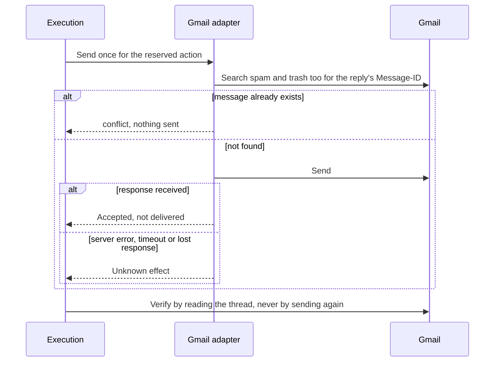
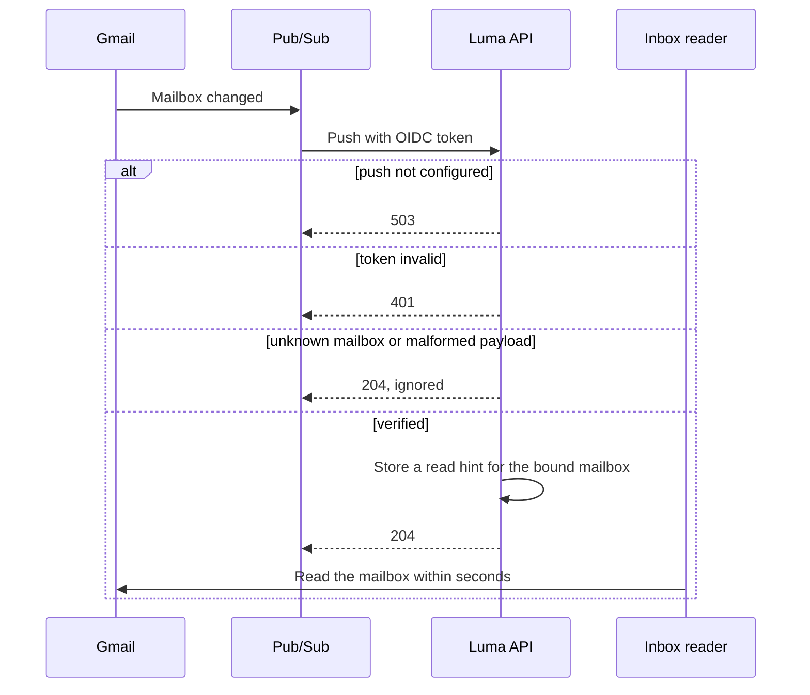

# Gmail connector

The Gmail app connects a Google mailbox to a workspace so the operations inbox can read the
messages its inbox rules select and send approved replies. Luma asks Gmail only for matching
messages, never reads the whole mailbox, and treats a send as accepted, not delivered, until
a fresh read finds the message. Code: `@luma/app-gmail`, with the protocol client, OAuth
requests, query building and MIME handling in `@luma/connector-gmail`.

## Access and grants

People with `connections.manage` choose **Connect Gmail**; Google asks the account owner to
allow reading and sending. Luma requests `openid`, `email`, `gmail.readonly` and `gmail.send`
with offline access, forced consent and PKCE (S256).

- `gmail.readonly` grants `messages.read`, `message-threads.read` and
  `message-attachments.read`. A connection is active only with it.
- `gmail.send` grants `messages.send`. People can untick it on Google's consent screen; the
  connection then stays active and read-only, and settings name the missing access until
  someone reconnects.
- Google may report broader scopes the account granted earlier (`gmail.modify`,
  `mail.google.com`); they count for the access they include.
- Sending also needs the app permission `gmail:messages.send`. Policy requires it to
  propose, approve or run a send, in place of `actions.propose` and `actions.execute`.

The mailbox is the account Google authorizes, read from the verified email claim of the ID
token and confirmed with a profile read. The optional mailbox address only preselects the
account. Connect a dedicated account for a shared mailbox, such as `orders@`: Google Groups
collaborative inboxes and delegated mailboxes are not supported, because the Gmail API acts
only on the authorizing user's own mailbox.

## Authorization and recovery guarantees

- State is random, stored as a hash, bound to the login session, operator, workspace and app
  installation version, expires after ten minutes and is consumed once. The PKCE verifier is
  derived from the state with the client secret, so nothing reusable is stored.
- One mailbox belongs to one workspace per OAuth client. Connecting it elsewhere fails until
  the owning workspace uninstalls the app, which releases the binding. Reconnecting in the
  same workspace reuses the connection ID, also for revoked or disconnected connections.
- Access and refresh tokens, expiry, granted scopes, app binding and mailbox share the
  tenant-bound encrypted envelope. Advisory and row locks serialize authorization and
  refresh across processes. A token is refreshed within 60 seconds of expiry on the next
  read or send, including background reads.
- `invalid_grant` on refresh (revoked by the user or an admin, password change, expired
  testing-mode grant) revokes the connection and deletes its secret; reconnect to restore
  it. Temporary or client-configuration failures keep the stored tokens. A refresh that no
  longer includes `gmail.send` removes `messages.send` from the grants.
- Revoking at Google ends the grant for the whole OAuth client and user, which would also
  disable the same mailbox in another environment that shares the client. Luma never revokes
  remotely; remove access in the Google account or Workspace admin console.

## Reads

`messages.read` turns the union of the mailbox's rules into one Gmail search, for example
`(from:(supplier.example OR jane@other.example) OR to:(orders@shop.example) OR cc:(…) OR deliveredto:(…) OR label:"Luma" OR (in:sent to:(…))) after:<epoch seconds>`.
An empty filter matches nothing and sends no request. Rule values are validated so they
cannot change the query: lower-case domains and addresses with a restricted local part,
and label names without quotes or backslashes.

Gmail search matches address tokens, so a domain term also matches its subdomains and can
match lookalikes such as `supplier.example.other.example`. The adapter checks every fetched
message against the filter exactly (domain or subdomain, address, recipient in To, Cc or
Delivered-To, label name, or a sent message addressed to a listed party) and drops the rest
before returning a page. Dropped messages are fetched but never stored or returned.

- Pages list at most 100 IDs and fetch each message in full, four at a time. A page is
  complete once every listed message is fetched; messages deleted in between are skipped.
  The cursor carries Gmail's page token and is bound to the connection and query.
- `message-threads.read` returns every message of a thread, paged locally; it is the read
  that verifies a send.
- Bodies prefer text/plain; HTML-only bodies are converted to plain text without rendering.
  Text is capped at 100,000 characters and marked truncated. UTF-8, Latin-1 and other
  charsets Node knows are decoded; unknown ones fall back to UTF-8.
- Attachments are identified by Gmail's part ID, scoped by the message. Gmail attachment IDs
  change between reads, so they are never used as identity. Inline parts without a filename,
  such as embedded images, are not attachments. `message-attachments.read` rejects content
  above the requested size before downloading it.
- Message reads are returned to the messaging owner only. They are not recorded as commerce
  observations, because messages are personal data with their own retention.

## Sending

The adapter derives the RFC Message-ID `<luma.<outbound ID>@<mailbox domain>>`. Before
sending it searches the mailbox, including spam and trash, for that ID and refuses another send when it exists. A search hit is a conflict, not
acceptance evidence; only independent verification can establish acceptance. Messages are plain-text UTF-8, threaded with
`In-Reply-To`, `References` and the Gmail thread ID; header values with line breaks are
rejected.

Gmail indexes search with a delay of seconds, so the duplicate check cannot catch a repeat
immediately after a send. Execution sends at most once per action and reconciles an
uncertain send by reading the thread, never by sending again. A server error, timeout or
lost response after dispatch is an unknown effect.

## Limits and errors

Gmail allows 250 quota units per user per second (list and get 5, thread 10, send and watch
100). Each mailbox's requests share a pacer at 200 units per second in each process, which
leaves room for the person's own clients. 429 and rate-limit 403 responses become
`rate_limited` with Gmail's delay (an hour for daily limits) and pause the pacer. 401 is
`authentication`; other 403 responses are `permission_denied`; 404 `not_found`; 5xx
`unavailable`. Reads retry short transient failures in place; sends are never repeated.

## Push notifications

Push is optional; scheduled reads cover every mailbox without it. When configured, the
first page of each message read renews `users.watch` (INBOX and SENT) when the registration
expires within 24 hours, and failures never fail the read. Gmail registrations last seven
days; uninstalling deletes Luma's records without calling Google, and later notifications
for an unbound mailbox are acknowledged and ignored.

`POST /api/v1/gmail/push` accepts only Pub/Sub's OIDC token: RS256 from Google's keys, issuer
`accounts.google.com`, the configured audience, and the configured service account with a
verified email. Invalid tokens get 401, an unconfigured deployment 503. A verified
notification resolves the mailbox through its binding and asks the inbox to read it within
seconds; unknown mailboxes and malformed payloads get 204 so Pub/Sub stops redelivering.

## Google Cloud setup

1. In a Google Cloud project per environment, enable the Gmail API and configure the OAuth
   consent screen with the four scopes. `gmail.readonly` is a restricted scope: an external
   app needs Google's OAuth verification, including a CASA security assessment, before
   general use. Until then use an internal app (one Workspace organization) or testing mode,
   whose refresh tokens expire after seven days.
2. Create a Web application OAuth client with the exact redirect URI
   `https://<public-host>/api/v1/gmail/callback`. In the ignored `apps/api/.env`, set
   `GMAIL_CLIENT_ID`, `GMAIL_CLIENT_SECRET`, `GMAIL_APP_ENVIRONMENT`, `GMAIL_CALLBACK_URL`
   and `GMAIL_WEB_ORIGIN`; the web origin must match the callback origin so the signed-in
   session reaches the callback. For local development expose the web port through an HTTPS
   tunnel as for [Shopify](shopify.md#local-development-app); `pnpm dev` uses
   `GMAIL_WEB_ORIGIN` for auth when no Shopify origin is set.
3. Google Workspace admins who restrict third-party access must trust the OAuth client
   (Security, API controls, App access control) before users can grant Gmail scopes.
4. For push, create a Pub/Sub topic, grant `gmail-api-push@system.gserviceaccount.com` the
   Publisher role on it, and create a push subscription to `https://<public-host>/api/v1/gmail/push`
   with authentication enabled, a service account and an audience. Set
   `GMAIL_PUBSUB_TOPIC` (`projects/<project>/topics/<topic>`), `GMAIL_PUSH_AUDIENCE` and
   `GMAIL_PUSH_SERVICE_ACCOUNT` and `GMAIL_PUBSUB_STORAGE_REGIONS` together. Configure
   the topic's message-storage policy to the cell's jurisdiction and inspect its exported
   configuration before enabling push. AU permits only `australia-southeast1`. The setting
   is a deployment assertion checked at startup; it does not change Google's topic policy.
   An unset or foreign storage policy disables push configuration rather than falling back
   to another jurisdiction. Register OAuth and webhook URLs on the regional web origin.

Simulated connections (labels starting with `SIMULATED`, or `.invalid` mailboxes) route every
request, including token refresh, to the [simulator](simulator.md) and never reach Google.
Without OAuth settings, connections are created with an access token and no refresh, as the
pilot does.
