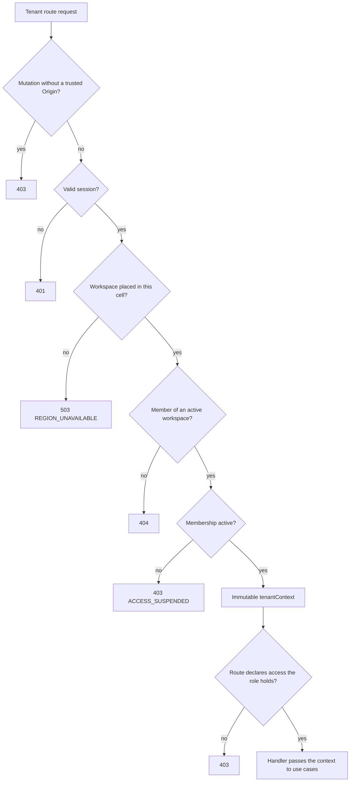
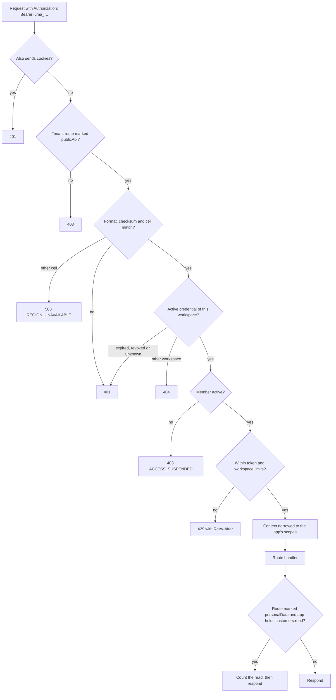

# Authentication and organization access

Luma stores Better Auth users, credentials and sessions in its PostgreSQL database, and the `@luma/identity` package owns them. Organizations are tenants. Each membership has one role: built-in Owner, Admin or Member, or a custom workspace role, and roles grant permissions from a typed catalog; see [ADR-009](architecture/009-permissions-and-roles.md) and the [permission reference](permissions.md). Every tenant request is authorized from the current session and membership, never from caller-supplied context. Each identity store serves one configured `EU`, `AU` or `US` cell. New development environments and the initial production cell use `AU`. Accounts and credentials stay in their cell.

## Database roles and configuration

The API connects with a restricted login: `NOSUPERUSER NOCREATEDB NOCREATEROLE NOBYPASSRLS`, granted only the group roles it needs. Never give the API or worker migration credentials. `pnpm run setup` provisions the local logins; when you manage PostgreSQL yourself and run `pnpm dev:manual`, grant the same group roles that `tooling/dev/database.mjs` grants, or features fail with permission errors.

Migrations run through the shared runner in `@luma/application-runtime` under a session advisory lock, each file in its own transaction with its record. It records checksums in `identity_migrations` (the name predates the shared runner; it tracks every migration), skips applied files and rejects changes to applied ones. The initial migration needs permission to create the `luma_identity` group role.

The API needs `IDENTITY_DATABASE_URL` (the restricted login), `BETTER_AUTH_SECRET` (`openssl rand -base64 32`; production refuses sample values and repeated patterns), `BETTER_AUTH_URL` (the public browser origin) and `AUTH_TRUSTED_ORIGINS` (exact browser origins). Production origins require HTTPS. `/ready` checks connectivity, migrated tables and the runtime role restrictions.

Background workers never receive the API login or the auth secret. They resolve workflow principals and read workspace members through their own login, which holds the read-only `luma_workflow_identity` role: memberships, roles, organization status and account status, without names, emails, sessions, credentials or write access. Identity methods outside those reads throw in a worker.

## Auth bridge

The web proxy forwards `/api/auth/*` to `/auth/*` and `/api/v1/*` to `/v1/*`. Better Auth uses `/auth` as its backend base path; its browser client must use the public `/api/auth` path. Mutations need the session cookie and an allowed `Origin` header; CLI callers must send both.

The bridge exposes only email sign-up (passwords of at least 12 characters), [email confirmation](#email-confirmation), sign-in, session read, sign-out, session listing and revocation, password changes, email password recovery and the [sign-in factor](#sign-in-factors) routes. Every other Better Auth route, including its organization routes, returns 404. Organization creation uses Better Auth's organization plugin inside the identity transaction, creating the organization and its first owner atomically; Luma's API owns membership management and placement rules. Cookie cache and automatic account linking are disabled.

## Membership rules

- `members.manage` invites, reassigns and removes members. Only owners grant or revoke ownership. Nobody can assign a role, or change a member, with permissions the actor does not hold.
- The last active owner cannot be removed or demoted. Suspended owners don't count.
- A membership is `active` or `suspended`. Suspension keeps the role, the account and the
  person's other workspaces; reactivation restores the same role. Luma staff suspend and
  reactivate memberships ([staff access](staff.md#membership-suspension)); the runtime role
  cannot change membership status. The membership records when, by whom (staff or customer) and
  why it was suspended.
- A suspended member can't act through the workspace's settings or role commands, receives no
  workspace mail, and can't rejoin through an invitation, because they are still a member.
- Membership mutations serialize on the organization row and recheck the acting membership after acquiring the lock.
- `workspace_people` keeps each workspace's current and former members for attribution.
  Triggers on memberships and user profiles maintain it, so no code path can skip it. Removal
  keeps the last recorded name and drops the email; [erasure](#account-deletion) also drops the
  name, so the person reads as "Former member" with their opaque ID. Reads are
  tenant-scoped under RLS; other domains name people through it instead of reading `users`.
- Apart from the creator, who becomes its first owner, people join a workspace only by accepting an invitation sent to their email; no customer API adds an account by ID, because the member list shows each member's current email. The synthetic pilot provisions its accounts through `provisionMember`, which no route exposes. Email invitations, role management and access history are described in [workspace settings](workspace-settings.md).

## Sign-in factors

People can add an authenticator app (TOTP) as a second factor after their password, and passkeys that replace the password. Both are personal account settings. Like sessions and accounts, the factor tables have no tenant scope, and only `luma_identity` may change them.

- TOTP is pending until the first code is confirmed; until then, sign-in needs only the password. Enabling, regenerating backup codes and disabling all recheck the password. Setup returns the TOTP URI and 10 backup codes once.
- When TOTP is on, a correct password deletes the new session and returns `twoFactorRedirect` with a signed 10-minute challenge cookie. Each challenge allows five codes; ten failures lock code entry for 15 minutes. A backup code is consumed when used.
- Confirming setup and turning TOTP off rotate the session.
- Trusted devices are not supported: requests with `trustDevice` or `disableSession` are rejected. Code delivery by email or SMS, rereading the TOTP URI and renaming passkeys are not exposed.
- Registering a passkey needs a session created within the last day. A passkey sign-in counts as both factors and skips the code step.

The passkey relying-party ID is `AUTH_PASSKEY_RP_ID`, defaulting locally to the `BETTER_AUTH_URL` hostname, and assertions are accepted only from `AUTH_TRUSTED_ORIGINS`. Configure a stable parent domain before registering production passkeys; the Lite cell uses its stage domain (see the [deployment guide](deployment.md#hosts-and-staff-access)). Every trusted origin must be the RP hostname or a subdomain of it; changing the RP ID invalidates registered passkeys. Browsers reject IP addresses as relying-party IDs, so local development serves the web app on `http://localhost:<port>`; `127.0.0.1` remains trusted for password sign-in only. Changing the production hostname invalidates existing passkeys. Passkeys created in one worktree are offered in others on `localhost`, but only work against the database that stored them.

## Sign-in protection

Auth endpoints are rate-limited per client address and path in every environment: sign-in, two-factor code checks and passkey sign-in to ten requests a minute, sign-up to five, confirmation and reset requests to three, confirmations to ten and reset attempts to five; other auth routes keep Better Auth's general limit. `AUTH_RATE_LIMIT=off` turns the limits off for tests and is refused in production. Counters live in the Valkey named by `AUTH_RATE_LIMIT_URL` (with `AUTH_RATE_LIMIT_CLUSTER`), so all API instances share them; keys hold a hash of the address and path. Without that setting, or while Valkey is unreachable, each instance counts in its own memory, which multiplies the effective limit by the instance count.

The client address is the socket address, or, with `AUTH_CLIENT_IP_HEADER`, the last entry of that header. Name only a header the [production proxy](#production-proxy) overwrites; otherwise clients choose their own bucket. Behind a proxy without this setting every client shares the proxy's address and bucket. The auth bridge passes the chosen address to Better Auth in its own header and replaces any client-sent value; sessions and security events record the same address.

Password sign-in is also limited per email address: after ten wrong passwords within 15 minutes, counted since the account's last successful sign-in or password reset, further password attempts return `429 SIGN_IN_LOCKED` before the password is checked, until older failures leave the window. Unknown addresses are counted by their keyed email hash and refused the same way, so the response reveals no account. Counts come from [security events](#security-events) in PostgreSQL and hold across instances. Anyone can lock an address this way for 15 minutes; passkey sign-in and password reset stay available. Refused attempts are not recorded and don't extend the lock.

## Email confirmation

Email sign-up creates the account without a session and queues a confirmation link; the response is the same when the address already has an account. Every new session, by password, passkey or two-factor sign-in, is refused with `403 EMAIL_NOT_VERIFIED` until the address is confirmed, after the credential was checked. Confirmation sets `users.email_verified` and creates no session, so the second factor still applies at the next sign-in. Accepting an invitation also needs a confirmed address and otherwise returns `403 EMAIL_NOT_VERIFIED`; an address someone merely typed at sign-up proves nothing about who reads its mail.

Confirmation links go through the account mail queue described under [password recovery](#password-recovery-and-account-sessions), carry their token in the URL fragment of `/verify-email`, and work for 24 hours. Sign-up writes the queued link in the transaction that creates the account, so an account exists only with its link; if the link can't be queued, sign-up fails and creates nothing. Better Auth only logs errors of its mail callbacks, so the auth adapter rolls back a transaction in which a queue write failed. Queued links are dropped once the address is confirmed. `POST /auth/send-verification-email` queues a new link and answers the same for unknown or confirmed addresses. Without a mail provider no link can be sent: new accounts can't be confirmed and `send-verification-email` returns `VERIFICATION_EMAIL_NOT_ENABLED`. Local development and test fixtures mark seeded accounts confirmed in the database.

Accounts created before confirmation was required stay unconfirmed: nothing they did proved control of the mailbox, and marking them confirmed would also bless accounts someone registered with another person's address. Their existing sessions keep working until they end; the next sign-in and any invitation acceptance ask them to confirm through a new link. A successful password reset also confirms the address.

## Password recovery and account sessions

Password recovery uses the same configured mail provider as workspace notifications. Without it, reset requests return `RESET_PASSWORD_DISABLED` for every email. Known and unknown emails receive the same successful response when delivery is configured. Requests and attempts are [rate-limited](#sign-in-protection).

Reset links expire after 15 minutes. Better Auth atomically consumes the verification before changing the password, so concurrent uses admit only one request. A reset ends every session and confirms the email address. On an account whose address was never confirmed it also removes every passkey and the authenticator app, because whoever registered the account may have added them before the mailbox owner took it over; on a confirmed account it keeps them. Disabled accounts cannot consume reset links. Password changes require the current password and, when two-factor is enabled, a completed two-factor or passkey sign-in within the last 15 minutes. Password-driven session rotation does not extend that proof. A password change can optionally end other sessions.

Recovery and confirmation links and mandatory notices of password changes and of added passkeys or authenticator apps use a durable account queue independent of workspace notification preferences. Links carry their token in a URL fragment, removed by the browser before submission; the auth callback redirect is not exposed. Queued link tokens are encrypted with a key derived from the identity secret and cleared after dispatch, final failure or expiry. Delivery uses stable provider keys, at most five attempts, and never sends expired links. Rotating the identity secret makes queued links unreadable; request another link. Security mail uses the initiating browser’s language cookie or preferred language, falling back to English. Mail and event hooks run after password writes; a failure can leave the password changed even when the response fails, so callers must recheck by signing in.

Session listing reads only the authenticated account and reports parsed device hints, IP address and last activity. No location lookup is configured. Activity updates at most every five minutes. Listing requires a valid session but not recent authentication. Responses carry session IDs, never session tokens: `POST /auth/revoke-session-by-id` ends one of the caller's own sessions, and IDs of other accounts' sessions change nothing. Better Auth's token-based `/revoke-session` is not exposed. Revocation rejects the ended session on its next request; cookie caching remains disabled.

## Security events

`account_security_events` records sign-ins and account security changes: password, passkey and two-factor sign-in steps with their failure category, two-factor on and off, backup code replacement, passkeys added and removed, password changes and resets, sessions revoked by the person or by staff, accounts disabled or enabled by staff, deletions scheduled or restored by staff, and staff requests to inspect the account with their approval, decline, revocation, lapse, or emergency access with its category. Submitted passwords, codes and credentials are never stored. People read their own events in **Settings › Security**; the account comes from the session. Staff read them on the account page under an account grant.

- A Better Auth plugin registered after the factor plugins records Better Auth endpoints from `hooks.before` and `hooks.after`, so a password sign-in that still needs a code is recorded as pending, not as a session. Responses are unchanged, so failures for known and unknown emails stay identical. A failure for an unknown email stores an HMAC of the normalized email, keyed with a key derived from `BETTER_AUTH_SECRET`, instead of a user; rotating the secret breaks correlation with older hashes.
- Changes are recorded only when the state changed: a retried disable, revocation or passkey removal that changes nothing writes no event, and a session is signed in once. Each failed attempt is its own event. Attempts rejected by the rate limiter before reaching the endpoint are not recorded.
- Hooks run after Better Auth's own writes. If the event can't be written the request fails and no new session cookie is delivered, but a change already made, such as a new passkey, stays. Staff session revocation and account disabling write their events inside `identity_support_revoke_sessions` and `identity_support_change_account`, with the command receipt, in one transaction. Account inspection requests write their events from a trigger on the request table, in the statement that changes the state; staff-originated events (requested, emergency-opened) carry the request ID as their staff command ID and read as by Luma support, while the person's answers and lapses carry none. The person answers in **Settings › Security** through routes that a support view can't use; repeating the same answer is accepted, so retries are safe. The disable event carries no reason; the staff reason stays in the staff audit.
- The IP address comes from `X-Forwarded-For` like Better Auth's own, so it is only trustworthy behind the [production proxy](#production-proxy). User agents are client-supplied hints.

Retention: the API clears IP addresses and user agents after 90 days and deletes events after a year, in bounded batches a minute after start and then hourly. Several API instances may run it concurrently. Erasing an account deletes its events.

## Disabled accounts

Luma staff disable an account that is compromised or abused ([staff access](staff.md#account-disabling)). A row in `account_disablements` exists while the account is disabled; only `identity_support_change_account`, owned by `luma_identity_support`, and the [deletion](#account-deletion) functions write it, and the runtime can read only its `user_id`. Memberships, roles and factors are untouched, so enabling restores every previous workspace.

- **Sign-in.** A Better Auth database hook refuses every new session of a disabled account with 403 `ACCOUNT_DISABLED`. Password, passkey and two-factor sign-ins check their credentials first, so the response reveals the state only to someone who already proved the credential. The message names no reason; it tells the person to contact their workspace owner or Luma support. The failed sign-in is recorded with reason `account-disabled`.
- **Existing sessions.** Disabling deletes all of the account's sessions in the same transaction. Session resolution also rejects disabled accounts, which covers a session created concurrently with the disable.
- **Every workspace.** The membership read carries the account's state, so tenant resolution, `resolveWorkflowContext` and `refreshContext` raise `AccountDisabledError`. It subclasses `MembershipSuspendedError`: background work pauses exactly as for a suspended member, Temporal activities report `MembershipSuspended`, worker discovery skips the principal, and `suspendedMembers` includes it so work shows that it needs a new owner. Disabled accounts receive no workspace mail.
- **Support views** can't start for a disabled account, and an open view is rejected on its next request.

## Account deletion

Luma staff delete accounts on request ([staff access](staff.md#account-deletion)). Deletion is a flag with a 30-day restore window, then permanent erasure. `account_deletions` records each scheduling and stays as the erasure receipt. Its functions are owned by `luma_account_deletion`: the staff runtime may schedule, restore and request immediate erasure; the customer runtime may only erase deletions that are due.

- **During the window** the account is disabled: scheduling adds an `account_disablements` row with category `account_deletion` unless the account is already disabled, ends its sessions and suspends its active memberships with `suspended_by_kind='account_deletion'`, so the [disabled-account rules](#disabled-accounts) apply and owners no longer count it. Enabling the account or reactivating those memberships separately returns 409; restore the account instead.
- **Restore** reactivates exactly the memberships the deletion suspended and removes only the disablement it added, so roles, earlier suspensions and an earlier disablement are as before. Ended sessions stay ended.
- **Owners.** An account that is the only active owner of a workspace that isn't closed can't be scheduled; owners whose accounts are disabled don't count. Transfer ownership first.
- **Erasure** runs in the customer API every minute, up to 20 accounts per pass, each in one transaction: an interrupted erasure rolls back and the next pass repeats it, and an erased deletion is skipped. It deletes the account, credentials, sessions, factors, memberships, notification preferences, Home layouts, pending verifications, account grants, support views and security events. In `workspace_people` the name and email become empty. Invitations sent to the email, and access events and workspace commands that name the email or name, replace them with `erased-<account ID>` and "Former member"; pending invitations are revoked. Activity, audit and attribution columns keep the opaque account ID, and each workspace gets a `member.remove` access event by Luma support.
- **Afterwards** worker discovery skips the account, and background work recorded as it raises `AccountErasedError`, a `MembershipSuspendedError`: it pauses and `suspendedMembers` reports that it needs a new owner. It never runs as the person again.
- **Receipt.** The `account_deletions` row keeps the opaque account ID, timestamps, category, request reference and the staff who scheduled, restored or requested erasure, without personal data. The staff audit keeps `customer.account.erased` without a staff actor.
- **Notices.** The person is emailed when the deletion is scheduled and restored, and before erasure. Notices live in `account_mail` without an address; the recipient is read from the account when sending. With mail configured, erasure waits until the completion notice is sent or has failed (five attempts or 23 hours). Like workspace mail, the notices are English only.
- **Backups.** Erased data stays in database backups until they expire under the deployment's backup retention, and is never restored from them. Before a restored backup goes into service, erase again every account with a `customer.account.erased` staff audit entry or an `erased` deletion recorded after the backup was taken.

## Context and isolation

Every Fastify route is protected by default. Only health, readiness, the OpenAPI documents, the static connector-provider catalog and the restricted auth bridge are public. Organization listing and creation need a session. Tenant routes use `/v1/organizations/:organizationId/...`; the guard resolves an immutable `request.tenantContext`, which handlers pass explicitly into application use cases.

Every tenant route declares who may call it: contract routes through `access` in their metadata (`requires(...)` or `anyMember` from `@luma/api-contract`), other routes through `config.access`. The guard denies routes without a declaration, and callers without the declared permission receive 403. No database handles or auth instances leave the identity package.

A path ID selects a tenant; it does not grant access. Each request reads the current session and membership. `activeOrganizationId`, tenant headers and client-supplied context are never authorization inputs.



| Situation                                        | Response |
| ------------------------------------------------ | -------- |
| Not a member, or the organization does not exist | 404      |
| Organization suspended or closed                 | 404      |
| Membership suspended (`ACCESS_SUSPENDED`)        | 403      |
| Account disabled or deleted (sessions are gone)  | 401      |
| Member without the required permission           | 403      |
| Organization placed in another region            | 503      |
| Provisioning in a disabled or other cell region  | 422      |

For a member, a suspended or closed organization raises `WorkspaceInactiveError`, a 404
`ServiceError` subclass. Callers see the same response; background work uses the subclass
to pause instead of failing or blocking. Cross-tenant worker discovery returns active
organizations only. A closed organization's data is removed after its announced
[deletion date](commerce-sync.md#closed-workspace-retention); from then on it can't be
reopened. The workspace list includes closed workspaces with `dataDeletionAt` and
`dataDeletedAt`, and their owners get notices through the mail queue.

A suspended membership raises `MembershipSuspendedError`, a 403 with the `ACCESS_SUSPENDED`
code; the member already knows the workspace exists. The workspace list still includes the
workspace with `membershipStatus: 'suspended'`, and the web app shows it as **Access suspended**.
Every request resolves the membership again, so the next request is rejected; live streams
recheck access every five seconds and close. Background work treats the error like an inactive
workspace (`pausesBackgroundWork`): discovery skips work acting as a suspended member, workflow
runs pause at their next activity, and they continue after reactivation. A sync stream whose
principal is suspended blocks as `principal_unavailable` until someone resumes it with their own
access. `suspendedMembers` tells other owners which recorded principals are suspended, so they
can show work that needs a new owner.

The context carries an audit identity: user, initiating user, session, membership, role reference, tenant, region and server request ID, plus the role's effective permissions, resolved in the same membership statement. There is no long-lived permission cache. It never contains passwords or session tokens. It is evidence metadata, not an audit log; each audit producer writes its own evidence through the audit package.

Owners call `refreshContext` on the context they are given before they act. A context that
`refreshContext` itself returned less than two seconds ago is returned unchanged, so one request
that fans out to many owners, such as the [Needs you queue](needs-you.md), reads the membership
once rather than once per owner. Only objects that `refreshContext` returned are reused. A
context from the request guard, a worker or an earlier request is always read again. The window
bounds how long work already admitted in one request may continue after a membership change.

The identity role has DML grants on auth tables and narrowly scoped grants on organization tables. It owns no tables and has no commerce grants. Organizations, memberships, invitations, workspace roles and role permissions force RLS; a member can read their own role before a tenant is selected, so context resolution needs no extra round trip. Bootstrap reads expose only the verified user's memberships and organizations. Provisioning uses a server-generated organization UUID. Tenant context is installed with transaction-local `set_config` only after membership, state and placement checks, so it does not survive rollback or pooled reuse. Runtime grants prohibit changing tenant ownership, placement or organization status.

Better Auth's `invitations` table remains because its organization plugin requires it; Luma uses `workspace_invitations`.

RLS prevents omitted filters; it does not protect against a compromised backend that sets arbitrary context. Credential and session tables are the regional bootstrap exception in [ADR-003](architecture/003-tenant-isolation-and-data-residency.md). Domain packages add their own scoped repositories, composite foreign keys, runtime roles and forced RLS policies.

### Support views

A support view lets Luma staff see a workspace as one member, read-only
([ADR-011](architecture/011-support-view.md), [staff access](staff.md#support-view)). Its cookie
selects the view instead of a customer session for tenant routes, the workspace list and live
streams; `resolveTenant` accepts it only when called with `supportView`, which the request guard
and stream rechecks do. The context's actor is the member, with their current role and
permissions, and `context.supportView` is set; `refreshContext` keeps it.

- The guard refuses every route other than `GET` and `HEAD` with 403 `READ_ONLY` before
  resolving access, unless the contract or route config declares `readOnly: true`. Declare it
  only for routes that read with a request body, such as metric queries. `GET` routes must not
  write.
- The rest of the request is restricted to reads: identity's settings transactions, and the
  API's tenant databases (`createTenantDatabase` with `readOnly: requestIsReadOnly`), open
  `READ ONLY`; settings reads then take no locks. Wire the same check into any new tenant
  database the API creates.
- Execution, policy evaluation, approvals and Ask Luma call `requireChangesAllowed` and refuse a
  support context themselves.
- Account routes (security events, invitations, workspace creation) refuse a support cookie;
  the workspace list returns only the viewed workspace. Personal security settings and
  credential setup aren't reachable.
- A view that ended returns 401; `GET /v1/support-view` then reports why and clears the cookie.

### API apps

A personal API app reads one workspace for the member who created it, through a bearer token
([ADR-017](architecture/017-api-apps.md)). The context's actor is the member, with the app's
scopes that the member's role still grants. `context.apiApp` is set, and `actor.sessionId` is
the credential ID. `refreshContext` rereads the credential and keeps the narrowing.



- **Admission.** The guard only takes `Bearer` tokens that start with `luma_`; other
  authorization headers, such as a proxy's credentials, are ignored as before. Only tenant
  routes whose contract declares `publicApi` accept tokens. Account
  routes, support view routes and API app management refuse them before the token is resolved.
  Bearer requests skip the Origin check, because browsers never attach bearer tokens by
  themselves; a request that also sends cookies is refused, so a session never mixes with a
  token.
- **Scopes.** API apps can be granted the read permissions of public routes, and a person
  grants only scopes they hold. Losing a permission removes it from the app on the next
  request, and regaining it restores it. App permissions are never included.
- **Management.** Members with `api_apps.create` create and rotate their own apps. People with
  `apps.manage` see every app and can revoke any of them, but only the person an app acts for
  can rotate it; nobody can mint a token that acts for someone else. Commands use
  `workspace_commands` receipts. A repeated command returns the app with `token: null`, because
  the token is never stored. Creating, rotating and revoking are access events.
- **Storage.** Identity manages `api_apps` and `api_app_credentials` under tenant RLS and can't
  read token hashes. Tokens resolve through `api_credential_resolve` and `api_credential_find`,
  owned by `luma_api_credentials`. Use is recorded at most once a minute.
- **Lifecycle.**
  - Apps reference their membership: removing the member or erasing the account deletes them,
    so a later invitation never revives a token.
  - A suspended membership blocks its tokens until reactivation.
  - An account disablement revokes the account's apps in every workspace, and enabling the
    account doesn't restore them.
  - Each member keeps at most 25 apps that aren't revoked.
- **Limits.** Each token is limited to 600 requests a minute and each workspace to 1,800 across
  its tokens. The counters share the store and the `AUTH_RATE_LIMIT` switch of the
  [sign-in limits](#sign-in-protection). Admitted responses carry `RateLimit-Limit`,
  `RateLimit-Remaining` and `RateLimit-Reset` for whichever limit has fewer requests left;
  refused requests still count.
- **Personal data reads.** Orders, customers and returns include customer details only for
  callers holding `customers.read`; their routes declare `personalData`, and a test keeps every
  public `customers.read` route marked. A successful read of such a route by an app holding
  `customers.read` adds to an hourly row in `api_app_personal_reads` (requests, and records
  counted from `items`), and the first read of a route in an hour adds an
  `api_app.personal_data_read` access event. Recording runs before the response is sent, in a
  short transaction outside the workspace lock; if it fails, the request fails and no data
  leaves. Counts are kept with the organization even after the app is gone, and the app list
  sums the last 30 days.
- **Notices.** The member an app acts for is emailed through `workspace_mail` a week before a
  token expires, unless they issued it for at most a week, and when someone else revokes the
  app. `api_apps_queue_expiry_notices` queues expiry notices hourly, once per credential;
  delivery rechecks that the member is active and the token is still current and unrevoked, and
  cancels the notice otherwise.
- **Change feed.** Apps keep copies current through `/changes`, which reports only the record
  types their scopes can read. See the [change feed](api.md#change-feed).
- **Writes.** No public route changes data yet. Before one does, action admission must treat an
  app as its own requester, and durable work started by an app must not continue with the
  member's full permissions.

## Browser sessions

Sessions record when they were last used. Resolving a session for a protected API request
advances `last_active_at` at most once per five minutes per session, so ordinary requests
don't write; Better Auth's own session reads through the auth bridge don't advance it. Use it
to show recent activity, not to enforce idle timeouts.

Protected web routes use TanStack Start's `ssr: false`: session and membership reads run in the browser through the same-origin proxy. The server renders no private content and forwards no session cookies. The `/app` layout itself renders on the server, but only as the public pending page; `Protected` runs in the browser, and each child route keeps `ssr: false` so no loader or `beforeLoad` runs on the server. Don't express that fallback as the layout's `pendingComponent`: the router then also uses it while loading in the browser, which stalled workspace pages after full page loads. Do not add server-side identity reads without forwarding only the current request's cookies to a configured, trusted API origin. Each router owns its own QueryClient; never share a server cache between users.

Sign-in, sign-up, password recovery requests and sign-out are server-rendered, so the page appears before its scripts load. Until hydration their submit buttons stay disabled: a native submission would put the fields, including the password, in the URL. Text typed or autofilled in that window stays on screen but outside form state, so forms adopt it after hydration. Pages that act on a token in the URL fragment (password reset, email confirmation, support view) stay client-rendered, because the server never receives the fragment and would render the wrong state.

Workspace URLs use organization UUIDs, and each tab selects its own workspace. Private queries use the `['private', 'organization', organizationId, ...]` prefix. Switching workspaces cancels and removes the previous workspace's queries, and session loss removes all private queries. Session and access reads refetch on focus and navigation. There is no query persistence or offline mutation queue.

Workspace creation is never retried automatically. After an uncertain creation, refresh the workspace list before creating another.

## Production proxy

Serve each cell’s web app and API under its configured regional HTTPS origin. DNS must route authenticated traffic directly to that cell so TLS terminates in-region; authenticated routes must not pass through a global CDN. Set `BETTER_AUTH_URL` to that origin and include it in `AUTH_TRUSTED_ORIGINS`. Forward `/api/` to the trusted API service, removing only the `/api` prefix. Preserve `Cookie`, `Origin` and every `Set-Cookie` header. Replace `X-Forwarded-For` with the client address and set `AUTH_CLIENT_IP_HEADER=x-forwarded-for` so [auth rate limits](#sign-in-protection) apply per client. Disable caching for auth and organization responses. Never rewrite an untrusted Origin into a trusted one. For example, with Nginx:

```nginx
location /api/ {
    proxy_pass http://luma_api/;
    proxy_set_header Host $host;
    proxy_set_header Origin $http_origin;
    proxy_set_header Cookie $http_cookie;
    proxy_set_header X-Forwarded-For $remote_addr;
    proxy_cache off;
    add_header Cache-Control "no-store" always;
}
```

`luma_api` is the deployment's fixed private API upstream. Forward all other paths to the TanStack Start server. Keep session cookies host-only, secure and HttpOnly, with no Domain attribute; never expose session tokens to JavaScript or browser storage. Over HTTPS every auth cookie name starts with `__Host-`, so the browser rejects a cookie of the same name planted by a sibling subdomain; a proxy that rewrites cookie names, paths or domains breaks sign-in. The development Vite proxy applies the same rewrite and preserves Origin and cookies.

The web server adds a Content Security Policy, `nosniff`, a `strict-origin-when-cross-origin` referrer policy and, in production, HSTS to every response it serves. The policy runs only scripts that carry the response's nonce or that such scripts load, keeps network, image and font loads on the page's origin, and forbids framing, plugins, base URL changes and cross-origin form posts; the [frontend guide](frontend-ui.md#content-security-policy) lists what this means for app code. Proxies must pass these headers through unchanged and must not cache HTML responses: a cached page reuses its nonce across visitors.

## SSO and SCIM extension points

`AuthSettings.plugins` accepts reviewed Better Auth server plugins. Adding a plugin does not expose HTTP endpoints: extend the auth allowlist, migrations and tests deliberately. Account and provider IDs stay separate from the canonical user UUID, and organization UUIDs stay stable across identity providers. Automatic account linking stays disabled until a verified linking policy exists.

SCIM provisioning must resolve a verified installation to one organization and recheck authority, state and placement before changing memberships. A tenant ID is never proof of authority. Regional federation must preserve ADR-003's residency boundary. SSO, SCIM credentials and service actors are not enabled.

## Regional placement and signup

The migration owner provisions the database cell once. Runtime roles can read its region and
cannot change it. API, worker and staff startup refuse a different `LUMA_REGION`; an existing
local EU database must keep EU configuration or be intentionally reset. Workspaces receive an
explicit immutable region matching their cell, and provisioning rejects disabled regions.

Identity resolves opaque workspace placement before reading memberships or tenant records.
A workspace in another cell returns `503 REGION_UNAVAILABLE`; Luma does not silently route
customer data across cells. The local placement directory holds only the lookup needed for
this check. Workspace slugs are unique within a regional identity store. A second cell must
keep region-qualified links; slugs are not global identity.

Email signup requires explicit confirmation of this cell’s enabled region before creating an
account. Missing, unavailable or other-cell choices return `422 REGION_UNAVAILABLE`. The
confirmed region, account that confirmed it and server timestamp commit as audit evidence
with the account insert. Onboarding creates the workspace in the same region. Public regional
configuration contains origins and availability only, never accounts or sessions. The global
entry redirects to the initial AU cell and stores no customer session.

Regional activation is an explicit deployment policy: production defaults to an AU-only
`LUMA_ENABLED_REGIONS` list. A reviewed new cell must set that list, its own `LUMA_REGION`,
regional origins and approved service endpoints, and provision the matching immutable database
record. Workspace requests cannot opt a region into that policy.
