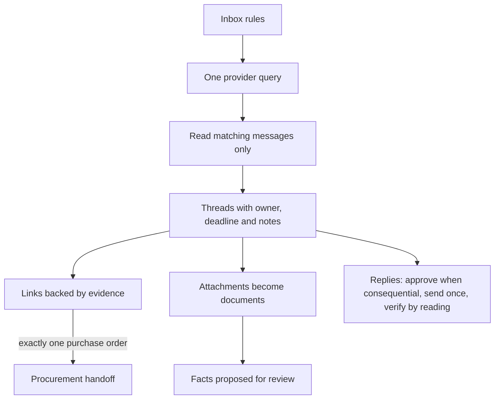
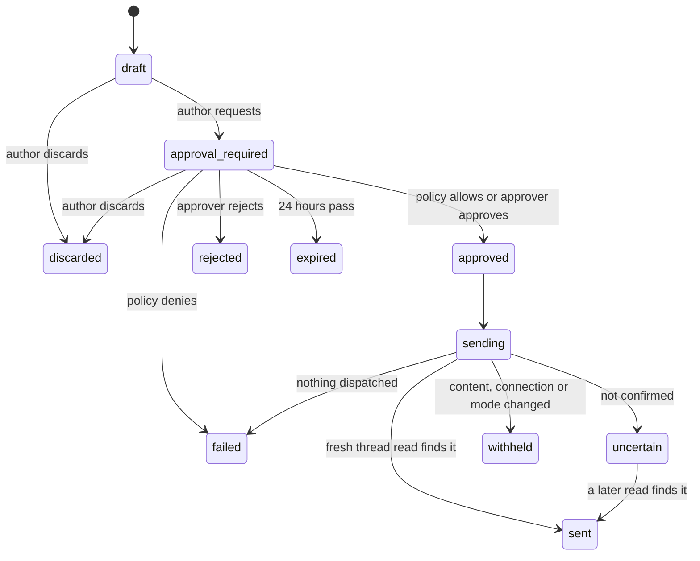

# Operations inbox

The operations inbox reads a shared mailbox, keeps only the threads that matter to
operations, links them to the records they are about and turns them into work items with an
owner, notes and a reply deadline. Code: `@luma/messaging`; provider protocols live in the
mailbox apps, and other owners' records are read only through ports composed in
`@luma/application-runtime`.

## Rules decide what Luma receives

A mailbox exists for every connection that asks for `messages.read`. It reads nothing until
someone with `messages.manage` adds a rule: a sender domain (subdomains match), a sender
address, a recipient address such as an `orders@` alias, or a provider label. Rules are
combined into one `MailboxFilter`, which the adapter turns into a provider query, so messages
outside the rules never leave the provider. Replies the team sent to matching correspondents
are always included. A rule can name its party; a supplier rule needs an existing supplier and
links every matching thread to it. Label rules cannot name a supplier, because a label says
nothing about who wrote the message.

Removing a rule stops new reads for it; threads already read stay. People who read threads need
`messages.read`, which Members have; changing rules, owners, deadlines, links and notes needs
`messages.manage`.

## Reading, windows and coverage

Mailboxes are read in the commerce sync process (the pilot runs the same passes). Each mailbox
is read as one member, initially whoever installed the connection, and that member is
reauthorized on every pass. Suspended or disabled members and inactive workspaces are skipped
without failing. A member who can no longer read messages blocks the mailbox until someone with
`messages.manage` changes it or reads it now, which makes them the member it is read as.

A runner leases one mailbox for five minutes and reads pages of 50, at most ten pages per turn.
The next provider cursor is stored after each page, so a restart resumes the scan instead of
starting over. Each scan has one of three kinds:

| Scan          | When                                                             | Window                              |
| ------------- | ---------------------------------------------------------------- | ----------------------------------- |
| `initial`     | First read, or after coverage was lost                           | The backfill window (30 days)       |
| `backfill`    | Rules were added since the last read                             | The backfill window, new rules only |
| `incremental` | Every two minutes, or a few seconds after a hint or **Read now** | `coveredUntil` minus 10 minutes     |

`coveredUntil` becomes the scan's start time only after a complete initial or incremental scan;
a backfill pass never moves it. The overlap covers provider clock skew and late indexing;
repeated messages are ignored because provider message IDs are unique per mailbox. A scan whose
rules were removed restarts with the current rules.

Failures keep the stored cursor and back off from 30 seconds to an hour, or longer when the
provider asks. Rejected credentials, missing permission and unsupported capabilities block the
mailbox until the connection changes or someone reads it again. A rejected provider cursor
restarts the scan. People see `needs_rules`, `syncing`, `current`, `paused`, `retrying` or
`blocked`, with a reason that says what to do.

## Threads

Messages and threads are stored once per provider ID. The RFC Message-ID is never an identity:
anyone can copy it into another message, so two messages that share one are both kept, and
it serves only as a threading hint and as the postcondition of Luma's own sends, where only
the mailbox's own sent copy counts. Each inbound message keeps whether the mailbox provider
authenticated its sender (`aligned`, `unaligned` or `unknown`, see [Gmail](gmail.md#reads));
the thread shows a label for the last two. Each new message recomputes its thread:
participants, the latest correspondent outside the mailbox, a snippet, counts and the latest
inbound and outbound times. A new inbound message reopens a closed or waiting thread.

The reply deadline is the latest unanswered inbound message plus the mailbox's reply hours (24
by default). A reply newer than that message clears it. A deadline someone sets replaces the
automatic one until they clear it. Threads past their deadline, or due within 30 minutes, are
Needs you items for their owner, or for everyone with `messages.read` while unassigned.

Owners must be active members who can read messages. Owner, deadline and status changes check
the thread revision; every write is idempotent by its request ID (a repeated ID with another
body is a conflict), writes a timeline event and an audit entry in the same transaction. Notes
are internal and are never sent.

The thread list is a configurable list. Its conditions use structured thread properties only:
owner (`me` resolves to each reader, empty is unassigned), status, mailbox, reply deadline,
last message, the kinds of actively linked records, attachments, awaiting a reply and facts to
review. Message text and subjects are never conditions, so a saved view cannot carry message
content; search (subject and correspondent) stays a request parameter. View counts follow the
search and the older `connectionId` parameter but never conditions, so the built-in views keep
their numbers. Sorts are the latest message (newest first by default) and the reply deadline,
with threads without one last in both directions. Groups are mailbox, owner and status. Cursors
bind the reader, view, search, conditions, sort and page size, or the group key within a group.

## Links and evidence

Links come from evidence, never from guesses:

| Method      | Evidence                                                                          |
| ----------- | --------------------------------------------------------------------------------- |
| `rule`      | A supplier rule matched the sender (or, for replies, the recipient)               |
| `address`   | A correspondent address equals a customer profile's email                         |
| `reference` | A token in the subject or text equals an order number or purchase-order reference |
| `manual`    | Someone linked the record and may read it                                         |

A reference or address that matches exactly one record gives an active link with the matched
text and its position in the message. When it matches several records, each becomes a
suggestion: suggestions are shown but never acted on, and confirming one activates only that
link. An ambiguous reference is not resolved by recency or similarity, because an action on the
wrong order is worse than a person picking the right one.

Rule and address evidence counts only when the sender is authenticated (inbound and DMARC
aligned, see [Gmail](gmail.md#reads)) or the mailbox provider confirms the mailbox sent the
message. Otherwise it is a claim anyone can write into the From line, so it becomes a
suggestion whose evidence says the sender was not verified, rather than an active link with
an "unverified" flag: every consumer of active links (procurement handoff, document supplier
matching, reply drafts, record pages) would otherwise need to know about the flag. A later
message from an authenticated sender activates the suggestion, as any unambiguous evidence
does, and a forged message never changes an existing link. References are text in the
message and link the same way whoever sent it; the procurement handoff still needs the
order's supplier. A link someone removed is never added
again automatically. Record labels are shown only to readers with the record's own read
permission.

## Procurement handoff

When an inbound message lands in a thread with exactly one active purchase-order link, and the
sender matched a rule for that order's supplier or the thread is linked to that supplier, the
message is recorded on the purchase order through procurement's message path, under the
member the mailbox is read as. Procurement then extracts commitments and follows up as for
messages recorded by hand ([supplier commitments](supplier-commitments.md#supplier-messages)).
The record ID derives from the workspace and the inbox message (its provider ID), so
rereads record nothing twice. The From address and the supplier rule it matched are only
claims; the handoff also says whether the mailbox provider authenticated the sender's domain
(DMARC aligned, see [Gmail](gmail.md#reads)). Procurement holds every fact from an
unauthenticated sender for review, and only an authenticated message claims its Message-ID
there, so a forged message sent first cannot make the genuine one a duplicate
([supplier commitments](supplier-commitments.md#supplier-messages)). A member without `procurement.manage` records a
`forbidden` outcome on the timeline instead. Only messages new to the inbox are handed off;
linking an order to an older thread does not resend its history. Incomplete message text,
including content beyond the procurement handoff limit, stays in the inbox with a reason and
is not handed to procurement as a complete supplier message.

## Documents

Attachments become documents when they are PDF, CSV, XLSX or plain text and at most 10 MB.
Other files are stored as `unsupported` with a reason; images are not documents. Documents
are queued as `pending` without content and read by a pass after each mailbox read, through
`message-attachments.read` as the member the mailbox is read as. A pass claims at most three
documents per workspace and member (`FOR UPDATE SKIP LOCKED`), so one large file cannot hold
up other mailboxes.

### Reading and its outcomes

| State         | Meaning                                                                                        | Reading again                           |
| ------------- | ---------------------------------------------------------------------------------------------- | --------------------------------------- |
| `reading`     | Claimed, or waiting to retry after a temporary failure (5 minutes, doubling, at most an hour)  | Automatic                               |
| `failed`      | Four attempts failed, the connection cannot read files, the file is gone, or the parser failed | `readDocument` with `messages.manage`   |
| `unreadable`  | Password-protected, damaged, empty, or a PDF without a text layer (scans are not read)         | No: the same bytes give the same result |
| `unsupported` | Another file type, or larger than 10 MB                                                        | No                                      |
| `duplicate`   | The same content was already read in the workspace                                             | No                                      |

A claimed read that stops without finishing is claimed again after its retry wait; the attempt
count fences a runner that lost its claim. Content whose retention passed before it was read
ends `failed`. The provider's SHA-256 must match the bytes, which are stored as the document
content. Reasons are short English strings; the web shows them by state.

Representations are text per page (PDF via `unpdf`, plain text as one page) or sheets of text
cells (CSV and XLSX). CSV separators (`;`, `,`, tab) are detected, quoted cells may hold
separators and line breaks, and files are read as UTF-8 (with or without a byte-order mark),
UTF-16 or Windows-1252. XLSX cells resolve shared and inline strings; date-formatted numbers
become ISO dates and other numbers keep their value. Luma keeps at most 300 pages or one
million characters, 20 sheets, 5,000 rows, 100 columns and 1,000 characters per cell, so a
document stays small enough to show beside its facts; a cut document is `ready` with a reason
saying so. Workbooks that would expand beyond 150 MB are treated as too large.

### Identity and versions

A document is one attachment of one message. Its content hash identifies it across the
workspace: content already read (ready or unreadable) makes a later copy `duplicate`, pointing
at the original, with no facts and no review. Reads of the same hash are serialized, so two
copies read at once still yield one original.

Versions of a file share a family: the file name within the thread, lower case, without
trailing markers such as `v2`, `(1)`, `final`, `copy`, `neu` or a date. A new hash in a family
with an earlier `ready` version becomes the next version and is compared with it. Lines compare
by SKU (or description), other facts by kind and role; repeated keys compare in document order.
Each fact is `new`, `changed` or `unchanged`, and the previous version's facts without a
counterpart are listed as removed. An unchanged fact keeps the previous version's confirmation
or rejection, so an amended document asks only about what changed.

### Facts

Facts are proposals: parties, references, lines, dates and amounts, each with its locator (a
text span on a page, or cells) and the source text it cites. Confirmed facts never authorize
an action; later work must go through its own controls.

- Spreadsheets are read by a header parser: the first row within the first 30 that names at
  least two known columns (English or German, such as `SKU`/`Artikelnummer`,
  `Bezeichnung`, `Menge`, `Einzelpreis`, `Liefertermin`, `Bestellnummer`) starts the table.
  Each row becomes a line, delivery dates and references cite their cells, and labels above
  the table, such as `Bestellnummer: PO-1001`, become references. Numbers or dates that read
  two ways (`1,500`, `05/01/2026`) are low confidence.
- Text, and spreadsheets beyond what the parser found, are read with the `document-extraction`
  model profile ([model gateway](model-gateway.md#document-extraction-profile)) when the
  server has an EU zero-retention route. The model must quote the document; facts whose quote
  is not in the document, or whose value is invalid, are dropped and counted in the
  extraction reason. Without a route, `extraction.available` is false and people add facts by
  selecting text or cells; the locator must lie within the document and the quote is taken
  from it.

Facts match records by exact evidence only: a line's SKU against catalog codes (a match names
no record, because products are not linkable records), purchase-order and order references
against their numbers, a customer party by profile email, and a supplier party by name, or by
the supplier a mailbox rule names for the thread when no name matches. Several matches make a
fact ambiguous and list the candidates.

### Review

People with `messages.manage` confirm, correct or reject facts; reviews are idempotent by
request ID, write a `fact_reviewed` timeline event and an audit entry, and are final.
Low-confidence and ambiguous facts need a correction before they count: confirming them
unchanged fails with 409, and a correction of an ambiguous reference must name the record,
either a candidate or a record the person can read. Corrections keep the fact's kind and the
original value. Unmatched facts can be confirmed as they are. Facts waiting for review count
on the thread and its documents and put the thread in the `review` view.

## Replies

People with `messages.send` draft replies on a thread. A draft answers the latest inbound
message: it goes to that message's reply-to addresses, else its sender, never to the mailbox
itself and with nobody copied; the subject gets one `Re:`; `In-Reply-To` and `References`
continue the latest message's chain. Drafts and requests belong to the person who drafted
them; others draft their own.

Drafts restate the current state of the thread's active links, read with the drafter's
permissions: an order's fulfilment, payment, tracking and planned ship date; a purchase
order's stage and outstanding, confirmed and expected quantities per line. Each statement is
a citation with the record and its observation time. A record that cannot be read, or was
read more than 24 hours ago (for a placed purchase order, the last read of the purchasing
system), is named in the text as something Luma can't confirm right now; its facts are left
out rather than guessed. Customer and supplier names only fill the greeting. Templates are
deterministic and in German when the inbound message reads German, otherwise English. Notes
and the inbound text are never quoted. Edits check the revision and keep only citations
whose statement is still in the text.

### Supplier purchasing mail

Procurement composes order emails and overdue follow-ups into this inbox. A new order starts
an outgoing thread; independent reads learn its provider thread identity while its local ID
and approval remain stable. Exact supplier-address rules bring replies back to the linked
supplier and order. Adding such a rule needs `messages.manage`; drafting and sending need
`messages.send` and `procurement.manage`.

An order PDF snapshots the reviewed company identity, line quantities, supplier article
numbers, optional prices and requested delivery date in the supplier's known English or
German language. Missing prices stay explicit. The draft retains its exact attachment bytes
for review, and approval binds those bytes with the message content. All supplier order and
follow-up sends need consequential approval. Procurement rechecks the order revision,
supplier revision, active deadline and tenant release before dispatch.

Fresh acceptance evidence hands the outgoing message back to procurement. A follow-up moves
its check time only after that read; a draft alone never changes it. If another decision
changed the deadline, the email stays sent with a reason explaining why its follow-up could
not be recorded. An owner handoff interrupted by a restart is retried without another send.

For 60 days after sending, periodic thread reads check for structured permanent delivery
reports. Only a MIME delivery-status report naming the exact original Message-ID and an
approved recipient counts; text saying "delivery failed" is insufficient. Anyone who has
seen the email can send such a report, so it marks the send failed only when the mailbox
provider authenticated the report's sender (DMARC aligned for its From domain, which covers
Gmail's own `mailer-daemon@googlemail.com`). Any other report makes the send `uncertain`
with a reason asking people to confirm with the supplier, so a forged report never prompts
another order email. That uncertainty is about delivery, not acceptance: further reads of
the send do not settle it. Three things do:

- A later authenticated report marks it failed.
- An inbound message that proves delivery marks it sent: the mailbox provider authenticated
  its sender (DMARC aligned), the sender is one of the send's recipients, and its
  `In-Reply-To` (or, without one, its last `References` entry) is the send's exact
  Message-ID. Earlier `References` entries don't count, because a reply to a later follow-up
  repeats them without proving they arrived. Unauthenticated replies prove nothing.
- A person who asked the supplier records **delivered** (sent) or **not delivered**
  (failed), with an optional internal note. This is a record of their decision, not an
  external effect, so it needs no approval; like other recorded decisions it needs the
  authority to send the email (`messages.send` and `procurement.manage`), the current
  revision and a command ID, and it writes a `delivery_resolved` thread event and an audit
  entry. It applies to any uncertain supplier email, including one whose send the mailbox
  never confirmed: the person is the escalation execution asks for, and nothing is sent
  again. Not delivered lets procurement draft the submission again.

Each settlement keeps who or what decided, writes a thread event and an audit entry, and
reopens the owner handoff, which the decision sends at once as the requester and the
supplier mail pass retries. After a person or a reply settled delivery, only an
authenticated report changes it again. A bounce is separate evidence and does not erase the
original acceptance. Gmail acceptance
does not establish supplier confirmation or guarantee final delivery. Stored draft PDF
copies follow the mailbox retention policy, as do attachments read back from the provider.

### Consequential replies need approval

A reply is consequential when its subject or text states a date or deadline (dates such as
`12.10.`, `2026-10-12`, weekdays, `next week`, `nächste Woche`, `within 3 days`), a quantity
(a number with a unit such as `units`, `pcs`, `Stück`, or a count that is confirmed or
outstanding), or money (amounts with a currency, refunds, credits, discounts, `Gutschrift`,
`Erstattung`, `Rabatt`), or when the mailbox setting requires approval for every reply. Cited
statements count like typed ones, and matching errs towards approval. Consequential replies
are high risk: policy requires approval of the exact text by someone with `decisions.respond`
and the mailbox app's send permission (`gmail:messages.send`), who must be someone other than
the requester when the workspace
[requires independent approval](workspace-settings.md#approval-preference). Other
replies are low risk and are sent as soon as they are requested, when policy allows.

### Sending once

Requesting a reply binds its exact content: the action carries the reply, connection and
thread identities and a digest of recipients, subject, text and threading headers, never the
text itself, and expires after 24 hours. After the request the reply can no longer change;
discard it and draft a new one. The effect maps the stored reply at dispatch and withholds it
when the stored content no longer matches the digest, the thread is gone, or the connection
is inactive or lacks `messages.send`. Approval sends at once as the requester, whose
membership is resolved again; the approver gains no authority to send. Approved replies
whose send did not start are sent by the background pass, and the requester can send them.
An observe-only workspace or connection records `not_executed` and the reply is withheld.
Sending needs Action Admission: servers composed without execution draft replies but answer
requests with 503.

Execution reserves `v0:<action ID>` before the single dispatch, and the mailbox app refuses
to send when the mailbox already holds a message with the reply's Message-ID
(`luma.<reply ID>@<mailbox domain>`). A provider acceptance is not the outcome: a complete fresh read
of the thread must find the exact Message-ID with provider-confirmed sent metadata, the
reviewed recipients, body, threading headers and attachment bytes. Cached messages and
partial reads never establish acceptance. The found message is marked as sent by Luma and
linked from the reply, the thread's reply deadline clears as for any reply, and records
linked to the thread show it there. Approvals, rejections, withheld sends and requests are
thread events and audit entries.

### Uncertain sends

When the mailbox does not confirm the send, or the read does not find the message yet, the
reply is `uncertain`. Checking it, from the thread or in the background pass after each
mailbox read, only reads the thread; nothing is sent again, whatever the result. Needs you
lists approvals, approved replies for their requester and uncertain sends under the thread.

## Retention and erasure

Message text and attachment content are kept for `MESSAGING_RETENTION_DAYS` (365 by default)
after receipt and removed by the sync process; addresses, subjects, dates, digests, links and
facts remain. Draft and sent body copies have their own content deadline under the same
retention policy. Removing source text clears its thread snippet and the thread's outbound
body, attachment and citation copies in the same transaction. Unsent drafts and approvals
are withheld; uncertain sends stay uncertain and are never dispatched again. Erasure also
visits source messages already removed by retention. Removing a document's content also removes its representation and its facts'
quotes, which are copies of the document text; values, locators and reviews stay. Text can
also be removed on request from the thread. A Shopify customer
redaction removes the text of messages to or from that customer's email, their attachment
content and thread snippets, and removes customer links. Erased members keep their opaque ID
on owners, notes and timeline entries, as elsewhere.

## Live updates

Every messaging table notifies the `messaging` topic, which members with `messages.read`
receive; threads, facts and replies also notify `decisions` for Needs you.
