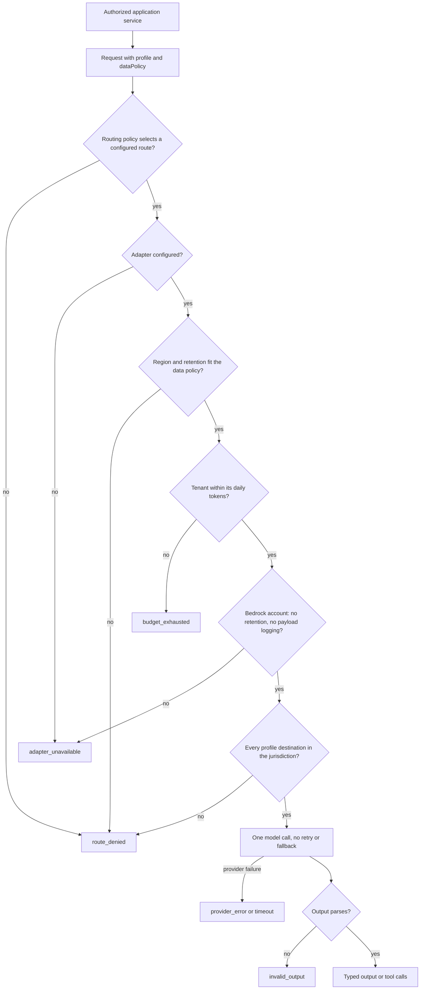

# Model gateway

The `ModelGateway` port in `@luma/platform` is the only way application services call a
model. Provider protocols stay in infrastructure, model calls are denied until routes are
configured, and tenant or personal data may only go to a route in the tenant’s jurisdiction with zero retention.
There is no public generation endpoint: callers reach a model only through their own
authorized application services.

The Bedrock checks apply only to `bedrock` routes; Vercel routes accept public input only.

## Regional processing

Every request carries the authorized tenant’s `EU`, `AU` or `US` region. The gateway
requires a matching adapter and zero retention for sensitive input. An `unrestricted`
request may carry public input only. AU configuration rejects Vercel routes entirely.

AU production uses Sydney (`ap-southeast-2`). EU destinations are limited to EU member
states; London and Zurich remain excluded. US destinations remain within the US.
A bare model runs at the configured endpoint. An `au.`, `eu.` or `us.` profile must match
the cell, and every destination returned by the control plane must remain in its
jurisdiction. Global, APAC, other-geography and ARN profiles are denied before inference.
There are no automatic retries or fallback destinations.

Regional availability is distinct from approval to process customer data. Complete the
[processing-path review](architecture/003-model-processing-path-review.md), including
retention and invocation logging in each profile destination, before enabling tenant traffic.

## Configuration

| Variable                                  | Behavior                                                                                               |
| ----------------------------------------- | ------------------------------------------------------------------------------------------------------ |
| `MODEL_GATEWAY_ROUTES`                    | JSON object mapping application profiles to routes; defaults to `{}` (calls denied)                    |
| `AI_GATEWAY_API_KEY`                      | Required for Vercel routes; server-only secret                                                         |
| `MODEL_GATEWAY_BEDROCK_REGION`            | Required for `bedrock` routes; must match the configured cell jurisdiction                             |
| `MODEL_GATEWAY_BEDROCK_ACCESS_KEY_ID`     | Required for `bedrock` routes; server-only                                                             |
| `MODEL_GATEWAY_BEDROCK_SECRET_ACCESS_KEY` | Required for `bedrock` routes; server-only secret                                                      |
| `MODEL_GATEWAY_BEDROCK_SESSION_TOKEN`     | Set only with temporary AWS credentials; server-only secret                                            |
| `MODEL_GATEWAY_TIMEOUT_MS`                | Request timeout, including Bedrock account checks and reading the response; 1–120000 ms, default 30000 |
| `MODEL_TENANT_DAILY_TOKENS`               | Input and output tokens each tenant may use per UTC day; 1000–1000000000, default 5000000              |

`apps/api/.env.example` has route examples for every profile. Unknown profiles, empty
provider lists, partial credentials and invalid route settings fail closed, and route
errors never include configuration values or secrets. Startup fails when a `bedrock`
route has no or partial Bedrock settings, or a region outside the cell’s list; London
(`eu-west-2`) and Zurich (`eu-central-2`) are outside the EU.

`ModelRoutingPolicy` may pick another configured profile or return `null` to deny. It sees
the profile and data policy, never the prompt, and its choice must still pass residency and
retention checks. Routes are frozen at composition; credentials, destination URLs and
provider options are never request parameters.

### Local setup

Managed commands do not generate model settings; put them in `apps/api/.env`. Until a
`bedrock` route exists, describing workflows, reading supplier messages and documents,
and Ask Luma report why they are unavailable and call no model. Seeded and simulator data is
synthetic, so the processing-path review does not block local use.

To enable them, create a dedicated IAM principal with the permissions under
[Bedrock regional adapter](#bedrock-regional-adapter), set the account's retention mode to `none` in the
configured region, copy the Bedrock variables and routes from `apps/api/.env.example`, and
restart `pnpm dev`. `pnpm evaluate:authoring` reads the same file and makes synthetic calls
through the `authoring` route.

## Data policy

Applications assign `dataPolicy` after authorization and classify the whole input,
including system messages, retrieved context, tool definitions and tool results. Any tenant
or personal data is `sensitive`, requires the trusted tenant’s region and a zero-retention route. Never
take the classification or profile from an HTTP body. Trace context is correlation
metadata, not authorization.

The Vercel adapter accepts only `public` input with `region: 'unrestricted'`; Regional requests
fail before network I/O. Vercel's
[regional inference](https://vercel.com/docs/ai-gateway/security-and-compliance/regional-inference)
pins provider inference but not gateway TLS termination and processing, so it does not meet
[ADR-003](architecture/003-tenant-isolation-and-data-residency.md). Never use it for tenant
prompts, even with zero data retention. It sends the provider allowlist and retention flag
to the gateway, so providers outside the list cannot be fallbacks.

Use `bedrock` for tenant data. Without Bedrock settings it returns `adapter_unavailable`
and never falls back to Vercel or a global route. Its regional declaration is not evidence of
provider compliance: complete the
[processing-path review](architecture/003-model-processing-path-review.md) before sending
tenant data.

Luma performs no automatic retries or model fallback. Failures return a fixed
`ModelGatewayError` code without response bodies or upstream causes; callers may escalate or
retry explicitly under the same policy. Redirects are rejected.

## Profiles

The tenant-data profiles share one rule: the feature is available only when its
profile routes to `bedrock` with `zeroDataRetention: true` and Bedrock settings exist.
Otherwise the feature reports the reason and calls no model. Each sends `sensitive`, tenant-region,
zero-retention requests.

| Situation                                                                                    | Result                                                                 |
| -------------------------------------------------------------------------------------------- | ---------------------------------------------------------------------- |
| No route for the profile                                                                     | `route_denied`                                                         |
| `bedrock` route without Bedrock settings, or a region outside the cell jurisdiction          | Startup error                                                          |
| Route with `zeroDataRetention: false`                                                        | `route_denied`                                                         |
| Route to Vercel                                                                              | `route_denied`, or `adapter_unavailable` when Vercel is not configured |
| Global, foreign-geography or ARN model ID, or a profile with foreign destinations            | `route_denied`, before the prompt is sent                              |
| Account retention mode is not `none`, invocation logging delivers payloads, or a check fails | `adapter_unavailable`, before the prompt is sent                       |
| Throttled by Bedrock                                                                         | `rate_limited`                                                         |
| Other Bedrock errors                                                                         | `provider_error`                                                       |
| Deadline reached or caller cancelled                                                         | `timeout` or `aborted`                                                 |
| Tenant used its daily tokens                                                                 | `budget_exhausted`, before the prompt is sent                          |
| Truncated, filtered, refused or malformed output                                             | `invalid_output`                                                       |

### Workflow authoring profile

`authoring` ([Describe a workflow](workflows.md#describe-a-workflow)) sends workflow
descriptions, field names, supplier names and example records. It uses structured output
limited to the workspace's installed vocabulary, at most three calls per request under one
60-second deadline. It records the route, token usage and a hash of the request text;
prompts and answers stay out of logs and traces.

Saved view drafting uses the same `authoring` route, with one structured call and a
30-second deadline. It sends the authorized query vocabulary and bounded canonical warehouse
identities. The result remains an unsaved draft until a person reviews it. Unknown identities,
unsupported relationships and source evidence limits require clarification; a model cannot
establish why an order is delayed or add an executable action to the draft.

### Supplier extraction profile

`supplier-extraction` ([Supplier commitments](supplier-commitments.md#supplier-messages))
reads supplier messages. Without a route, messages are stored and people record facts by
selecting text.

### Document extraction profile

`document-extraction` ([Operations inbox](messaging.md#facts)) reads documents attached to
messages: PDF and plain-text pages, and spreadsheet rows the table parser did not cover. It
sends the file name and at most 60,000 characters of content, one call per document.
Documents are read in the sync process, which reads the same `MODEL_GATEWAY_*` settings as
the API; the `supplier-extraction` route applies there too, to supplier messages handed to
procurement. The model must quote the document; facts whose quote is not found are dropped.
Without a route, people add facts by selecting text or cells, and spreadsheets still get
their table facts.

### Assistant profile

`assistant` ([Ask Luma](assistant.md)) sends questions, earlier turns and read results. The
model must support tool use.

## Request limits and daily budgets

Model calls are expensive and share the cell's regional provider quota, so one person or
workspace must not be able to use it up for everyone. Two limits apply:

| Limit                 | Scope                                         | Applies to                                                                  | On reaching it                                             |
| --------------------- | --------------------------------------------- | --------------------------------------------------------------------------- | ---------------------------------------------------------- |
| Ten requests a minute | One person in one tenant, across all features | Ask Luma questions, workflow describe, refine and Code Step, view drafting  | 429 `TOO_MANY_REQUESTS` with `Retry-After`; no model call  |
| Daily tokens          | One tenant, per UTC day                       | Every gateway call, including mailbox document and supplier message reading | `budget_exhausted`; each feature reports it as unavailable |

Services check the request limit after authorization and availability and before building
model input; replays of a stored workflow result do not count. The gateway checks the daily
budget before each call and adds the call's input and output tokens afterwards, including
calls whose output is unreadable. Calls already running can therefore overrun the budget by
their own usage. Every `ModelRequest` carries the authorized `tenantId` for this; never take
it from request input.

Both counters live in the Valkey named by `AUTH_RATE_LIMIT_URL`, shared by the API and the
sync process, with keys holding hashes rather than tenant or person IDs. Without that setting,
or while Valkey is unreachable, each process counts in its own memory, so limits weaken to
per-process ones instead of blocking model features.

## Bedrock regional adapter

The adapter calls the Bedrock
[Converse API](https://docs.aws.amazon.com/bedrock/latest/APIReference/API_runtime_Converse.html)
in the configured region with Signature Version 4. It rejects redirects, does not retry, and
never switches region, route or adapter.

Use a jurisdiction-specific profile matching the cell (`au.`, `eu.` or `us.`), or a
foundation model available in its configured region. Profile destinations are checked before
sending the prompt; a destination outside the cell jurisdiction denies the request.

Before the first request, and again after five minutes, the adapter checks the account in
the configured region. Only successful checks are reused; no prompt is sent until all pass.

| Check                                    | Control plane request           | Passes when                                                                                 | Otherwise             |
| ---------------------------------------- | ------------------------------- | ------------------------------------------------------------------------------------------- | --------------------- |
| Data retention                           | `GET /data-retention`           | `mode` is `none`                                                                            | `adapter_unavailable` |
| Invocation logging                       | `GET /logging/modelinvocations` | Logging is off, or `textDataDeliveryEnabled` is `false` and no other data type is delivered | `adapter_unavailable` |
| Profile destinations (regional profiles) | `GET /inference-profiles/<id>`  | Every destination region is in the cell’s AWS region list                                   | `route_denied`        |

With retention mode `none`, Bedrock stores no inputs or outputs and rejects models that
require retention, such as those retained for
[abuse detection](https://docs.aws.amazon.com/bedrock/latest/userguide/abuse-detection.html).
Set it in the configured region with `PUT /data-retention` and `{"mode":"none"}`; see
[data retention](https://docs.aws.amazon.com/bedrock/latest/userguide/data-retention.html).

Grant the IAM principal `bedrock:InvokeModel` on the regional profile in the configured region
and on the foundation model in every approved destination region, plus
`bedrock:GetAccountDataRetention`, `bedrock:GetModelInvocationLoggingConfiguration` and
`bedrock:GetInferenceProfile`, and nothing else. The adapter does not refresh temporary
credentials; restart with new values before a session token expires. Deployed cells create
this principal per stage and give its key to the application; see
[deployment](deployment.md#settings).

Structured output uses a forced tool named after the output schema, so output schemas must
describe a JSON object and the model must support forced tool choice. When tools are also
declared, the model must call a declared tool or the output tool. Consecutive messages with
the same role are merged. Stop reasons other than `end_turn` and `tool_use` fail with
`invalid_output`. HTTP 429 and `ThrottlingException` return `rate_limited`; other failures
return `provider_error` without reading the body. Bedrock reports tokens but not cost, so
`costUsd` is `null`.

## Requests and outputs

- `tenantId` is required and counts the call against that tenant's daily budget.
- `maxOutputTokens` is required (1–32768). An optional `AbortSignal` cancels a call.
- Structured output takes a `ModelSchema` with a stable name, JSON Schema and matching
  parser. The gateway parses and validates the response locally for every adapter; keep
  schema and parser aligned. Invalid responses fail with `invalid_output`.
- The gateway never executes tools. It rejects undeclared tools, duplicate call IDs and
  arguments that fail the parser; parser return values are not used. Route write proposals
  through the policy, approval and execution services.
- Before provider I/O, historical calls must have unique IDs and match the currently
  declared tools. Every assistant tool batch needs exactly one result per call before the
  next turn; incomplete, orphaned or duplicate results fail with `invalid_request`. Each
  call generates one response; the caller owns the bounded loop.
- Results report adapter, configured model, tokens, latency and `costUsd`. Missing cost is
  `null`, never zero. These are diagnostic metadata, not billing records.

## Tracing and verification

Each call creates a `model.generate` generation under the explicit parent trace with only
startup-approved model names, token counts, latency and reported cost. Prompts, responses,
tool data, credentials and upstream errors are excluded, and SDK auto-instrumentation stays
off. Every adapter must pass the shared adapter contract suite in `@luma/platform`,
including redaction from errors and exported traces; add a fixture there for a new adapter.

To verify an account, configure a route and credentials, call the port with synthetic data,
and compare the provider records with the Langfuse trace. CloudTrail records each Bedrock
`Converse` call in the configured region; `additionalEventData.inferenceRegion` shows where
an `eu.` profile processed it. Tenant data requires operator sign-off on the processing-path
review.
