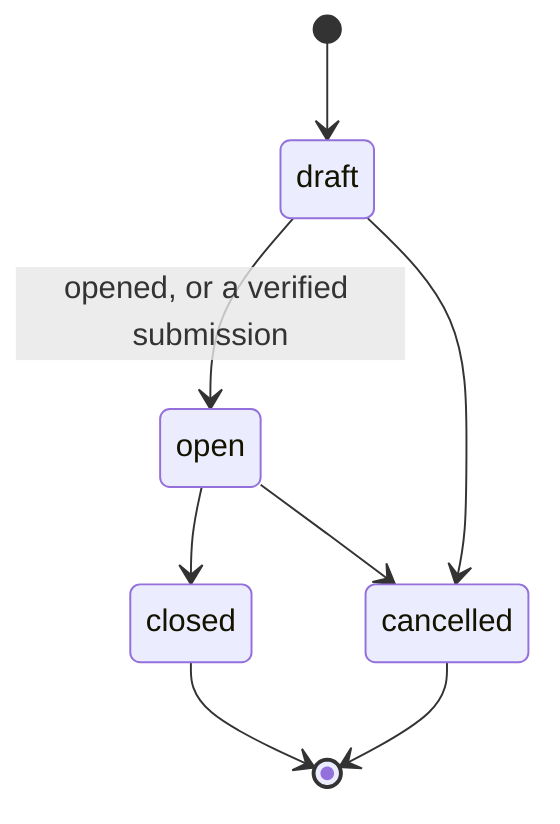

# Procurement records

`@luma/procurement` owns suppliers and purchase orders, separate from connector commerce
projections. Every write is revision-checked, idempotent and audited in the same
transaction. A purchase order holds versioned lines (ID, SKU, description, quantity, unit)
and a supplier name snapshot. Drafting also snapshots the supplier article number and unit
price when terms report a currency. Governed callers must supply that snapshot in their admitted intent; drafting never enriches already approved parameters. It does not model invoices or warehouse movements.
Submission to a supplier, confirmations and receipts are covered in
[Supplier commitments](supplier-commitments.md).

`procurement.manage` creates records and changes order status; `procurement.read` reads
them. Every use case refreshes membership before touching the tenant store.

## Ownership and provenance

Orders default to `authority: "luma"`; an external reference does not transfer ownership.
`authority: "external"` requires at least one external reference and blocks local
lifecycle changes. External status is not synchronized. External mappings and connection
IDs are provenance references, not execution grants.

`origin` workflow run, action and outcome IDs record creation provenance. They do not prove
that a workflow ran or passed Action Admission. Procurement capabilities must call this
owner service after their own authorization checks. Generic workflows may refer to a
`purchase_order` subject within their tenant context, but no procurement rule belongs in
the generic Workflow interpreter.

A supplier can be linked to its record in one purchasing-system connection, with the hours
it has to confirm a sent order. Link changes are revision-checked and audited.

## Lifecycle

All new orders start as drafts. Only Luma-owned orders change state locally.

Opening records an operational commitment; it does not send the order. A verified
submission moves a draft to open. Closing records completion, not receipt; receipt is read
from the purchasing system. Transitions need a reason and the current revision. Terminal
orders cannot reopen. Correct a draft by cancelling it and creating a new order. An uncertain or submitted native order cannot be cancelled through a local lifecycle transition: cancellation requires a supported and verified provider change.

## Concurrency and retries

The service serializes writes per tenant, and reads share that lock so an order and its
audit history never straddle a write. Records, command results and lifecycle audit commit
or roll back together. A composite supplier foreign key prevents cross-tenant references.

Creation IDs and transition command IDs are tenant-scoped idempotency keys. After an
uncertain response, resend the same ID and body: an exact retry by the same actor returns
the original result, a changed request returns 409, and an older command never rolls back
the current state.

## Lists

The purchase-order and supplier lists filter, sort and page on the server; clients never
filter a returned page. Search matches a purchase order's reference, supplier name or line
SKUs, and a supplier's name or external reference system and ID, ignoring case and treating
wildcards literally.

Both lists accept conditions from their catalogs in `@luma/api-contract`, with the shared
rules in [Conditions and grouping](orders-workspace.md#conditions-and-grouping): empty and
unknown values never match comparisons, amounts compare within one currency, and days and
relative periods follow the request's `timeZone`. The API checks conditions against the
catalog and answers 400 naming the condition. One evaluator in the application applies the
rules to derived values in memory; stored fields (supplier, status, authority, reference,
line SKU and location, created and updated) compile to SQL with every value bound as a
parameter. With `match: any`, conditions stay in SQL only when every
one is stored; otherwise every order is evaluated in memory.

A purchase order's stage, attention, next owner, expected date, confirmation due time and
next check come from the same progress rules as its record, evaluated at the first page's
time; later pages keep that time so orders do not shift between pages. Conditions, groups
and sorts on them read every order that matches the stored conditions and summarize it
before paging, so their cost grows with the workspace's orders.

- Attention lists open item kinds except a pending send approval, which shows in the stage.
  `attention` not empty is the legacy `stage=attention` filter.
- Next check is the earliest check time recorded for an item someone is following up: its
  latest response is a follow-up with a check time, and the item would otherwise need
  attention. A past time means the check is due and the item is back in attention.
- Value is the exact sum of quantity × unit price. It is empty when no line has a price and
  unknown when only some lines have one or prices use different currencies. Value sorts by
  currency code, then amount.
- Line SKU and location match when any line matches; their negative operators match when
  none does. Location is empty when no line names one.
- Expected dates are calendar days and compare as days; a time in a condition names its
  local day.

Missing sort values come last in both directions, ties by ID. Sorts by creation, update,
reference and supplier read in SQL order, so collation stays the same between pages.
Groups by supplier, status, stage, next owner and authority count every match exactly and
return their first rows (10 by default, at most 50) with per-currency value sums. Statuses,
stages and owners follow the catalog's option order; suppliers sort by name, then ID. At most
50 groups return; `groupsTruncated` says when more match.

Cursors are bound to the tenant and the complete query: search, filters, conditions, time
zone, grouping and sort, regardless of property order. A group's cursor also binds its group
key but not the page sizes; a grouped read without a group key accepts no cursor. Any other
cursor returns 400. The first page of an unfiltered order list also counts the workspace's
orders per stage and needing attention, which evaluates every order.

The page offers built-in purchase-order views for the overview counts (needing an answer,
waiting on the supplier, drafts); they are the list's `stage` parameter, combined with any
conditions. The board groups by derived fields only, so it is read-only.

Both lists filter and sort by custom fields (`custom:<field ID>`) of their record type in SQL,
before paging, with the collection operators of the field type. The list checks each field
against the live definitions in the read's snapshot: archived, unknown or other-type fields
answer 400, so the view needs repair, and fields behind a read permission the reader lacks
answer 403 for conditions and sorts alike, so their values can't be inferred. Values are
Luma-owned, so a record without a value is empty: comparisons and negative comparisons never
match it, `none_of`, `is_not` and `not_contains` do. Dates are calendar days and compare as
days in the reader's zone; `me` in a person condition is the reader. Text sorts by its first
200 characters, which keeps cursors short, and records without a value come last in both
directions. Custom conditions run only in SQL, so `match: any` cannot combine them with
derived purchase-order fields such as stage or value (400). Procurement reads the adaptive
field tables in its own infrastructure because the shared collection engine lives in
read-models, which depends on procurement; the API login holds `luma_adaptive` for this.
Saved purchase-order views, their metrics, charts, exports and row actions read this same list:
built-in views as `stage` and catalog conditions as `where`. Format 1 views with the earlier
`attention`, `supplierId` and `status` filters are upgraded to the equivalent conditions on read.
A row's `attention` value in a view is the key of one open item, preferring the kinds the view's
conditions name, so row actions such as a supplier follow-up can name it; reading those keys
evaluates the open orders once per page that has any.

Suppliers carry their purchase-order count. Supplier conditions run in SQL. Has open orders
means a purchase order with status open. Confirmation overdue means an order with an open
`confirmation_overdue` item; the progress rules decide it in a separate read just before the
page, so the two reads can differ by a moment.

## Capabilities and effects

Procurement exposes versioned capabilities for supplier lookup, open purchase-order
lookup, Luma-owned draft creation and audited lifecycle transition. Each parses its input at
runtime and goes through the owner service, so membership and tenant checks apply to every
call. Inventory context comes from connector `inventory.read`; there is no broad
procurement capability. The supplier follow-up workflow adds `procurement.follow-up.record`.

Draft creation and transition are bound to Action Admission only when execution is enabled.
The target is a tenant-owned `purchase_order` UUID, and the connection ID is the tenant ID
for this internal service. Creation reuses the order ID as its command key; a transition
carries a stable command ID, target status, expected revision and reason, and its expected
postcondition must name the resulting status. Risk floors are medium for creation and high
for transitions, so both need approval.

Verification is an independent read of tenant, ownership, status, revision and the command
audit record; creation also compares supplier, reference, lines and origin. An unavailable
read is inconclusive. The in-memory simulated owner keeps the same validation, retry and
audit behavior for deterministic scenario evaluation.

## Supplier purchasing terms

Purchasing terms belong to the supplier and canonical SKU pair. Missing values stay unknown;
pack size, minimum quantity and lead time never acquire a silent default. A product can have
terms for several suppliers. A manager records a reason when choosing a preferred supplier
or changing a term, and must remove an existing preference before choosing another.

Provider reads and imports remain observations. Human overrides apply only to the fields
they name and remain separate from those observations. A later provider read cannot erase
an override. Each changed value appends a version, preserving prices, actor, source identity,
read time and completeness; stale reads cannot replace newer evidence. A partial read never
removes pairs it did not return. Draft prices are fixed at drafting time, so a later price
change never rewrites an existing order.

Supplier terms are released per workspace through the `supplier-purchasing-terms` flag.
Both the API and worker enforce it. Reading requires current `procurement.read`; recording
terms or importing purchasing-system observations requires current `procurement.manage`.
The same tenant transaction commits a term, its retry result and its audit evidence.

## Reviewed purchasing plans

The purchasing workbench groups canonical products by supplier. Available stock already
accounts for source reservations; reservations are shown separately and are never subtracted
again. Competing sources are not summed. Native-owned locations use ledger balances.
Incoming supplier orders, transfers and native incoming balances use the same projection as
Inventory and Products. Incoming units never increase available stock.

Demand is an explicit average over a selected, completely imported order-history window.
Missing history, stale stock, missing pack sizes or minimum quantities withhold a quantity.
An active replenishment rule can supply its minimum and target without inventing demand.
Open drafts and orders suppress a second suggestion. A saved plan retains manual quantity
changes beside the original suggestion and evidence.

Each supplier plan has one immutable request and one governed action. Workspace approval
rules apply. Independent readback verifies the exact draft, including price and location
snapshots. A process interruption can resume the original approval and action. An uncertain
creation is reconciled by reading. Pending and uncertain plans reserve their products, and
the procurement transaction checks existing orders again before inserting the draft.

`purchasing-workbench` releases the view; `purchasing-plans` releases new governed drafts.
Disabling a write release does not prevent reconciliation of existing attempts.

## Observed purchasing outcomes

Plans retain the suggestion and chosen quantity. Explicit ignored decisions capture the
server recommendation with the person's reason. Later stock and receipt observations
establish outcomes; a saved plan or a manual receipt claim alone does not.

Availability through receipt requires independently verified receipt evidence, usable stock
reads no more than five minutes apart, and a fresh positive stock read after receipt. Gaps
remain unknown. Stockout duration is an observed interval between reads, never an estimated
duration across a gap. These observations do not prove counterfactual prevented loss.
Insights separates observed availability, observed stockouts and unknowns under
`purchasing-outcomes`.
