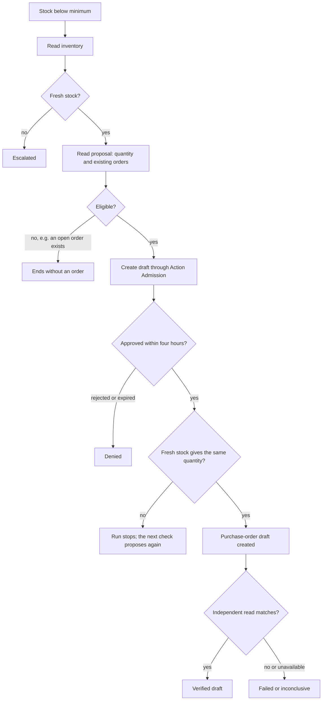

# Replenishment workflow

`inventory-replenishment` drafts a purchase order when a mapped inventory position falls
below its minimum. It is a built-in `workflow/2` process that needs no Exception. Its
outcome is an independently verified **purchase-order draft**, not a supplier submission or
received goods; sending the order is a separately admitted step (see
[Supplier commitments](supplier-commitments.md)).

## Rule and authority

Someone with `procurement.manage` activates a rule for one exact position, source
connection and supplier. The immutable rule records minimum stock, target stock, a quantity
risk threshold, the principal, the workflow digest and the admission artifact. Only one
active rule may cover a position; revoke it before changing the scope. The worker acts as
the activating principal and refreshes membership at every activity and admission check.

Setup browses stock in pages of 50 and searches SKU labels on the server. Selected positions
stay selected across pages and searches. Rule readiness uses its exact configured source,
independently of the choices page.

Bulk setup previews and activates up to 25 positions per request, each through the
single-rule path and for exactly one position. Previews change nothing. Items succeed or
fail on their own: a position covered by another active rule fails as `covered`, and
unexpected errors are `uncertain`. Resending the same items returns the activated rules
unchanged, so a retry never duplicates or widens a grant. A request may name each position
once.

## Quantity and stock

When available stock is below the minimum, the quantity is `ceil(target - available)`,
capped at one million units. Canonical inventory must give a numeric available quantity
and be less than five minutes old. Deleted, missing, future-dated and stale stock cannot
authorize an order. Any draft or open order for the same SKU stops replenishment, across
suppliers and inventory sources.

While a rule waits, the monitor rereads its stock when the stored report is older than four
minutes, at most once a minute per rule, so proposals follow soon after stock falls instead
of waiting for the next sync. A rule with a run in progress gets no second run. Each pass
reads only the eligible watched positions and reuses those reports; after a provider refresh it reads the changed position
again. Stock reads for admission remain independent and fresh.

## Approval and admission

The risk threshold makes larger proposals high risk; smaller drafts keep Procurement's
medium-risk floor. Both therefore need approval with `decisions.respond`, following the [workspace independent approval setting](workspace-settings.md#approval-preference). The
workflow never lowers capability risk or treats a workflow decision as execution authority.

Action Admission binds the proposal to the run, action step, subject reference and exact
artifact. Before dispatch, eligibility rechecks the active scope, current inventory,
quantity, unit, supplier and existing orders. A proposal stays open for four hours, and its
approval lasts as long as the proposal. Right before the order is created, stock is reread
through the installed capabilities, so a late approval acts on current stock: a different
quantity stops the run, and the next check proposes again.

## Approval context

A proposal retains product identity, known current supplier terms or reviewed overrides, recent source-backed sales, stock cover estimates and existing draft/open orders. Missing prices, lead time and incomplete demand stay unknown. Unit cost and quantity produce an exact estimated value; stock cover is an estimate from recorded sales, not a demand forecast or confirmed incoming stock.

The context is immutable across approvals and restarts. The draft review also freezes the linked purchasing destination. One still-current approval can cover sending an unchanged, independently verified draft to that destination, as the original requester. The requester chooses the delivery date at submission. Changed lines, supplier, destination, draft revision or policy require a new approval. Workspaces may require separate send review for every replenishment order, or at and above an exact currency amount; unknown prices and other currencies require separate review when a threshold is configured. A later terms change does not rewrite what the person reviewed. Known unit prices and product descriptions carry into the internal draft; the purchasing system determines final supplier prices and tax at submission. These facts are informational and never replace stock, permission, policy, existing-order or dispatch checks. Quantity approval thresholds are labeled as quantity controls, not financial impact.

## Durability and outcomes

Runs use the shared process queue (see [Process runtime](workflows.md#process-runtime)).
API starts persist before Temporal dispatch. The monitor checks active rules every five
seconds, deduplicates by an observation-based source ID, and recovers committed unfinished
starts. Manual stock checks carry a client request ID, so exact retries recover the same
run.

Proposal, order and line UUIDs derive from the run. Tenant/position and tenant/SKU claims
serialize overlapping proposals, and the Procurement owner checks existing commitments
again inside the order-creation transaction. Terminal runs release the claim; existing
drafts still block another replenishment. A worker restart preserves decisions, receipts
and step evidence.

A successful capability receipt is not the outcome. An independent read checks Luma
ownership, draft status, revision, supplier, immutable lines, origin and command audit.
Failed or unavailable verification stays visible and never becomes verified success. Worker
scope discovery exposes routing identities only; application, approval and inventory reads
still enforce tenant and membership checks.

## Readiness

Readiness follows [the workflow model](workflows.md#readiness). A rule whose stock is
missing, deleted, unreadable or older than five minutes is blocked, using the same
`stockUnusableReason` as the Insights stock chart. It degrades the workflow while other
rules have usable stock and blocks it when none do.

## Simulator scenarios

`pnpm simulator:replenishment` runs the scenario matrix against the provider simulator,
isolated PostgreSQL and a real local Temporal server: verified happy path with a separate
approver, policy rejection, stale inventory, existing orders, retried starts with a worker
restart during approval, and a concurrent cancellation that fails verification. The stale
and verification scenarios change test-owned records at activity boundaries; they use the
real interpreter, policy, admission and Procurement services and never supply a fake
success.
