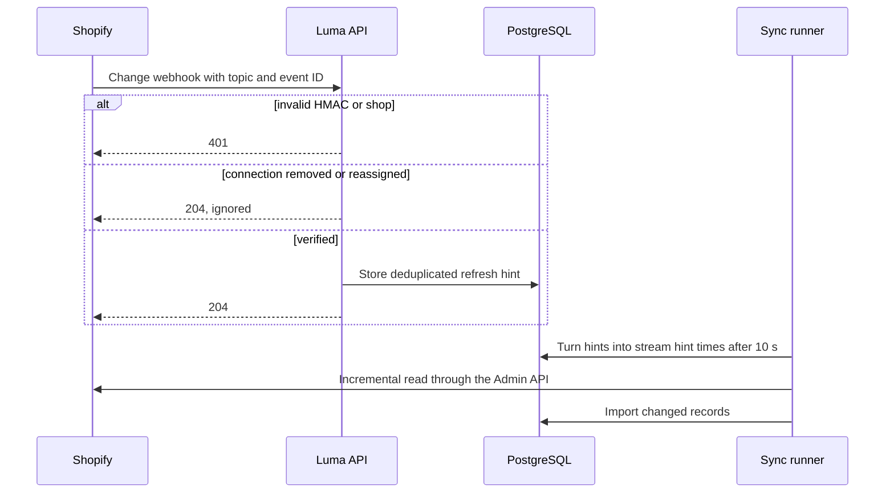
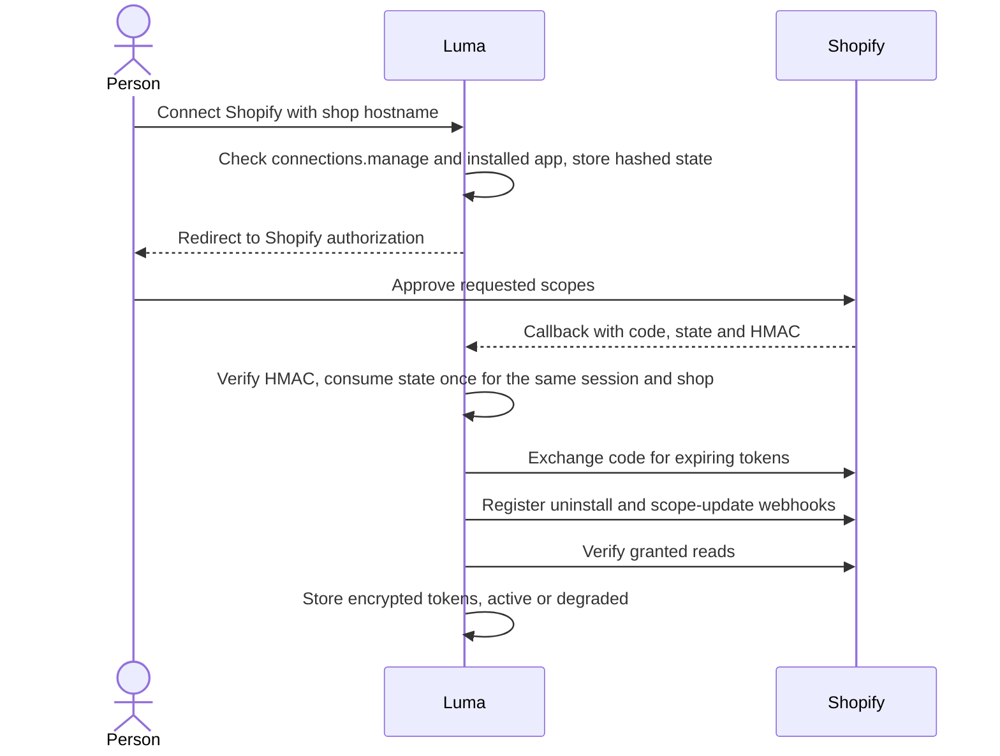

# Shopify connector

The Shopify app reads orders, products, inventory, fulfillment work, shipments, returns,
refunds and (when approved) customers through the Admin GraphQL API `2026-07`, and offers
[governed actions](shopify-actions.md) for fulfillment recovery, inventory
corrections, order quantity edits and returns. Merchants connect through standalone OAuth. Reads are observations, not a
transactional snapshot of the shop, and scope-limited visibility never establishes
shop-wide absence. Code: `@luma/app-shopify`, with the protocol client in
`@luma/connector-shopify`.

Production app settings, approvals and privacy operations are in
[Shopify partner readiness](shopify-production.md). The app's live record browser is
described in its [package README](../packages/apps/shopify/README.md#operational-records).

## Access and grants

- `read_orders` normally covers the last 60 days; older orders need Shopify-approved
  `read_all_orders`.
- `read_products` and `read_inventory` cover variants, inventory items and stock levels.
- Fulfillment visibility follows the granted fulfillment-order categories. Luma requests
  merchant-managed and third-party categories, not `read_assigned_fulfillment_orders`,
  because it is not a fulfillment service.
- `returns.read` is granted with `read_orders` and `read_returns`; connections authorized
  before it existed must reconnect.
- `orders.quantity.edit` is granted with `write_order_edits` and a fulfillment read scope,
  because edits are judged against fulfillment work. Connections authorized before Luma
  requested `write_order_edits` must reconnect to edit orders.
- `read_customers` is requested only when the deployment has protected customer data
  approval (see [commerce sync](commerce-sync.md#customers)).
- Order addresses are read with `read_orders` only when the deployment is approved for
  protected customer data and addresses (see
  [Shopify partner readiness](shopify-production.md)). Without approval, orders report
  addresses as not shared rather than absent.

A missing grant returns `permission_denied`; it never becomes an empty successful page.

## Read and mapping rules

`limit` (1–100) bounds parent orders, products or inventory items; a parent can produce
several observations. Cursors bind tenant, connection, shop, API version, capability,
page size and filters; preserve them and repeat the same query for the next page. Filters
accept GIDs only (InventoryItem and Location for inventory, Order for fulfillment and
returns), never SKU labels or raw Shopify search expressions.

Nested collections (order lines, shipping lines and discounts, variants, inventory
locations, fulfillment orders and lines, returns and refunds) are fully paginated before a
page returns. Order pages hold seven orders, because each order's amounts and first nested
pages cost about 135 query points against Shopify's 1,000-point limit. Missing or repeated
cursors, malformed fields, GraphQL partial errors or failed child requests reject the
whole page, and more than 1,000 continuation pages in one nested collection rejects the
scan rather than truncating it. Collection absence never emits tombstones. Independent deletion confirmation follows the
[commerce sync rules](commerce-sync.md#ledger-and-coverage).

- **Orders:** `quantity` retains originally ordered units; `currentQuantity` excludes
  refunded and removed units. `cancelledQuantity` is their difference, a reduction fact
  rather than proof of cancellation or its cause. A fully removed line stays with zero
  current units. Deleted or custom variants have no SKU identity; a line whose variant is
  gone keeps its product (`variant_removed`), and a line without a product is a custom item
  or a deleted product (`no_product`), which Shopify does not distinguish. Unknown financial
  statuses stay `unknown`; malformed descriptive fields become null without rejecting the order.
- **Order charges:** shop and presentment currencies, original and current subtotal,
  shipping, discount, tax, duty and total amounts in both currencies, current tax lines,
  shipping lines including removed ones, discount codes and titles with their values, tags
  and operational attributes (edited, test, requires shipping, channel, cancellation
  reason, Shopify's fulfillment status, processed, closed and cancelled times). Amounts are
  Shopify's exact decimals and are never recalculated. The order note, custom attributes and
  manual discount descriptions are free text and are not read. History exports cannot
  include discounts, because discount applications have no ID to group export rows by;
  exported orders leave discounts unread until an incremental read reports them.
- **Order addresses** (delivery and billing address lines, city, province code, postal code
  and country; no names or phone numbers) are personal data. They are parsed outside raw
  capture and the commerce sync stores them only in the erasable customer store.
- **Products:** per variant, the inventory-item SKU identity, variant title (none for
  `Default Title`), price in shop currency and barcode. SKU text preserves case and is
  never identity.
- **Bundles:** catalog recipes use exact component, variant and InventoryItem identities.
  `requiresComponents` is retained separately: false alone does not prove an empty recipe.
  The first recipe edge is included in the catalog page; overflow pages are drained in batches of ten parents, with at most 5,000 components per
  parent and 5,000 edges across the product to bound import memory. Missing parent nodes leave recipes unknown; incomplete pages fail the read.
  Bulk exports retain the exported parent flag but leave the recipe unknown rather than
  attaching a recipe read later to historical evidence. Sold component lines retain their
  historical LineItemGroup, independently of the current catalog recipe. Parent group
  quantity is merchandising context, not another stock or fulfillment line. Current-unit
  reductions and component returns do not redefine the sold group. Deleted components
  keep group and SKU text without inventing an InventoryItem identity.
- **Inventory:** all eight states are retained separately in `each`: on hand, committed,
  reserved, incoming, damaged, quality control, safety stock and available. Shopify committed
  stock and its separate reserved state are distinct; neither establishes a native Luma
  reservation. Location activity, item-level activation and tracking are separate nullable
  facts. Untracked values stay null; zero and negative stock are kept.
  Identity is the InventoryItem scoped by Location; SKU and location references stay
  account-wide.
- **Fulfillment work vs shipments:** each FulfillmentOrder is outstanding work
  (`fulfillment_order`), each Fulfillment a separate `shipment`. Work line quantities are
  the total work, alongside provider-reported `remainingQuantity`. Zero work quantities
  remain explicit after removals; shipment line quantities support split shipments.
  An on-hold order without a readable hold reason reports one `other` hold.
- **Returns and refunds:** a returns page checks one page of orders cheaply and reads
  returns and refunds only for orders that have them, emitting returns before the refunds
  that refer to them. Units received count every disposition except `MISSING`. Return
  notes are not read. Only successful `REFUND` transactions count as money returned.

Shopify `updatedAt` has whole-second precision; the
[projection rules](commerce-projections.md#projection-rules) let an equal time with a later
read win. Returns report no update time. `updatedAt` is the best available progress time
for fulfillment work, but unrelated edits also change it. Source revisions are null
because these reads expose no conditional revision token.

## Evidence, errors and webhooks

`recordObservations` must durably save the batch before a read succeeds. Raw capture is
off by default; when enabled it passes allowlisted fields with an explicit expiry and
excludes unknown fields, customer and address payloads, credentials, headers and error
messages. Tokens are resolved per request and never appear in descriptors, observations
or failures.

Requests use HTTPS, reject redirects and time out after 15 seconds by default.
`Retry-After` and GraphQL throttle cost become delay advice; the shared transport retries
only short-delay transient queries (see
[connectors](connectors.md#errors-retries-and-evidence)), and the SDK's own retries are
disabled. GraphQL errors reject partial data, and an unexpected `X-Shopify-API-Version`
rejects silent version fallback. Token-store failures return `transient`; empty
credentials return `authentication`.

Every installed Shopify client uses one region-local Valkey admission scope for the
trusted tenant, app identity and shop. Reconnecting or rotating a token retains the
scope. API reads, health checks, OAuth setup, background pages, nested reads, Bulk
Operation control and governed actions all use it; download URLs are outside Shopify's
GraphQL cost bucket. Keys contain opaque hashes, query-shape hashes, costs and expiring
reservations. Credentials and provider records never enter Valkey.

Foreground work has two reserved transport slots and up to 1,000 cost points of
headroom; incremental reads precede history work. A first background query may borrow
one second of restore capacity so it can learn its cost without waiting for a completely
full bucket. Unknown query shapes reserve the
single-query maximum. Requested and actual costs reconcile atomically against the
provider balance, including refunds and a shared throttle cooldown. Foreground admission
waits at most two seconds; background pages release their durable lease and resume later
when capacity is unavailable. A compound background read that already fetched parent
records waits up to ten seconds per continuation request, preserving that progress while
foreground work keeps priority. Caller cancellation returns an unused reservation. An
expired reservation only frees a transport slot: it cannot prove the provider did no work.

Mutations obtain capacity before execution's dispatch guard rechecks authorization,
policy, approval expiry and fresh preconditions. Multi-stage actions recheck authority
before each mutation, without comparing later stages to the original preconditions.
Admission never authorizes an action or makes a mutation retryable. A bookkeeping failure
after a provider response preserves that response; independent verification still decides
the outcome.

Configure `SHOPIFY_ADMISSION_URL` on every API and worker, with `SHOPIFY_ADMISSION_CLUSTER`
when connecting to a cluster. Use TLS and a region-local primary, authenticated access,
persistence and `noeviction`. The admission role needs hash, expiry, server time, script
execution and `INFO server` access. Missing or unavailable admission fails conservatively;
the Shopify app's readiness check fails. Server epochs invalidate outstanding permits
following a restart and rebuild cost knowledge conservatively. Valkey's asynchronous
replication cannot guarantee lossless admission state across failover; provider throttles
remain the final limit, and execution claims and audits remain durable in PostgreSQL.

Webhooks are verified with HMAC-SHA256 over the original request bytes and the expected
shop, and deduplicated by tenant, connection, topic and event ID. They only produce
refresh hints for [commerce sync](commerce-sync.md#change-notifications); partial webhook
fields are never projected, and missing fields never mean deletion. Persist the hint
before acknowledging.

Order edits and fulfillment-order moves, splits, merges and cancellations refresh both
orders and fulfillment work. `orders/edited` uses `read_orders`; the fulfillment-order
topics require a merchant-managed, assigned or third-party fulfillment-order read grant.
Luma already requests the merchant-managed and third-party grants. Authorization skips
these subscriptions when the grants are missing, while connection health reports missing
fulfillment access. One shared topic registry drives mapping and registration, including transactions, paid
orders, inventory item and level changes, locations, customers and fulfillment holds.
Registration checks actual grants, including write grants that imply reads. The connection
access panel queries current subscriptions and distinguishes registered, missing, failed and
unavailable topics. It reports the last verified delivery separately; no delivery yet does
not prove failure. Reconnect repairs missing subscriptions without duplicating existing
subscriptions at the same connection URL. Existing connections must reconnect to register
new subscriptions;
scheduled reads continue to cover changes in streams they can read.

Emitted queries are validated against an offline snapshot of the versioned Admin schema.
When changing `API_VERSION`, regenerate it with
`pnpm --filter @luma/api exec node scripts/update-shopify-schema.mjs <version>`, format it,
review the schema diff and rerun the adapter tests.

## Authorization and recovery guarantees

People with `connections.manage` choose **Connect Shopify** and enter the store's
`*.myshopify.com` hostname; Shopify asks them to approve access and Luma verifies it on
return. **Reconnect Shopify** reauthorizes the same connection, including disconnected or
revoked ones.

A denied approval consumes the state and changes nothing. Credentials are stored even when
grants are missing, so a degraded connection can be repaired by reconnecting.

- The start route requires current `connections.manage`, the installed app and a trusted
  request origin. State is random, stored as a hash, expires after ten minutes and is
  consumed once. It binds the login session, operator, tenant, shop and app environment.
- Callbacks require Shopify's HMAC over the complete decoded, sorted query; duplicate
  parameters and mismatches are rejected. Credentials never reach the browser, query
  cache or request logs.
- Tokens are expiring (`expiring=1`). Access and refresh tokens, expiry, app binding and
  granted scopes share the tenant-bound encrypted envelope. Advisory and row locks
  serialize authorization and refresh across processes. A token is refreshed within 60
  seconds of expiry on the next read, including workflow reads without a browser
  session. Temporary failures keep the stored pair; rejected or expired refresh
  credentials revoke the connection and require reconnect.
- An uncertain authorization exchange can require reconnect, because a remote token issue
  and the local commit cannot be one transaction.
- One app/shop pair belongs to one workspace. Reconnect reuses its connection ID; another
  tenant cannot claim it.
- Authorization registers connection-specific `app/uninstalled` and `app/scopes_update`
  subscriptions. A signed uninstall checks the stored shop/app binding and current token
  (refreshing an expired one) before revoking, so a delayed delivery cannot disable a
  newer working install. Revocation deletes the encrypted secret and disables
  capabilities. Scope updates are rechecked against current grants, not the event
  payload.
- Provider authentication and permission errors also update connection health, without
  storing raw provider errors.

## Local development app

1. Create a development app and development store in Shopify's Dev Dashboard with
   synthetic data only. Configure it as in
   [partner readiness](shopify-production.md#app-configuration) (non-embedded, legacy
   install flow, scopes, webhook version).
2. Run setup, then expose this checkout's printed **web** port through a public HTTPS
   tunnel; the web server proxies `/api`. With Tailscale:
   `tailscale funnel --bg http://127.0.0.1:<web-port>` (use a neutral device hostname if
   certificate transparency logs should not show your machine name).
3. In the ignored `apps/api/.env`, set `SHOPIFY_CLIENT_ID`, `SHOPIFY_CLIENT_SECRET`,
   `SHOPIFY_APP_ENVIRONMENT=development`,
   `SHOPIFY_CALLBACK_URL=https://<public-host>/api/v1/shopify/callback` and
   `SHOPIFY_WEB_ORIGIN=https://<public-host>`. Never put app secrets in `VITE_*`
   variables.
4. Set the app URL to the web origin, allow the exact callback URL and publish the
   configuration version. Restart `pnpm dev`; it uses `SHOPIFY_WEB_ORIGIN` for auth and
   allows that host in Vite. Manually managed environments must also set
   `BETTER_AUTH_URL` and `AUTH_TRUSTED_ORIGINS` to that origin and allow the host in Vite.
5. Sign in through the public origin, connect the store and confirm **Validated**. Keep
   the tunnel running for webhook delivery; afterwards stop it with
   `tailscale funnel --https=443 off`.

### Query cost check

The Shopify contract test keeps collection read queries under Shopify's 1,000-point query limit using
the simulator's cost model. `pnpm shopify:cost-check` checks that model against a real store: it
verifies the account and token scopes, reads each authorized collection capability at the largest sync page, and lists, per query, the
requested cost Shopify reports beside the simulator's estimate. It fails when a read fails or
the simulator estimates less than Shopify charges; then correct the model in
`packages/simulator/shopify`. It only reads.

Run it against a development store with synthetic data. Set `SHOPIFY_COST_CHECK_SHOP` to the
store domain and `SHOPIFY_COST_CHECK_TOKEN` to an Admin API access token with the read scopes
Luma requests, in the shell rather than a committed file. Missing scopes and operations
requiring an exact order or return target are reported as skipped. Their query shapes require
the corresponding action contract checks; an empty-store collection probe cannot exercise them.

Customer reads are skipped unless you explicitly set `SHOPIFY_COST_CHECK_CUSTOMER_ACCESS`
to `basic`, `contact`, `address` or `contact,address`, matching the app's approved protected
customer data access. This setting does not add token scopes or grant Shopify approval.
Transfer and shipment collections also require their separate native read scopes.
Follow-up queries for line items and
other nested lists run only when a record has more than a first page, so include an order with
more than eight lines. Run it after changing a read selection or the API version.

Use a separate custom-distribution app only for an eligible live merchant pilot, in a
separate database and environment. Custom distribution cannot convert to public; the
merchant later installs the public app and reconnects.

### Inventory transfers and shipments

Optional `read_inventory_transfers` and `read_inventory_shipments` grants enable separate
read streams. Existing installations keep baseline commerce reads when these grants are absent.
Shipment relationships require the shipment grant; otherwise the transfer's collection remains
unknown. Nested inventory item and live location identities require their own inventory,
product or location grants and are omitted when inaccessible. Historical location facts remain.
See [Inventory transfers and receiving](inventory-workspace.md#transfers-and-receiving) for
quantity semantics and the limits on discrepancy and claim conclusions.
