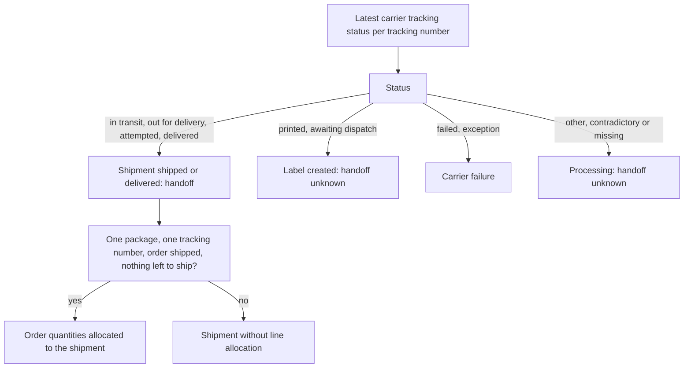
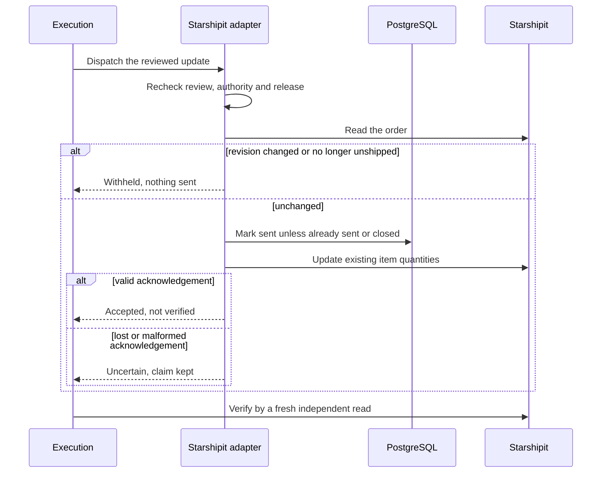

# Starshipit shipping

Starshipit contributes shipping-order and carrier-tracking observations to the shared
Orders and Fulfillment views. Source identity, read time and carrier update time remain
separate. A shipped order, printed label or accepted update does not prove carrier
handoff or a resolved issue.

## Setup and permission

The fixed Starshipit API host receives an API key and subscription key. Both credentials
remain encrypted and are reread before each request. The account name is a local label:
the documented API has no account-identity echo. Rotation interrupts pagination.

Visibility and actions use separate tenant-scoped PostHog releases. Missing evaluation
withholds them. New updates require both releases; existing uncertain updates can still
be reconciled through reads after release removal.

A successful read probe cannot confirm live write permission. The default verifier grants
updates only to trusted synthetic installations. Live deployments need confirmed write
permission and a sandbox check of unshipped-order behavior before supplying a verifier
that grants the capability. Unconfirmed write requests leave a connection degraded.

## Reads and handoff

Scans cover Unshipped, Printed and Shipped independently, then read each order's details.
Fulfillment additionally reads tracking. A failed detail or tracking request fails the
page; incomplete evidence never establishes deletion. Cursors bind tenant, connection,
capability and page size. There is no documented update-time filter.

Order numbers and SKU text suggest mappings; they never establish canonical identity.
Line and tracking IDs retain their order namespace. Explicit tenant-owned mappings connect
this provider to existing commerce records.

Only carrier tracking status establishes handoff. Printed and awaiting-dispatch remain
unknown for handoff; unshipped does not establish warehouse custody. Reordered duplicates
retain the newest dated report. Contradictory statuses at one time become unknown.
Times without a timezone are unknown.

An order's quantities are allocated to a shipment only when there is one package, one
tracking identity, actual carrier handoff, a shipped order and zero units left to ship
for every item. Split packages and ambiguous tracking retain separate shipment records
without inferred allocations. Publishing them needs explicit reviewed allocation evidence.

The provider documents two requests per second for Developer subscriptions and twenty
for approved Production subscriptions. Reads run sequentially and honor short 429 delay
advice. Detail and tracking requests increase scan cost; a completed list request does
not establish complete order coverage.

## Governed downstream updates

Quantity updates copy values already reported by the selected authoritative order source.
They change existing shipping items only before labels are created. They do not hold
shipments, recalculate storefront prices, restock, create items or cancel orders. The
documented API offers an order update, not a shipment hold.

Reviews bind exact line IDs, old and target quantities, provider fingerprint and authority
revision. Both sources are refreshed. Explicit mapping and complete current authoritative
evidence are required. Shared policy, approval, Action Admission, execution and audit
govern the update. Observe-only mode sends no update.

The provider documents neither atomic revision preconditions nor idempotency keys for
updates. Preflight is not atomic. Controlled targets and a durable per-order claim with
a fence written before dispatch prevent duplicate starts, restarts and retries from
sending again. Changed authority, expired reviews, labels and removed permission withhold.
An unfinished or failed authoritative refresh withholds approval and dispatch without
discarding the saved review. A later complete read can restore its eligibility only
when the exact reviewed source state still matches.

Acceptance remains unverified until a fresh independent read confirms all quantities.
Lost or malformed acknowledgements retain the claim and require reconciliation. Failed
verification does not permit another send. Closing an unsent operation fences delayed
dispatch; uncertain sent operations remain claimed until their outcome is known.

## Refresh-only webhooks

The optional installation-owned bearer secret authenticates the sender's Authorization
header. This is Luma's wakeup protocol, not a claim that Starshipit signs events with a
documented signature. Without a configured secret delivery is denied. Installation,
tenant, connection status and version are rechecked before storing a refresh hint.

Payloads never update canonical state. Identical deliveries are deduplicated; delayed or
reordered events request a current read. That read supplies the evidence, so old events
cannot roll shipment state backwards.

Protocol semantics follow the [Starshipit API reference](https://api-docs.starshipit.com/).
